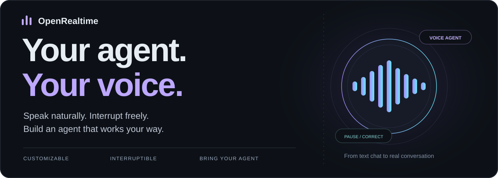
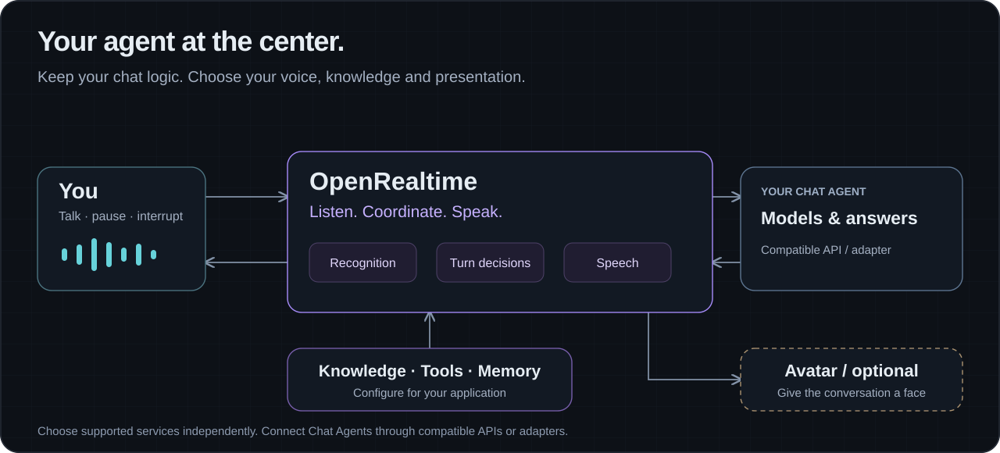

# OpenRealtime



## Introduction

**OpenRealtime is an open-source, customizable, interruptible voice AI agent product. Give your assistant a voice and let it follow the pace of your conversation.**

Connect your Agent to chat, consult your material and use configured tools to help with work—all through voice. Configure its persona, voice, models, knowledge and tools. Add an avatar when a visible character helps the experience.

Choose speech recognition, answer models and speech synthesis separately. Keep your existing chat logic and combine services to fit your budget and experience. Suitable combinations can cost less than GPT-Realtime-style end-to-end services; cloud APIs avoid self-hosted model GPUs. [Cost and service choices](docs/product/COST-AND-FLEXIBILITY.en.md)

**[Try the demo](https://realtime.happy-token.cn)** · **[Getting started](#getting-started)** · [Documentation](docs/README.md) · [Connect your Chat Agent](docs/guides/CHAT-AGENT-INTEGRATION.en.md) · [中文](README.zh-CN.md)


*Samantha in the current app, showing optional avatar presentation and role selection. Local preview using bundled avatar material; left navigation is hidden.*

## What you can do

- **Real-time voice interaction.** Speak directly, ask follow-ups and interrupt an answer to add a detail or make a correction. Let your Agent follow your conversation.
- **Connect your Agent.** Add speech input and output to an existing Chat Agent through a compatible API or adapter while keeping your models and business logic.
- **Chat and work through voice.** Have a conversation, consult documents, discuss a problem or use connected tools to help with work. Say what you need, then refine and confirm it as you talk.

Configure knowledge, tools and memory for everyday conversations or business assistants. Product documentation Q&A is one practical first walkthrough. [Product overview](docs/getting-started/OVERVIEW.en.md) · [Hands-on example](docs/getting-started/PRODUCT-ASSISTANT.en.md)

## Features

- **Your services. Your voice Agent.** Choose TTS, LLM and speech recognition services, then combine voices, personas and tools to customize how your assistant speaks and what it can do. [Role configuration, Chinese](docs/guides/ROLE-CONFIGURATION.md)
- **Smart turn detection. Room to think.** Combine meaning and speaking activity to decide when your turn is complete. Reduce premature replies during thoughtful pauses and let the assistant respond at the right moment. [Turn detection](docs/SEMANTIC-EOT.md)
- **Smart interruptions. Intent matters.** Distinguish an interruption from a brief acknowledgment and reduce false interruptions caused by background noise. When you ask to stop, make a correction or raise a new question, stop the old answer and respond to the new input. [Interruption handling](docs/SEMANTIC-INTERRUPTION.md)
- **Streaming conversations.** Connect spoken input, incremental answers and speech playback for follow-ups and multi-turn dialogue.
- **Service choices that fit your budget.** Choose recognition, answers, speech and turn decisions independently, reuse your existing Chat Agent and select economical combinations. [Cost and flexibility](docs/product/COST-AND-FLEXIBILITY.en.md)
- **Bring your own Chat Agent.** Connect compatible text-chat APIs or implement an adapter for your own interface while retaining business logic. [Integration guide](docs/guides/CHAT-AGENT-INTEGRATION.en.md)
- **Answers from your material.** Import text, files or Web content, inspect retrieval excerpts and bind documents to a role. [Knowledge guide, Chinese](docs/KNOWLEDGE-BASE-GUIDE.md)
- **Tools, memory and continuation.** Select tools for a role, configure long-term memory, manage history and continue an existing conversation. [Permissions](docs/TOOL-PERMISSIONS.md) · [Memory and history](docs/MEMORY-AND-HISTORY-GUIDE.md) — Chinese
- **Optional avatars.** Use the Anam integration, configure local lip sync, or manage and select existing motion and talking materials. Each route has its own service and asset requirements. [Avatar routes, Chinese](docs/DIGITAL-HUMAN-DRIVING.md)
- **Open source and self-hosting.** Run the app in your environment, configure services, storage, authentication and permissions, and develop new adapters or interaction capabilities. [Deployment, Chinese](docs/deployment/public-trial.md) · [Architecture](docs/ARCHITECTURE.md)

## Getting started

### 1. Try it online

Open **[realtime.happy-token.cn](https://realtime.happy-token.cn)**, select an available role and presentation mode, start a conversation and allow microphone access. Ask a question, then try a follow-up, a pause, a stop and a correction.

To configure your own roles, documents and services, use an account with the relevant permissions or a local deployment. Public demo services, access and quotas are operator-configured. [Web app guide, Chinese](docs/QUICK-START.md)

### 2. Run locally

Prepare Python 3.12+, [uv](https://docs.astral.sh/uv/), Node.js 22 and pnpm 10:

```bash
git clone https://github.com/happy-token/OpenRealtime.git
cd OpenRealtime
uv sync
pnpm install
pnpm dev
```

Open **http://localhost:3010**. Local GPU avatar rendering is disabled by default.

Without credentials, deterministic demo adapters let you explore the interface and application path. Real voice and document Q&A require recognition, answer and speech services. [Startup and troubleshooting](docs/getting-started/LOCAL-DEVELOPMENT.md)

### 3. Configure real speech and answers

The default local direct route can use Doubao recognition and speech with DeepSeek answers. Put your own service credentials in `.env.local`:

```dotenv
DEEPSEEK_API_KEY=your-deepseek-key
DOUBAO_API_KEY=your-doubao-speech-key
VOICEAGENT_ASR_BACKEND=doubao-direct
VOICEAGENT_TTS_BACKEND=doubao-direct
VOICEAGENT_DEMO_TOOLS=1
OPENREALTIME_AVATAR_RENDERER_MODE=disabled
```

Restart `pnpm dev` and verify transcription, an answer and speech playback. Speech credentials need access to the chosen ASR/TTS resources. Configure any providers overridden by your role as well. `VOICEAGENT_DEMO_TOOLS=1` enables the local tool/knowledge path; check role documents and tool permissions separately. [Complete service setup](docs/getting-started/CLOUD-SERVICES.md)

### 4. Build your first assistant from product documents

Start with a short product guide or FAQ, then expand after the first questions work:

1. **Import material.** Add a product guide, feature description or FAQ in Resources → Knowledge.
2. **Test retrieval.** Ask a specific question and inspect the returned source excerpts.
3. **Configure a role.** Set its name, persona and voice, bind the documents and check tool permissions. Ask it to use the material and acknowledge missing information.
4. **Talk and check.** Try an introduction, factual questions and follow-ups, then a stop, an addition and a correction.
5. **Add an avatar if useful.** Configure character assets or services after Q&A works.

For example, if the material says “a 14-day trial for up to five people,” check both conditions with questions, then ask about something the material does not cover. [Complete product guide and Q&A walkthrough](docs/getting-started/PRODUCT-ASSISTANT.en.md)

### 5. Connect an existing Chat Agent

For a compatible text-chat API, configure its endpoint, authentication, model identifier and API style. Custom HTTP or SDK interfaces need an adapter.

Verify streamed answers, follow-ups, stops, corrections and cancellation. Your Agent can supply tools, knowledge and memory, or combine them with OpenRealtime's capabilities. [Compatible API configuration and adapter guide](docs/guides/CHAT-AGENT-INTEGRATION.en.md)

## How it works



You speak; OpenRealtime recognizes the input and coordinates the conversation turn. An answer model or your Chat Agent produces a reply, which a speech service reads aloud. Knowledge, tools and memory participate as configured; an avatar adds optional visual presentation.

Configure each layer independently to retain business logic, change voices and models, or adjust cost and experience. [Voice pipeline](docs/VOICE-PIPELINE.md) · [Extension contracts](docs/SEMANTIC-DECISION-PLUGINS.md)

## Services and integrations

| Capability | Current integration and configuration |
| --- | --- |
| Recognition and speech synthesis | The default local example uses Doubao; see other supported routes in the [service reference](docs/reference/WEB-DEMO-CONFIGURATION.md) |
| Answer models and Chat Agents | DeepSeek, compatible Chat Completions / Responses services and custom adapters; see the [integration guide](docs/guides/CHAT-AGENT-INTEGRATION.en.md) |
| Turn and interruption decisions | Independent LLM decision configuration, with optional Jev adapters; see the [decision contracts](docs/SEMANTIC-DECISION-PLUGINS.md) |
| Knowledge, tools and memory | Document import and role binding, tool selection and permissions, long-term memory and history; see the [configuration guides](docs/README.md) |
| Optional avatars | Anam integration, local lip sync and existing motion/talking materials; see [avatar routes, Chinese](docs/DIGITAL-HUMAN-DRIVING.md) |

Availability depends on configured services, permissions, assets and runtime environment. [Environment example](.env.example) · [Support and scope](docs/reference/SUPPORT-AND-SCOPE.md)

### Deployment and extension

The backend comprises the session management service (users, configuration and data) and the voice interaction service (real-time voice processing). [Deployment guide, Chinese](docs/deployment/frontend-backend.md)

## Documentation and examples

| Your goal | Start here |
| --- | --- |
| Understand the product and customize a role | [Overview](docs/getting-started/OVERVIEW.en.md) · [Roles, Chinese](docs/guides/ROLE-CONFIGURATION.md) |
| Answer questions from your material | [Product assistant walkthrough](docs/getting-started/PRODUCT-ASSISTANT.en.md) · [Knowledge, Chinese](docs/KNOWLEDGE-BASE-GUIDE.md) |
| Add voice to an existing Chat Agent | [Compatible APIs and custom adapters](docs/guides/CHAT-AGENT-INTEGRATION.en.md) |
| Configure tools, memory and data | [Permissions](docs/TOOL-PERMISSIONS.md) · [Memory and history](docs/MEMORY-AND-HISTORY-GUIDE.md) · [Data management](docs/DATA-MANAGEMENT-GUIDE.md) — Chinese |
| Select avatar and motion assets | [Avatar routes](docs/DIGITAL-HUMAN-DRIVING.md) · [Motion orchestration](docs/MOTION-ORCHESTRATION-GUIDE.md) — Chinese |
| Deploy or extend | [Deployment, Chinese](docs/deployment/public-trial.md) · [Architecture](docs/ARCHITECTURE.md) · [Protocol](docs/asyncapi.json) |

[All documentation](docs/README.md) · [Web docs](https://realtime.happy-token.cn/docs) · [Roadmap](ROADMAP.md) · [Changelog](CHANGELOG.md)

## Current scope and roadmap

Default knowledge retrieval uses keyword-matched excerpts; validate retrieval and answers with your own material. English voice configuration and full conversation acceptance still need work. Coding and action Agent adapters have foundations, while unified onboarding and complete voice task collaboration remain roadmap work.

Avatar modes have separate prerequisites. Prerecorded material does not establish live lip sync matching every word of the current reply. Verify the experience with your selected services and mode. [Detailed capabilities](docs/reference/SUPPORT-AND-SCOPE.md) · [Roadmap](ROADMAP.md)

## Contributing and getting help

Contributions include bugs, usage feedback, documentation and new service or Agent adapters. Read [Contributing](CONTRIBUTING.md), then use [GitHub Issues](https://github.com/happy-token/OpenRealtime/issues) for problems. Include the version, service combination and reproduction steps.

[Security reports](SECURITY.md) · [Code of conduct](CODE_OF_CONDUCT.md)

## License

Runtime and integration code are [Apache-2.0](LICENSE). Hosted services and third-party assets retain their own terms. [Third-party notices](THIRD_PARTY_NOTICES.md)
