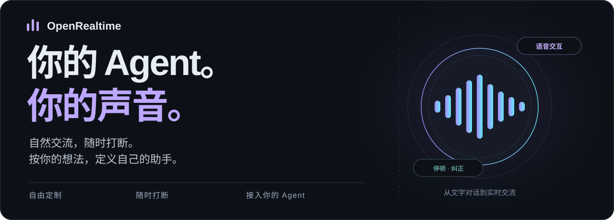
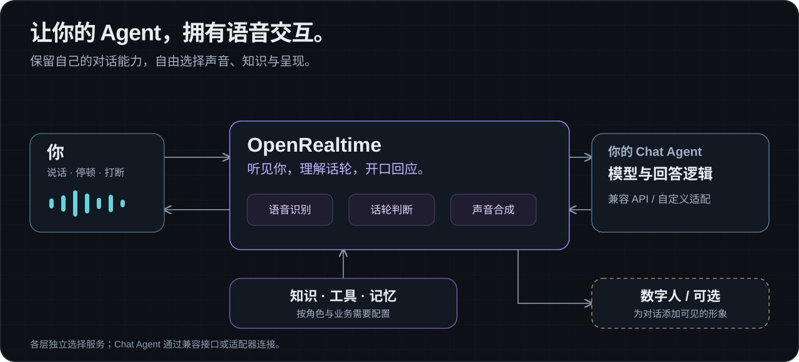

# OpenRealtime



## 介绍与定位

**OpenRealtime 是一个开源、可自定义、可打断的实时语音交互 Agent 产品。让你的助手听懂问题、开口回答，并跟上你的对话节奏。**

接入你的 Agent，用语音聊天、查询资料，并通过已配置的工具辅助工作。角色、人设、声音、模型、知识和工具由你配置；想让助手拥有可见的形象时，再加入数字人。

语音识别、回答与声音合成可以分别选型，保留已有的对话能力，按预算和体验自由组合。合适的服务组合可比 GPT-Realtime 这类端到端方案更便宜；使用云 API 时，无需自建模型 GPU。[了解成本与选型](docs/product/COST-AND-FLEXIBILITY.md)

**[在线体验](https://realtime.happy-token.cn)** · **[使用方法](#使用方法)** · [文档](docs/README.md) · [接入自己的 Chat Agent](docs/guides/CHAT-AGENT-INTEGRATION.md) · [English](README.md)


*当前应用中的 Samantha，展示可选数字人体验与右侧角色切换。截图为本地素材预览，左侧导航隐藏。*

## 能干什么

- **实时语音交互。** 直接开口交流、连续追问，在回答时随时打断、补充或纠正，让 Agent 跟上你的对话节奏。
- **接入你的 Agent。** 为已有 Chat Agent 加上语音输入与输出，通过兼容 API 或适配器连接，保留自己的模型与业务回答逻辑。
- **用语音聊天和工作。** 聊天、查询资料、讨论问题，或调用已接入的工具辅助工作。把需求说出来，并在交流中继续补充与确认。

从日常交流到业务助手，按需要配置知识、工具和记忆。产品资料讲解与问答可以作为第一个上手示例。[产品概览](docs/getting-started/OVERVIEW.md) · [上手示例](docs/getting-started/PRODUCT-ASSISTANT.md)

## Features

- **自由组合，打造你的语音 Agent。** 灵活选择 TTS、LLM 与语音识别服务，搭配喜欢的声音、人设和工具，定制助手的表达方式与实际能力。[角色配置](docs/guides/ROLE-CONFIGURATION.md)
- **智能判停，给思考留时间。** 结合语义与说话状态判断你是否说完，减少把思考中的停顿当作结束，让助手在合适的时机接话。[判停机制](docs/SEMANTIC-EOT.md)
- **智能打断，听懂你的意图。** 区分真正的打断与简单附和，减少环境噪声引起的误打断；识别到叫停、纠正或新问题时，及时停止旧回答，响应新的输入。[打断机制](docs/SEMANTIC-INTERRUPTION.md)
- **流式语音交流。** 语音输入、逐段回答和声音播放连接在一起，支持持续追问与多轮交流。
- **按预算选择，控制语音成本。** 识别、回答、声音与话轮决策分别选型，复用已有 Chat Agent，选择更经济的服务组合。[成本与灵活性](docs/product/COST-AND-FLEXIBILITY.md)
- **接入自己的 Chat Agent。** 支持兼容的文字对话 API；自定义接口可以通过适配器连接，保留自己的业务回答逻辑。[接入指南](docs/guides/CHAT-AGENT-INTEGRATION.md)
- **用自己的资料回答。** 导入文本、文件或网页内容，测试检索片段，再将资料绑定到角色。[知识库](docs/KNOWLEDGE-BASE-GUIDE.md)
- **工具、记忆与续聊。** 为角色选择可调用的工具，配置长期记忆，管理历史记录并继续已有对话。[工具权限](docs/TOOL-PERMISSIONS.md) · [记忆与历史](docs/MEMORY-AND-HISTORY-GUIDE.md)
- **数字人按需添加。** 使用已接入的 Anam、配置本地口型，或管理与选择已有动作、口型素材。不同方式有各自的服务与素材要求。[数字人路线](docs/DIGITAL-HUMAN-DRIVING.md)
- **开源与自行部署。** 在自己的环境运行应用，配置服务、数据存储、身份认证和权限，也可以开发新的适配器与交互能力。[部署](docs/deployment/public-trial.md) · [架构](docs/ARCHITECTURE.md)

## 使用方法

### 1. 先在线体验

打开 **[realtime.happy-token.cn](https://realtime.happy-token.cn)**，选择可用角色与呈现方式，开始对话并允许麦克风访问。问一个问题，再试着追问、停顿、叫停或纠正，感受助手如何接续交流。

自定义自己的角色、资料与服务时，使用有相应权限的账号或本地部署。公开体验的可用服务、权限与额度由运营方配置。[页面使用指南](docs/QUICK-START.md)

### 2. 在本机运行

准备 Python 3.12+、[uv](https://docs.astral.sh/uv/)、Node.js 22 和 pnpm 10：

```bash
git clone https://github.com/happy-token/OpenRealtime.git
cd OpenRealtime
uv sync
pnpm install
pnpm dev
```

打开 **http://localhost:3010**。本地 GPU 数字人渲染默认关闭。

未配置凭据时，确定性演示适配器用于浏览界面和检查应用链路。要进行真实语音与资料问答，还需配置识别、回答和声音服务。[启动与排错](docs/getting-started/LOCAL-DEVELOPMENT.md)

### 3. 配置真实语音与回答服务

默认本地直连路线可以使用豆包识别与合成、DeepSeek 回答。在 `.env.local` 中填入自己的服务凭据：

```dotenv
DEEPSEEK_API_KEY=your-deepseek-key
DOUBAO_API_KEY=your-doubao-speech-key
VOICEAGENT_ASR_BACKEND=doubao-direct
VOICEAGENT_TTS_BACKEND=doubao-direct
VOICEAGENT_DEMO_TOOLS=1
OPENREALTIME_AVATAR_RENDERER_MODE=disabled
```

重启 `pnpm dev`，验证语音转写、模型回答与声音播放。语音凭据需有对应 ASR/TTS 资源权限；角色若覆盖了供应商，也需配置对应服务。`VOICEAGENT_DEMO_TOOLS=1` 用于本地工具与知识路径，仍需核对角色的资料和工具权限。[完整服务配置](docs/getting-started/CLOUD-SERVICES.md)

### 4. 用产品资料搭建第一个助手

从一份简短产品说明或 FAQ 开始，先跑通问答，再逐步增加资料：

1. **导入资料。** 在「资源库 → 知识库」添加产品说明、功能介绍或常见问题。
2. **测试检索。** 用一个具体问题查看返回的原文片段，确认资料能被找到。
3. **配置角色。** 设置名称、人设与声音，绑定资料并核对工具权限；要求助手依据资料回答，未说明的内容明确告知。
4. **开始交流。** 测试产品介绍、事实问答与追问，再尝试停止、补充和纠正。
5. **按需加形象。** 问答跑通后，再给助手配置数字人素材或服务。

例如，资料写明「试用 14 天，每个团队最多 5 人」，就用“试用多久？”和“可以邀请几个人？”核对回答，再问一个资料未覆盖的问题。[完整示例：产品资料语音讲解与问答](docs/getting-started/PRODUCT-ASSISTANT.md)

### 5. 接入已有的 Chat Agent

已有兼容文字对话接口时，可以配置接口地址、认证、模型名与 API 风格，让自己的 Agent 提供回答；自定义 HTTP 或 SDK 接口则需要实现适配器。

接入后验证流式回答、追问、停止、纠正与取消行为。工具、资料和记忆可以由自己的 Agent 提供，也可以结合 OpenRealtime 的能力。[兼容接口配置与适配指南](docs/guides/CHAT-AGENT-INTEGRATION.md)

## 工作方式



你说话，OpenRealtime 识别内容并协调话轮；回答模型或你的 Chat Agent 生成回复，再由声音服务播出来。知识、工具与记忆按需参与，数字人作为可选的呈现能力。

每一层可以独立配置，便于保留自己的业务逻辑、调整声音和模型，也便于按成本与体验更换服务。[语音 Pipeline](docs/VOICE-PIPELINE.md) · [扩展接口](docs/SEMANTIC-DECISION-PLUGINS.md)

## 服务与集成

| 能力 | 当前接入方式与配置入口 |
| --- | --- |
| 语音识别与声音合成 | 默认本地示例使用豆包；其他受支持路线见[服务配置参考](docs/reference/WEB-DEMO-CONFIGURATION.md) |
| 回答模型与 Chat Agent | DeepSeek、兼容 Chat Completions / Responses 的服务，以及自定义适配器；见[接入指南](docs/guides/CHAT-AGENT-INTEGRATION.md) |
| 话轮与打断判断 | 独立的 LLM 决策配置，可选 Jev 适配；见[决策合约](docs/SEMANTIC-DECISION-PLUGINS.md) |
| 知识、工具与记忆 | 资料导入与角色绑定、工具选择与权限、长期记忆与历史；见[配置指南](docs/README.md) |
| 可选数字人 | 已接入的 Anam、本地口型、已有动作与口型素材；见[数字人方案](docs/DIGITAL-HUMAN-DRIVING.md) |

具体可用性取决于已配置的服务、权限、素材和运行环境。[环境变量示例](.env.example) · [支持与范围](docs/reference/SUPPORT-AND-SCOPE.md)

### 部署与开发扩展

后端由会话管理服务和语音交互服务组成：前者负责用户、配置与数据，后者负责实时语音交互。 [前后端分离部署](docs/deployment/frontend-backend.md)

## 文档与示例

| 你想做什么 | 从这里开始 |
| --- | --- |
| 认识产品与配置角色 | [产品概览](docs/getting-started/OVERVIEW.md) · [角色配置](docs/guides/ROLE-CONFIGURATION.md) |
| 跑通自己的资料问答 | [产品助手示例](docs/getting-started/PRODUCT-ASSISTANT.md) · [知识库](docs/KNOWLEDGE-BASE-GUIDE.md) |
| 为已有 Chat Agent 加上语音 | [兼容 API 与自定义适配](docs/guides/CHAT-AGENT-INTEGRATION.md) |
| 配置工具、记忆与数据 | [工具权限](docs/TOOL-PERMISSIONS.md) · [记忆与历史](docs/MEMORY-AND-HISTORY-GUIDE.md) · [数据管理](docs/DATA-MANAGEMENT-GUIDE.md) |
| 选择数字人和动作素材 | [数字人路线](docs/DIGITAL-HUMAN-DRIVING.md) · [动作编排](docs/MOTION-ORCHESTRATION-GUIDE.md) |
| 部署或开发扩展 | [部署](docs/deployment/public-trial.md) · [架构](docs/ARCHITECTURE.md) · [协议](docs/asyncapi.json) |

[全部文档](docs/README.md) · [前端文档](https://realtime.happy-token.cn/docs) · [路线图](ROADMAP.md) · [更新记录](CHANGELOG.md)

## 当前范围与路线图

知识库默认采用关键词片段检索，请用自己的资料核对检索与回答效果。英文语音配置和完整交流验收仍需补齐；编码、办事 Agent 已有适配基础，统一接入与完整语音任务协作仍在路线图中。

数字人的可用模式各有前提，预制素材不等于逐字匹配当前回答的实时口型。按实际选择的服务与模式验证体验。[详细能力说明](docs/reference/SUPPORT-AND-SCOPE.md) · [路线图](ROADMAP.md)

## 参与贡献与获取帮助

欢迎提交缺陷、使用反馈、文档改进，以及新的服务或 Agent 适配器。先阅读[贡献指南](CONTRIBUTING.md)，再通过 [GitHub Issues](https://github.com/happy-token/OpenRealtime/issues)反馈问题；排错时附上版本、服务组合和复现步骤。

[安全报告](SECURITY.md) · [行为准则](CODE_OF_CONDUCT.md)

## 许可

运行时与集成代码采用 [Apache-2.0](LICENSE)。托管服务与第三方素材保留各自条款。[第三方说明](THIRD_PARTY_NOTICES.md)
