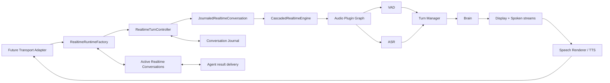
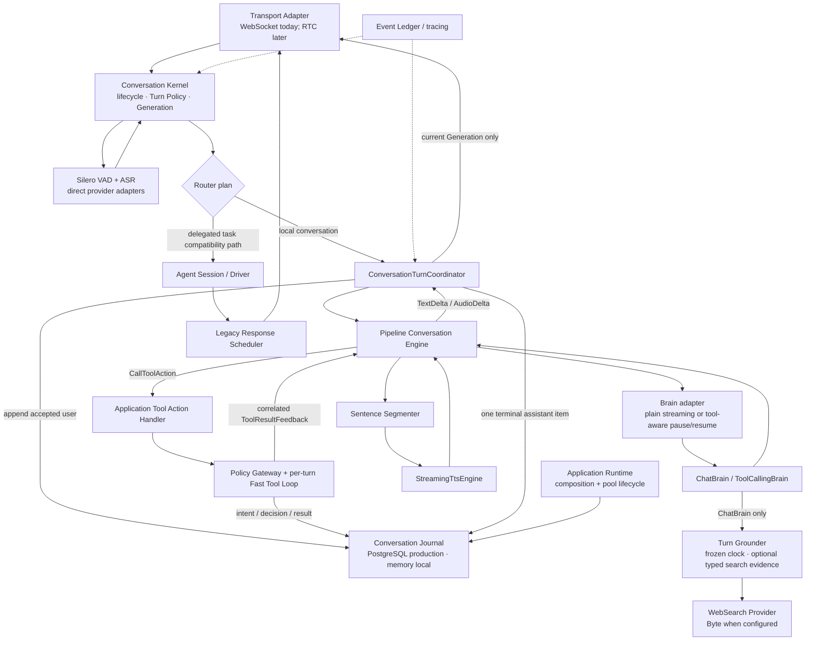
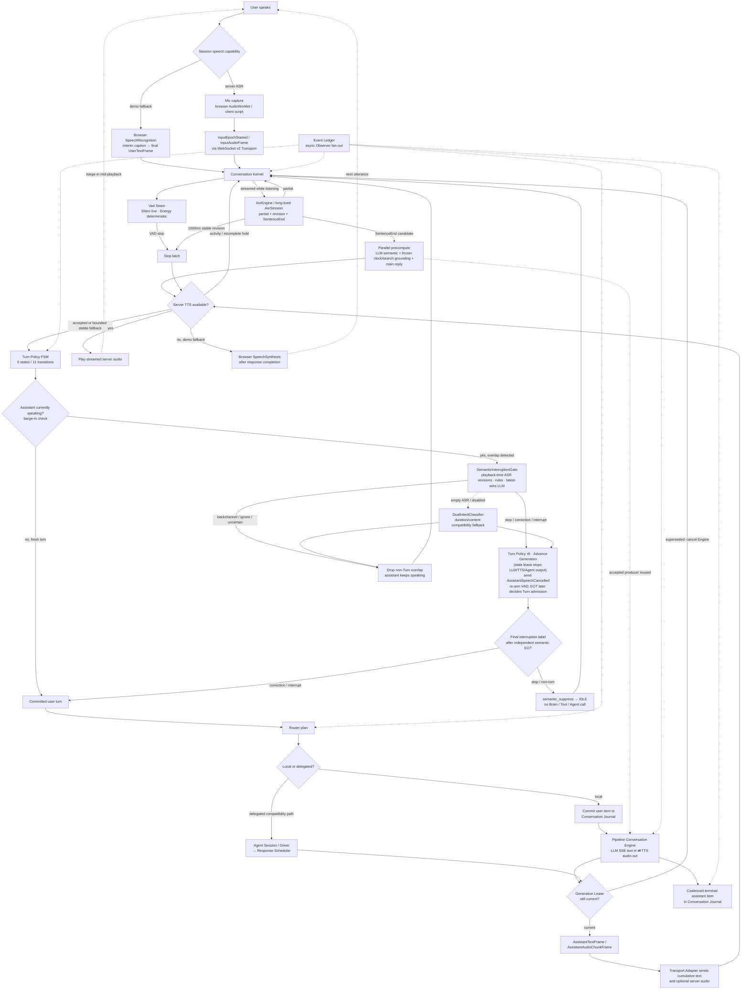

# Architecture

This is the consolidated "how it all fits together" view. For term definitions
see [CONTEXT.md](../CONTEXT.md); for why a given design was chosen see the
individual [ADRs](adr/); for the dialogue-state model itself see
[full-duplex-survey.md](full-duplex-survey.md).

## Frontend and backend services

OpenRealtime has a frontend and a backend. **The session management service and
voice interaction service are both backend services.** They can share a host;
moving them to separate hosts requires resolving their storage and internal
control dependencies.

| Layer | Component | Responsibilities |
| --- | --- | --- |
| Frontend | Web UI | Pages, documentation, interaction, browser audio capture and playback |
| Backend | Session management service (`apps/backend`) | Login, permissions, assistant configuration, knowledge, memory and history; `/api/*` |
| Backend | Voice interaction service (`server` and the Python launcher) | Streaming ASR, turn detection, interruptions, Agent / LLM calls and TTS; `/voice/*` |

See the [independent deployment guide](deployment/frontend-backend.md). The
runtime diagrams below describe the internals of the voice interaction service.

> This document describes the currently assembled production runtime. The
> accepted target that will progressively replace the turn-scoped Conversation
> Engine with a stateful Native/Cascaded Realtime Engine is documented in
> [Realtime Engine unified interface and plugin architecture](GPT-Voice/13-Realtime-Engine统一接口与插件架构.md)
> and ADR-0063 through ADR-0065. Until that migration completes, names and
> boundaries below intentionally reflect the live compatibility baseline.

The replacement runtime is no longer only a protocol scaffold. The assembled,
not-yet-live composition is:

This path now passes its isolated contract and integration tests, including
Journal visibility barriers, dual text/audio streaming, plugin graph routing,
partial-open rollback, and explicit capability/response/delivery failure
events. The live demo remains on the compatibility diagram by default while
the new WebSocket bridge is validated through an explicit runtime flag.
The cancellation/barge-in contract, external speech lifecycle, and model-output
speech-delivery accounting are already covered by the isolated runtime suite;
the managed runtime also implements the Journal-backed reconfiguration barrier,
and reconnect delivery replay is covered by the durable-outbox integration test.

For an assessment of how much of this diagram is real at runtime — and which
parts were, until 2026-08-05, aspirational — see
[ASSESSMENT.md](ASSESSMENT.md), [INTERACTION-CASES.md](INTERACTION-CASES.md),
and [LATENCY.md](LATENCY.md). The barge-in branch below in particular described
behavior the Kernel did not implement until
[ADR-0036](adr/0036-concurrent-turn-execution-and-real-barge-in-cancellation.md).

## Seam map

Every box below is a Seam (or an application service over Seams). The live
Voice Web Demo uses the Pipeline branch. RTC is intentionally absent: it will
be another Session Plane adapter and will not own tool, Agent, or persistence
logic.

Attached, not in the critical path of every turn: **Device Fleet**
(`device_fleet/`, activation/firmware/inventory contract for multi-device
ecosystems) and **Multi-modal Turn Content** (vision/action metadata bundled
onto a turn by `VisionSource`, read only if a Brain author chooses to).

## One turn, end to end

0. The Kernel's frame loop and its turn work run **concurrently** (ADR-0036):
   steps 1–4 below happen on the loop, and steps 5–10 happen in a per-turn
   `asyncio.Task` so audio keeps being read while the Brain thinks and the TTS
   stream is written. Without that split the overlap branch in step 4 is
   unreachable with any real vendor latency.
1. **Transport Adapter** receives audio/text frames for one connection and
   hands them to the **Conversation Kernel** as `Frame`s.
2. The Kernel feeds each audio chunk once through the `Vad` Seam (`SileroVad`
   live, `EnergyVad` deterministic) and through the Speech Seam's long-lived
   `AsrSession`. ASR revisions are streamed to the client immediately.
3. A provider SentenceEnd freezes a revisioned endpoint candidate and starts
   the **LLM-only `EotClassifier`** plus a side-effect-free main-response
   prefetch in parallel. In the ordinary ChatBrain path that one producer first
   resolves read-only realtime grounding (respond/clock/lookup), then starts the
   main LLM stream; stable acceptance reuses both instead of spawning duplicate
   work. SentenceEnd does not commit the turn. The
   `SemanticEndpointGate` also requires VAD stop or the 1000ms ASR-idle
   fallback; new VAD/ASR activity invalidates all candidate work. See
   [Semantic EoT](SEMANTIC-EOT.md) and [ADR-0057](adr/0057-sentence-end-semantic-race-and-speculative-response.md).
4. Once both semantic and stop latches accept a stable candidate, **Turn
   Policy** evaluates `USER_EOT_CONFIRMED` against its 5-state/11-transition
   FSM, consulting `AddresseeClassifier` (third-party-speech filtering) and
   `DualIntentClassifier` (barge-in vs. backchannel) as needed, and emits a
   committed user turn.
5. **Router** selects local conversation or explicit Agent delegation without
   invoking the local Brain as a side effect of planning.
6. For a local turn, **ConversationTurnCoordinator** appends the user item to
   **Conversation Journal before Engine dispatch**. The application runtime
   supplies an in-memory Journal for local development or a PostgreSQL Journal
   for durable deployments; startup never runs schema migrations implicitly.
7. **Pipeline Conversation Engine** consumes plain Brain deltas through
   `BrainStreamingAdapter`, or pauses a `ToolCallingBrainStreamingAdapter` on a
   canonical `CallToolAction`. The Coordinator sends that action through the
   application Tool Action Handler, Policy Gateway, per-turn Fast Tool Loop, and
   Tool Executor. Intent is durable before the handler runs; the result is
   durable before correlated `ToolResultFeedback` resumes the same Engine
   response. Low-risk work executes inline, while deny/defer/confirmation
   outcomes become safe model feedback without invoking the handler.
8. The Coordinator gates every user-visible delta by the **Generation Lease**.
   Supersession cancels the upstream Engine token; stale queued turns never call
   the provider. Engine calls are serialized per Voice Session to prevent two
   generations from mutating one stateful provider session concurrently.
9. Completion, cancellation, or failure creates one coalesced assistant Journal
   item. Audio/token deltas are not persisted individually. The browser merges
   cumulative text for one Generation and separately reports playback finish.
10. The existing Agent delegation path still uses the compatibility Response
   Scheduler. Moving delegated work onto canonical `DelegateTaskAction` and the
   durable Supervisor is the next orchestration increment. Bound confirmation
   storage exists, but authenticated decision input and resume remain to be
   connected to the client protocol.
11. Every step along the way fans out read-only events to the **Event
   Ledger**'s Observers (logging/analytics) — never mutates the pipeline.

### Diagram

## Seam → Protocol → ADR

| Seam | Protocol (file) | Default conformer | Real conformer | ADR |
|---|---|---|---|---|
| Application Runtime / Persistence | `application/runtime.py`, `persistence/unit_of_work.py` | `InMemoryPersistence` (local/test) | `PostgresPersistence` | [0055](adr/0055-postgresql-authoritative-state-and-s3-compatible-artifacts.md) |
| Conversation Journal | `conversation_journal/journal.py` | `InMemoryConversationJournal` | `PostgresConversationJournal` | [0050](adr/0050-server-owned-conversation-journal-as-authoritative-history.md) |
| Conversation Engine | `conversation_engine/protocol.py` | `PipelineConversationEngine` | provider-neutral Pipeline with real streaming Brain/TTS adapters | [0041](adr/0041-unified-conversation-engine-with-native-realtime-and-pipeline-conformers.md), [0048](adr/0048-end-to-end-streaming-conversation-engine-and-output-contract.md) |
| Transport Adapter | `transport/base.py` | — | `WebSocketTransportAdapter` (`transport/plugins/websocket.py`), `UdpTransportAdapter` (`transport/plugins/udp.py`) | — |
| VAD | `signals/energy_vad.py` | `EnergyVad` (deterministic tests) | direct official-package `SileroVad` (`signals/plugins/silero_vad.py`) | [0056](adr/0056-remove-pipecat-runtime-dependency.md) |
| Turn Policy | `turn_policy/policy.py` | full FSM, no plugins | — | — |
| AddresseeClassifier | `turn_policy/addressee.py` | accept-all | — | [0004](adr/0004-unified-addressee-classifier.md) |
| Wake Word | `turn_policy/wake_word.py` | unregistered = always-open | — | [0005](adr/0005-voiceprint-informational-wakeword-gating.md) |
| Voiceprint | `signals/voiceprint.py` | unregistered = no-op | — | [0005](adr/0005-voiceprint-informational-wakeword-gating.md) |
| DualIntentClassifier | `turn_policy/dual_intent.py` | `DefaultDualIntentClassifier` (duration threshold) | `LlmDualIntentClassifier` (`turn_policy/plugins/llm_dual_intent_classifier.py`) | [0007](adr/0007-duration-threshold-dual-intent-classifier.md), [0015](adr/0015-content-aware-dual-intent-classifier.md) |
| Semantic Interruption | `turn_policy/semantic_interruption.py` | exact rules + latest-wins Gate; model optional | `LlmSemanticInterruptionClassifier` (`turn_policy/plugins/llm_semantic_interruption_classifier.py`) | [0060](adr/0060-latest-wins-semantic-interruption-gate.md), [guide](SEMANTIC-INTERRUPTION.md) |
| Semantic Endpoint / EotClassifier | `turn_policy/semantic_endpoint.py`, `turn_policy/eot_classifier.py` | no classifier = semantic pass, stop latch still required | LLM-only `LlmEotClassifier` (`turn_policy/plugins/llm_eot_classifier.py`) | [0057](adr/0057-sentence-end-semantic-race-and-speculative-response.md), [guide](SEMANTIC-EOT.md) |
| AsrEngine | `speech/asr.py` | `PreloadedAsrEngine` | `DoubaoAsrEngine` (`bigmodel` default; adapter URL override), `BellaAsrEngine` | [0011](adr/0011-doubao-asr-tts-as-swappable-speech-seam.md), [0058](adr/0058-doubao-bigmodel-asr-default-and-latency-baseline.md) |
| TtsEngine | `speech/tts.py` | `SilentTtsEngine` | `DoubaoTtsEngine` (`speech/plugins/doubao_tts.py`) | [0011](adr/0011-doubao-asr-tts-as-swappable-speech-seam.md) |
| StreamingTtsEngine | `speech/tts.py` | `SilentTtsEngine` | `DoubaoTtsEngine` (`speech/plugins/doubao_tts.py`) | [0012](adr/0012-streaming-tts-as-a-separate-protocol.md) |
| DuplexStreamingTtsEngine | `speech/tts.py` | test adapters | `DoubaoDirectTtsEngine` (`speech/plugins/doubao_tts_direct.py`) | [0062](adr/0062-duplex-text-audio-streaming-tts.md) |
| Brain / StreamingLlmClient | `brain/base.py`, `brain/llm_clients.py` | `EchoLlmClient` | `OpenAiCompatibleLlmClient` SSE stream (`brain/plugins/openai_compatible_llm_client.py`) | [0048](adr/0048-end-to-end-streaming-conversation-engine-and-output-contract.md) |
| Turn Grounder / GroundingPlanner | `brain/realtime_grounding.py` | no-op when LLM credentials are absent | `RealtimeGroundingCoordinator` + `LlmGroundingPlanner` | [0059](adr/0059-speculative-realtime-date-and-search-grounding.md), [guide](REALTIME-GROUNDING.md) |
| ToolCallingLlmClient / Voice Tool Runtime | `brain/llm_clients.py`, `application/tool_actions.py` | `EchoToolCallingLlmClient` + bounded `FastToolLoop` | `OpenAiCompatibleToolCallingLlmClient` (`brain/plugins/openai_compatible_tool_calling_llm_client.py`) | [0009](adr/0009-single-tool-call-per-turn.md), [0029](adr/0029-real-tool-calling-llm-client-and-search-hardening.md), [0061](adr/0061-two-speed-voice-tool-runtime.md) |
| DelegationPolicy | `brain/delegation_policy.py` | `NeverDelegatePolicy` | `KeywordDelegationPolicy` (demo-grade, `brain/plugins/keyword_delegation_policy.py`) | [0001](adr/0001-two-layer-external-agent-integration.md) |
| StatusInquiryClassifier | `brain/status_inquiry.py` | `KeywordStatusInquiryClassifier` | — | [0008](adr/0008-status-inquiry-classifier-and-single-inflight-delegation.md) |
| Agent Session Protocol / Driver | `agent_session/` | `InMemoryDriver` | — | [0001](adr/0001-two-layer-external-agent-integration.md) |
| Knowledge Base | `knowledge_base/protocol.py` | `InMemoryKnowledgeBase` | — | [0010](adr/0010-knowledge-base-as-tool-source.md) |
| WebSearch | `web_search/protocol.py` | `DeterministicWebSearch` | `ByteWebSearch` (`web_search/plugins/byte_web_search.py`) | [0014](adr/0014-web-search-and-clock-as-tool-sources.md), [0016](adr/0016-byte-web-search-conformer.md), [0029](adr/0029-real-tool-calling-llm-client-and-search-hardening.md), [0059](adr/0059-speculative-realtime-date-and-search-grounding.md) |
| Device Fleet | `device_fleet/protocol.py` | `InMemoryDeviceFleet` | — | [0003](adr/0003-device-fleet-as-standardized-seam.md) |
| VisionSource | `signals/vision_source.py` | `NoVisionSource` | — | — |
| Event Ledger / Observer, Hook Point | `ledger/`, hook sites throughout | no-op passthrough | — | [0002](adr/0002-dual-hook-mechanism.md) |

## L0 ceiling

This project is an **L0** architecture per the full-duplex survey's §4
hierarchy: an external module pipeline (VAD/EoT/turn-classifier feeding a
text LLM), not an end-to-end trained duplex model. DUAL-state discrimination
(backchannel vs. barge-in vs. third-party speech) is achieved via bolt-on
classifier plugins (`AddresseeClassifier`, `SemanticInterruptionClassifier`,
and the compatibility `DualIntentClassifier`), not
native architectural integration — an explicitly accepted trade-off, not a
gap to close. See [full-duplex-survey.md](full-duplex-survey.md) §4/§6 and
the `L0/L1/L2/L3` and `Dialogue State` entries in
[CONTEXT.md](../CONTEXT.md).
