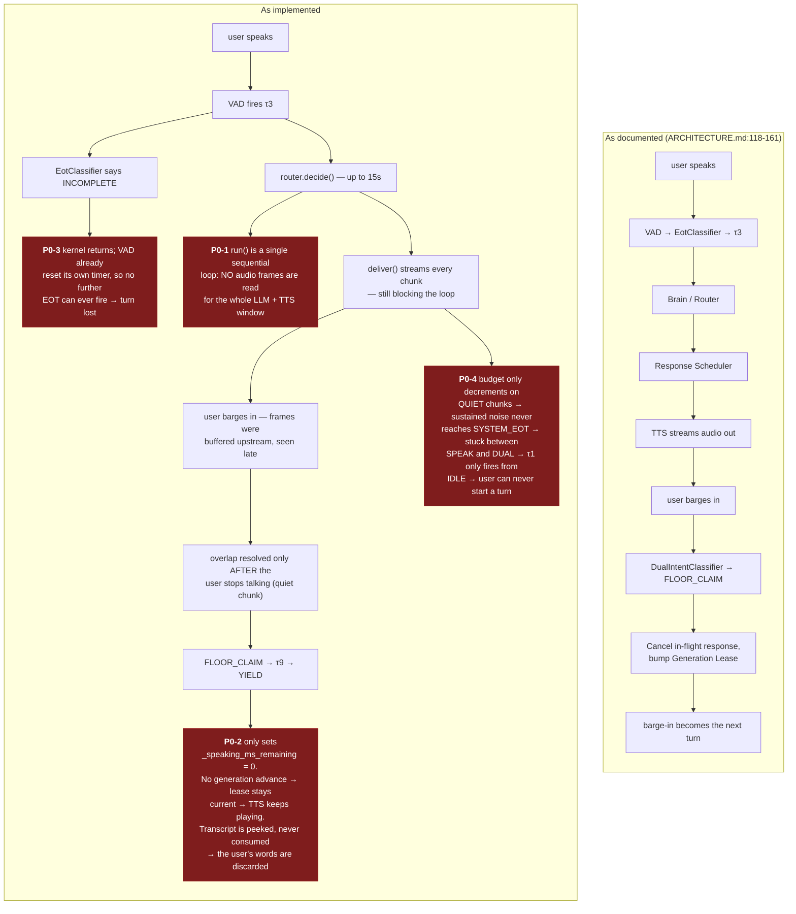

# Assessment — 2026-08-05

A product / engineering / technical review of the whole project, written against
the code as of `8e0b41f`. Companion documents:
[INTERACTION-CASES.md](INTERACTION-CASES.md) (per-case interaction audit) and
[LATENCY.md](LATENCY.md) (latency budget and optimization plan).

**A note on vocabulary.** [CONTEXT.md](../CONTEXT.md)'s glossary tells us to
avoid "Layer" in favour of "Seam". That rule still holds for the architecture
itself. The five-tier model below is a *product / deployment* view — "what does
a customer have to build, buy, or operate at each altitude" — which cuts across
Seams rather than replacing them. It is used here only in that sense.

**A note on positioning.** This review is written against a declared target of a
**production voice runtime**. Under an earlier "reference framework" reading,
several findings below (no codec, no persistence, no auth, no tenancy) would be
scope boundaries rather than gaps. They are gaps.

---

## Executive summary

The documentation and contract layers of this project are substantially more
mature than its runtime. That inversion is the single most important thing to
understand about the codebase:

- The mapping from [full-duplex-survey.md](full-duplex-survey.md)'s five-state /
  eleven-transition FSM into `server/turn_policy/policy.py:30-58` is real and
  accurate — τ1–τ11 line up with the paper's Table 4 entry for entry. This is a
  genuinely uncommon foundation.
- **But on paper the system is full-duplex, and at runtime it is half-duplex.**
  `ConversationKernel.run()` (`server/kernel/conversation_kernel.py:161-163`) is
  a single sequential loop, so the entire τ8–τ11 overlap family is unreachable
  once a real LLM or TTS engine is wired in.
- Four P0 defects sit on the core interaction path, and **none of the 425
  existing tests detect any of them**. The whole suite runs in 4.25 seconds —
  which is itself the tell: a voice system's test suite that completes in four
  seconds contains no timing assertions at all.
- The tests validate *mechanism* (which FSM edge was traversed, whether a lease
  went stale) rather than *experience* (whether audio actually stopped, whether
  the user's words were answered).

`docs/COMPLETION_STATUS.md` reports 7/10 architecture points and 11/11
requirement points Done. Those verdicts are accurate **at the contract level**
and overstated at the product level; four are corrected in this pass (see
[Record corrections](#record-corrections)).

---

## The five tiers, as built

```mermaid
flowchart TB
    subgraph L1["① 用户与终端层 · Terminal — Web 60% / Device 10%"]
        direction LR
        L1A["Next.js client<br/>AudioWorklet capture,<br/>gapless playback scheduling<br/><b>real</b>"]
        L1B["ESP32 firmware<br/>149 LOC, I2S capture AND<br/>playback both stubbed<br/><b>handshake only</b>"]
        L1C["udp/websocket<br/>Python clients<br/>~40 LOC demos"]
    end
    subgraph L2["② 接入通信层 · Access & Transport — 35%"]
        direction LR
        L2A["WebSocket + UDP<br/><b>real</b>"]
        L2B["RTC / MQTT / LiveKit<br/><b>contract only</b>"]
        L2C["Endpoint Session<br/>hello/resume, 60s grace,<br/>256-frame buffer<br/><b>real, in-process only</b>"]
        L2D["MISSING: codec/opus ·<br/>sequence numbers · jitter<br/>buffer · heartbeat · auth ·<br/>version negotiation"]
    end
    subgraph L3["③ 语音能力层 · Speech & Turn-Taking — contract 85% / runtime 40%"]
        direction LR
        L3A["Turn Policy FSM<br/>5 states / 11 transitions,<br/>faithful to the survey<br/><b>real</b>"]
        L3B["Silero VAD · Bella ASR ·<br/>Doubao ASR/TTS<br/><b>real conformers</b>"]
        L3C["P0-1 half-duplex kernel<br/>P0-2 barge-in never cancels<br/>P0-3 semantic EOT deadlock<br/>P0-4 SpeakingClock fiction"]
    end
    subgraph L4["④ 业务知识层 · Business & Knowledge — 30%"]
        direction LR
        L4A["AcpDriver<br/>real JSON-RPC/NDJSON<br/>over stdio"]
        L4B["ByteWebSearch<br/>real, with SSRF guard"]
        L4C["MCP = schema adapter,<br/>no client/transport;<br/>KB = substring match,<br/>not RAG; delegation has<br/>no timeout"]
    end
    subgraph L5["⑤ 数据运营层 · Data & Operations — 5%"]
        direction LR
        L5A["EventLedger fan-out ·<br/>StageTracer per-stage spans"]
        L5B["ABSENT: persistence ·<br/>metrics export · session<br/>recording · analytics ·<br/>identity/tenancy · CI"]
    end
    L1 --> L2 --> L3 --> L4
    L3 -.-> L5
    L4 -.-> L5

    classDef real fill:#1b5e20,stroke:#2e7d32,color:#fff
    classDef partial fill:#8d6e00,stroke:#a97800,color:#fff
    classDef missing fill:#7f1d1d,stroke:#991b1b,color:#fff
    class L1A,L2A,L2C,L3A,L3B,L4A,L4B,L5A real
    class L1C partial
    class L1B,L2B,L4C partial
    class L2D,L3C,L5B missing
```



| Tier | Verdict |
|---|---|
| ① 用户与终端层 | The web client is the most complete surface in the repo. The device story is a handshake demo: `clients/esp32/main/main.c:10` stubs I2S mic capture and `:79` logs `playback not implemented`. PRD point 5 ("参考小智平台", multi-device) has a contract and no device audio path. |
| ② 接入通信层 | Two real adapters, but the wire format is base64-PCM-inside-JSON (`transport/frames.py:22-29`) — ~33% bandwidth inflation, no codec, no sequence numbers on inbound audio, no loss recovery, no jitter buffer, no heartbeat (UDP has zero liveness detection), no protocol version field, and no auth on the data plane. `EndpointSessionRegistry`'s resume machinery is the best-engineered part of the tier and is entirely in-process. |
| ③ 语音能力层 | The contract is excellent; the runtime has four P0s. Detailed below. |
| ④ 业务知识层 | Two genuinely production-grade integrations (`AcpDriver`, `ByteWebSearch`) surrounded by named-after-the-real-thing stubs. `tools/mcp_source.py` has no MCP client, transport, or handshake — it repackages a handler you already built. `knowledge_base/in_memory_knowledge_base.py:20` is case-insensitive substring matching. `await session.result()` (`kernel/conversation_kernel.py:314`) has no deadline, so a hung backend leaves the user with an ack and then permanent silence. |
| ⑤ 数据运营层 | Effectively absent. `grep -rl 'sqlite\|postgres\|redis\|prometheus\|opentelemetry'` over `server/` returns nothing. Nothing survives a process restart; the framework cannot run as more than one replica. There is no identity or tenancy model at all — `device_fleet`'s `device_id` never reaches `endpoint_session` or `agent_session`, so nothing can say which device or user a session belongs to. |

---

## Blueprint vs. runtime

`ARCHITECTURE.md:118-161` documents the intended turn. The left diagram is that
claim; the right is what the code does.



---

## Technical findings — the four P0s

### P0-1 · The kernel is structurally half-duplex

`kernel/conversation_kernel.py:161-163`:

```python
async def run(self) -> None:
    async for frame in self._transport.receive():
        await self._handle_frame(frame)
```

One frame's entire pipeline — VAD, hook, EOT gate, `router.decide()` (an LLM
call, `timeout_s=15.0` by default), and `response_scheduler.deliver()` (which for
`StreamingSpokenResponseScheduler` streams *every* TTS chunk) — must finish
before the next inbound frame is even read off the transport iterator.

Consequence: **barge-in during think-time or during playback cannot be observed
in real time.** The τ8–τ11 machinery is demonstrable only under the zero-latency
defaults used in tests. It is not exercised against real TTS timing anywhere.

### P0-2 · Barge-in does not interrupt anything

`_resolve_dual_overlap:527-529` reacts to `ResponseAction.YIELD` with exactly
one statement: `self._speaking_ms_remaining = 0.0`.

`GenerationCounter.advance()` is called in precisely two places in the whole
kernel (`:177` and `:365`), **neither on the barge-in path**. So
`GenerationLease.is_current()` stays true, and
`scheduler/streaming_spoken_response_scheduler.py:60-62` — the per-chunk lease
check whose docstring advertises "true mid-playback barge-in cancellation" —
never trips. The assistant talks over the user and finishes its old answer.

Worse, the interrupting utterance's transcript is only `peek_transcript()`ed
(`:522`), never consumed or routed. Since τ9 lands in LISTEN with the VAD's
onset tracker still holding `_speaking = False` (SPEAK/DUAL only ever call
`measure_chunk`, which does not touch tracker state), **no EOT can ever close
that utterance.** The user's words are stranded and they must repeat themselves.

`ARCHITECTURE.md:135` draws `FLOOR_CLAIM → "Cancel in-flight response / bump
Generation Lease"`. The code does neither.

The clearest evidence that this was never exercised end to end:
`tests/scheduler/test_streaming_spoken_response_scheduler.py:123` simulates a
barge-in by passing `on_yield=counter.advance` — the test **manually** advances
the generation, because the kernel never does.

### P0-3 · Semantic end-of-turn can deadlock

When `_should_defer_eot` returns True, `_handle_audio_chunk:369-370` returns
early. But `_OnsetEotTracker.advance` (`signals/energy_vad.py:82-86`) already
committed `_speaking = False; _silence_ms = 0` as a side effect of emitting
`USER_EOT_CONFIRMED`. Every subsequent quiet chunk therefore hits
`if not self._speaking: return None`.

So a user whose utterance is judged INCOMPLETE and who then simply waits for a
reply **waits forever**. `eot_max_deferrals` bounds deferrals, not silence — it
only helps if the user speaks again. This is on the primary
semantic-completeness path, the very feature the project invested most in.

### P0-4 · SpeakingClock is a fiction, and noise deadlocks SPEAK

`_speaking_ms_remaining` is decremented **only on quiet chunks in SPEAK**
(`:461-463`), and never at all in DUAL. Under sustained audio above the energy
threshold it never decrements, `SYSTEM_EOT` never fires, and the FSM
ping-pongs SPEAK ↔ DUAL indefinitely. Because τ1 only has a rule from IDLE,
**the user can never start a new turn** — a noisy room bricks the session.

Underneath that, `SpeakingClock.estimate_ms` is `len(text) * ms_per_char`, an
estimate explicitly decoupled from real playback. The web demo uses
`ms_per_char=180.0` (`demos/voice_web_server.py:157-158`), roughly 3× too long
for English text — and `EchoLlmClient` emits English.

---

## Semantic completeness (语义完整度)

Genuinely implemented, and the design intent here is serious:

| Signal | Where |
|---|---|
| Silence duration (RMS or Silero) | `signals/energy_vad.py:82`, `signals/plugins/silero_vad.py` |
| Sentence-final punctuation | `turn_policy/eot_classifier.py:36` |
| Trailing connective (6 English + 6 Chinese, hardcoded) | `turn_policy/eot_classifier.py:40-53` |
| LLM judgement, fail-open to COMPLETE | `turn_policy/plugins/llm_eot_classifier.py:39-43` |
| Dual-scorer ensemble with a disagreement rule | `turn_policy/plugins/ensemble_eot_classifier.py:62-64` |
| Independent INCOMPLETE / UNCERTAIN deferral caps | `kernel/conversation_kernel.py:432-441` |

Two structural problems limit all of it:

**1. The ASR seam forecloses the mainstream techniques.** `AsrSession`
(`speech/asr.py:16-40`) exposes only `consume_transcript` and `peek_transcript`
— **no partial / interim hypothesis interface**. And `speech/asr.py:3-5` states
it as an axiom: *"an AsrEngine only answers 'what did they say,' never 'are they
done talking.'"* That axiom is what makes the semantic layer a one-shot veto
downstream of an acoustic decision. Incremental-hypothesis stability, prosodic
features, and speculative prefill all require the interface the axiom forbids.

**2. The ensemble is serial despite its name.**
`ensemble_eot_classifier.py:50` still `await`s the slow path before returning;
the fast scorer runs concurrently but is never allowed to answer first, and the
slow path has no deadline (a 15s LLM timeout becomes a 15s stall on the critical
path). A fast/slow ensemble that always waits for slow saves nothing.

Not implemented at all: prosody / F0 terminal contour, ASR partial-stability
windows, filler words (呃 / 那个 / um) as continuation signals, unfinished-list
enumeration, per-user adaptive thresholds, and any confidence value propagated
out of the EOT decision.

---

## Engineering findings

- **No CI.** No `.github/workflows`, no other config. Every regression check
  depends on a human remembering to run `uv run pytest` and `ruff check`.
- **`server/py.typed` ships a promise nothing verifies** — no mypy or pyright in
  `pyproject.toml`, despite type annotations throughout.
- **Test mass measures mechanism, not experience.** `tests/` is 7,826 LOC
  against `server/`'s 5,853, and much of it is real behavioural coverage of
  lease semantics, ASR session lifecycle, and threshold math. But every one of
  the six acid-test cells in `tests/bench/test_full_duplex_scenarios.py`
  asserts only a τ-transition list plus `end_state`. The barge-in case
  (`:119-131`) never checks that audio stopped, that the interrupting utterance
  was answered, or how long the yield took. And
  `test_latched_zero_gap_handoff_is_still_tau3` (`:107`) encodes
  *"zero-gap handoff is not implemented"* as the expected value.
- **Two layering inversions.** `signals/energy_vad.py:27` imports `Signal` from
  `turn_policy/` — sensors depending on the decision layer's vocabulary, the
  wrong direction even though it is not circular. And
  `turn_policy/plugins/llm_eot_classifier.py:9` imports `LlmClient` from
  `brain/`; that shared client abstraction belongs in `core/`.
- **Duplicate ADR number**: two files are numbered `0031`.
- **`.coverage` is stale** — it references `src/voiceagent/`, a path from before
  the `voiceagent/` → `server/` rename (ADR-0028), so `coverage report` errors
  out. Any coverage figure quoted from it is meaningless.
- **No retries anywhere** on any network client (LLM, ACP, web search, ASR,
  TTS). One transient failure costs the turn.
- **`pipecat-ai[silero]` is a full dependency pulled in for one VAD model** —
  notable for a project positioned partly as a pipecat alternative.
- **`tmp/` holds hundreds of MB of vendored research repos**, correctly
  gitignored, but several `docs/references/*.md` analyses depend on that
  local-only state with no documented way to refetch it.

Hygiene that is *fine*, and worth saying so: `.env` is gitignored and untracked,
no secrets appear in `git ls-files`, all files are under the 800-line limit, the
import graph has no cycles, and ADR-to-code traceability via docstrings is
unusually good for a project this size.

---

## Assets worth preserving

A refactor should not lose these. They are the parts that are genuinely done:

1. **The survey → FSM mapping** (`turn_policy/policy.py:30-58`,
   `full-duplex-survey.md`). Faithful and citable.
2. **The ADR discipline.** One decision per file, cross-referenced from
   docstrings, with a `**Correction (date)**` convention already in use
   (ADR-0015, ADR-0020). `ISSUES.md:95-105` even records a factual error the
   project found in its own prior documentation and corrected.
3. **`AcpDriver`** (`agent_session/plugins/acp_driver.py`) — real JSON-RPC 2.0
   over NDJSON stdio, with `initialize` / `session.new` / `session.prompt` /
   `session.update` / `request_permission` all handled.
4. **`ByteWebSearch`** (`web_search/plugins/byte_web_search.py:120-146`) —
   private/loopback/reserved-IP validation before any URL can be spoken as a
   citation, plus a response-size bound. The one production-grade tool.
5. **Delegation semantics** — single in-flight, generation-lease gating,
   supersede-and-cancel (`kernel/conversation_kernel.py:251-342`). Correct and
   well tested.
6. **ASR session self-healing** (`:493-503`) — `is_alive` check with
   discard-and-restart instead of pushing into a dead socket.
7. **`tests/test_startup_smoke.py`** (real server, real handshake) and
   **`tests/live/test_bella_voice_pipeline_live.py`** (real audio round trip,
   `RUN_LIVE=1` gated).

---

## Record corrections

Four `COMPLETION_STATUS.md` verdicts are corrected from Done to Partial in this
pass, each with a new `ISSUES.md` entry:

| PRD point | Claimed | Actual |
|---|---|---|
| 架构 5 — device ecosystem | Done (contract level) | `clients/esp32/main/main.c:10,79` — mic capture and playback both stubbed; no device audio path exists |
| 架构 6 — multi-modal | Partial | Understated: `transport/frames.py` has no image or video frame type at all, and no Brain populates `ActionOutput` |
| 架构 8 — RAG / KB / MCP | Done | `knowledge_base/in_memory_knowledge_base.py:20` is substring matching; `tools/mcp_source.py` has no MCP client, transport, or handshake |
| 需求 8 — timeout handling | Done | ADR-0006 reasons about *fillers*, not deadlines. There is no session- or turn-level timeout anywhere; `kernel/conversation_kernel.py:314` awaits a delegation result forever |

---

## Path to production

Ordered by how hard each one blocks a real deployment.

1. **The four P0s** — the interaction is wrong, not just incomplete. Being
   addressed now; see the plan in `CHANGELOG.md [Unreleased]` and the two new
   ADRs.
2. **Latency** — currently 1.5–4.5s from end-of-speech to first audio byte. The
   single biggest item costs nothing architecturally to identify and a lot to
   fix: `brain/plugins/openai_compatible_llm_client.py:52` requests
   `stream: true` and `:107` joins every delta into one string before returning.
   Full plan in [LATENCY.md](LATENCY.md).
3. **Access/transport hardening** — opus (or any codec), binary framing,
   sequence numbers with loss handling, heartbeat/idle eviction, protocol
   version negotiation, and data-plane auth. Today's base64-in-JSON PCM is not
   deployable over cellular.
4. **An identity and tenancy model** — one concept that `endpoint_session`,
   `agent_session`, and `device_fleet` all resolve against. Prerequisite for
   everything in tier ⑤.
5. **Persistence** — session, delegation, and device state currently live in
   process dicts. Blocks multi-replica and blocks any restart.
6. **Tier ⑤ itself** — metrics export with real percentiles, session recording,
   and quality analytics. `StageTracer` deliberately does not aggregate, and no
   `Observer` implementation ships.
7. **CI**, plus a type checker to back `py.typed`, plus a latency benchmark with
   enforced SLOs so items 1–2 cannot silently regress.

Deliberate divergences that are **not** on this list, and stay closed: the
tiered-filler subsystem (ADR-0006) and voiceloop's push-everything-to-an-external
Brain philosophy (`ISSUES.md` ISSUE-0012).
