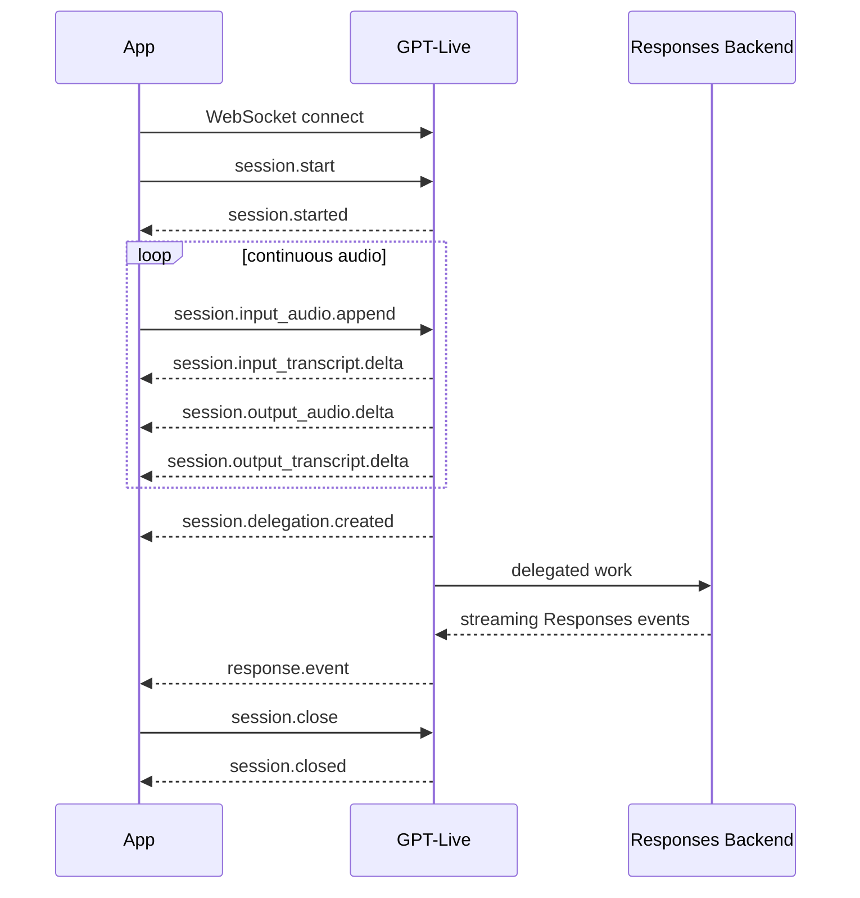

# OpenAI GPT-Live API 接口调研与能力分析

> 调研日期：2026-09-17  
> 调研对象：OpenAI GPT-Live（`gpt-live-1` / Live API）  
> 文档范围：仅分析 API 本身的接口形态、输入、输出、事件、功能、限制与接入方式；不关联任何具体项目架构。  
> 资料原则：以 OpenAI 官方文档与官方 API Reference 为主。

---

## 0. 结论摘要

GPT-Live 不是传统的“HTTP 请求 → 一次性文本响应”接口，而是一套面向**实时全双工语音会话**的长期连接 API。

它的核心模型 `gpt-live-1` 可以：

- 持续接收用户音频；
- 在用户仍然说话时同时生成并播放助手音频；
- 持续输出用户与助手的增量 transcript；
- 处理自然打断；
- 接收文本历史、运行时指令和应用上下文；
- 将复杂推理、Web Search、函数调用等任务委托给后端 agent；
- 通过 WebRTC、WebSocket、SIP 接入；
- 通过 sideband WebSocket 让可信服务端旁路观察和控制同一个会话；
- 可选保存录音、下载录音、从已有会话 fork 新会话。

截至 2026-09-17，GPT-Live 与 OpenAI 的 **Realtime API 是两套不同的 API 契约**：

- GPT-Live 使用 `gpt-live-1` 与 `/v1/live/sessions`；
- Realtime API 使用 `gpt-realtime-*` 等模型与 `/v1/realtime`、`/v1/realtime/calls` 等接口；
- 两者在认证方式、事件模型、VAD/turn detection、工具模型和计费方式上都不能直接互换。

因此，理解 GPT-Live 最合适的抽象是：

```text
持续媒体流
  +
Live 会话状态
  +
JSON 控制/事件流
  +
可选后端 Delegation
```

而不是：

```text
prompt -> completion
```

---

# 1. GPT-Live 的定位

官方将 `gpt-live-1` 定义为一个 **full-duplex voice model**。

所谓 full-duplex，指：

- 用户可以继续说；
- 模型可以同时说；
- 输入与输出时间轴可以重叠；
- 模型可以处理插话和打断；
- 工具调用或后端任务可以在语音对话继续进行时并行执行。

官方模型页当前给出的基础能力：

| 能力 | 支持情况 |
|---|---|
| 文本输入 | 支持 |
| 文本输出 | 支持 |
| 音频输入 | 支持 |
| 音频输出 | 支持 |
| 图像输入 | **不支持** |
| 视频输入 | **不支持** |
| Streaming | 支持 |
| Function calling | 支持 |
| Structured Outputs | 不支持 |
| Fine-tuning | 不支持 |
| Predicted Outputs | 不支持 |

主模型名：

```text
gpt-live-1
```

Live API 主入口：

```text
/v1/live/sessions
```

需要注意：模型目录页面可能同时展示 OpenAI 的其他 endpoint 分类，但 GPT-Live 官方连接指南和 API Reference 中实际描述的 Live 会话协议，应以 `/v1/live/sessions` 及其子资源为准。

---

# 2. 整体接口形态

GPT-Live 当前有四种值得区分的接入形态：

| 接入方式 | 主要场景 | 音频通道 | JSON 事件通道 |
|---|---|---|---|
| WebSocket | 服务端、媒体服务器、音频桥接 | WebSocket Base64 音频事件 | 同一个 WebSocket |
| WebRTC | 浏览器 / 客户端实时语音 | WebRTC media track | WebRTC data channel |
| SIP | 电话系统 | SIP/SRTP 媒体 | Webhook + 可选 sideband |
| Sideband WebSocket | 服务端旁路控制 WebRTC/SIP 会话 | 不作为主音频输入通道 | 独立 WebSocket |

---

# 3. WebSocket 接口

## 3.1 连接地址

服务端连接：

```text
wss://api.openai.com/v1/live/sessions
```

认证：

```http
Authorization: Bearer $OPENAI_API_KEY
```

WebSocket 不需要在 URL query string 中传模型。

连接建立之后，客户端首先发送：

```json
{
  "type": "session.start",
  "event_id": "event_start",
  "session": {
    "model": "gpt-live-1"
  }
}
```

服务端返回：

```json
{
  "type": "session.started",
  "...": "..."
}
```

收到 `session.started` 后，才开始发送音频和其他命令。

---

# 4. WebRTC 接口

WebRTC 是官方建议的浏览器语音接入方式。

## 4.1 媒体与事件分离

在 WebRTC 模式下：

```text
麦克风音频       -> WebRTC media track
模型生成音频     <- WebRTC media track

JSON 控制事件    <-> WebRTC data channel
```

因此 WebRTC data channel 上**不应**发送：

```text
session.input_audio.append
```

也不应该期待在 data channel 上收到：

```text
session.output_audio.delta
```

这些音频都由 WebRTC media track 处理。

---

## 4.2 创建会话

浏览器生成 SDP Offer，然后把 Offer 发给自己的可信应用服务器。

应用服务器调用：

```http
POST /v1/live/sessions
Authorization: Bearer <PROJECT_API_KEY>
Content-Type: application/json
```

请求的核心结构：

```json
{
  "session": {
    "model": "gpt-live-1"
  },
  "transport": {
    "type": "webrtc",
    "sdp": "<browser SDP offer>"
  }
}
```

OpenAI 返回：

```json
{
  "session": {
    "id": "live_123"
  },
  "transport": {
    "type": "webrtc",
    "sdp": "<SDP answer>"
  }
}
```

浏览器再把 `transport.sdp` 设置为 remote description。

### 一个很重要的区别

WebRTC 的 HTTP 创建请求本身就已经启动 Live session。

因此：

```text
WebSocket: 需要发送 session.start
WebRTC:    不要再次发送 session.start
```

WebRTC data channel 上应等待：

```text
session.started
```

再发送后续应用命令。

---

# 5. 浏览器认证与 ephemeral token

GPT-Live 当前官方 WebRTC 指南采用：

```text
Browser
   |
   | SDP Offer
   v
Your trusted server
   |
   | project API key
   v
POST /v1/live/sessions
```

也就是说：

- OpenAI Project API Key 保留在服务端；
- 浏览器不直接获得长期 API Key；
- 服务端代替浏览器向 OpenAI 创建 GPT-Live WebRTC session。

这和 **Realtime API** 的 `POST /v1/realtime/client_secrets` ephemeral client secret 流程不是同一套接口。

因此不要把 Realtime API 的：

```text
/v1/realtime/client_secrets
```

直接当作 GPT-Live 的认证接口使用。

如果 OpenAI 后续修改 Live 的浏览器认证方式，应以最新 Live 文档为准。

---

# 6. Session 配置

典型 GPT-Live session 配置：

```json
{
  "model": "gpt-live-1",
  "instructions": "Be concise and helpful.",
  "audio": {
    "format": {
      "type": "audio/pcm",
      "rate": 24000
    },
    "output": {
      "voice": "marin"
    }
  },
  "delegation": {
    "type": "client"
  },
  "store": false
}
```

主要字段：

| 字段 | 含义 | 会话中是否可修改 |
|---|---|---|
| `model` | Live 模型 | 否 |
| `instructions` | 前台语音行为指令 | 不能直接替换，可 append |
| `input` | 启动前文本历史 | 否 |
| `audio.format` | WebSocket 输入/输出音频格式 | 否 |
| `audio.output.voice` | 语音 voice | 否 |
| `delegation` | 后端委托模式 | 模式不能切换 |
| `store` | 是否保存录音以支持下载/fork | 否 |
| `client` | WebRTC 前端 data channel 权限 | 启动配置 |

Startup `instructions` 当前最多可达到：

```text
16,384 tokens
```

---

# 7. 输入：GPT-Live 能接收什么

从 API 使用者视角，可以把 GPT-Live 的输入分成 5 类。

---

## 7.1 实时音频输入

这是 GPT-Live 最核心的输入。

### WebSocket

发送：

```json
{
  "type": "session.input_audio.append",
  "audio": "<base64 raw audio>"
}
```

其中 `audio` 是原始音频字节的 Base64。

### WebRTC / SIP

音频不走 JSON event，而是直接走媒体通道。

---

## 7.2 启动文本历史

会话创建时可以通过 `session.input` 注入已有对话历史。

例如：

```json
{
  "model": "gpt-live-1",
  "input": [
    {
      "type": "message",
      "role": "user",
      "content": [
        {
          "type": "input_text",
          "text": "I need help with my recent order."
        }
      ]
    },
    {
      "type": "message",
      "role": "assistant",
      "content": [
        {
          "type": "output_text",
          "text": "What is the order number?"
        }
      ]
    }
  ]
}
```

官方支持的 initial history role 包括：

```text
developer
user
assistant
```

这部分是**启动历史**，不是 Realtime API 那套通用 conversation item event 模型。

---

## 7.3 运行时 instructions

运行过程中可以追加系统级指令：

```json
{
  "type": "session.instructions.append",
  "event_id": "instruction_1",
  "delegation_id": null,
  "content": "Answer more briefly from now on."
}
```

适合：

- 改变当前对话策略；
- 要求立即问候；
- 要求说一段 disclosure；
- 在运行时纠正行为；
- 安全检查后改变后续行为。

注意：append 是追加上下文，不等价于修改 startup `instructions` 字段。

---

## 7.4 运行时 thinking/context

应用可以给 GPT-Live 提供“内部参考，但不要求立即说出来”的上下文：

```json
{
  "type": "session.thinking.append",
  "event_id": "context_1",
  "delegation_id": null,
  "content": "The account lookup is still running."
}
```

该内容：

- 进入 Live 模型上下文；
- 可以影响后续回答；
- 不表示必须立即朗读；
- **不是安全秘密存储区**。

官方明确提醒，不应把 credential、secret 或绝不能泄漏的文本放入这些 context event。

---

## 7.5 运行时 commentary

如果应用有一段希望模型“告诉用户”的信息：

```json
{
  "type": "session.commentary.append",
  "event_id": "result_1",
  "delegation_id": "item_123",
  "content": "Your appointment is confirmed for Thursday at 2 PM."
}
```

模型可以将其组织成自然语音说出。

需要注意：

```text
commentary != verbatim TTS
```

模型可能改写或 paraphrase。

如果业务要求一个句子必须逐字播放，应由应用自己播放验证过的录音或 TTS，而不能把 `commentary` 当作确定性播报 API。

---

## 7.6 三种运行时文本输入的区别

| 事件 | 用途 |
|---|---|
| `session.instructions.append` | 改变/约束模型行为 |
| `session.thinking.append` | 提供内部推理或进度上下文 |
| `session.commentary.append` | 提供应对用户说出的结果/信息 |

三类 append 当前每次 `content`：

```text
最多 500 tokens
```

---

# 8. 不支持的输入

`gpt-live-1` 当前不支持：

```text
Image input
Video input
```

因此，如果业务需要：

- 看图片；
- 看摄像头；
- 分析截图；
- 视频理解；

需要在其他模型/API 中完成，再把必要的文本结果传回 Live。

这点与某些 `gpt-realtime-*` 模型不同，不能把 Realtime 的 image-input 能力默认套用到 GPT-Live。

---

# 9. 音频格式

WebSocket 下 `session.audio.format` 同时决定输入和输出格式，并且会话开始后不能修改。

支持：

| 配置 | 实际格式 |
|---|---|
| `{"type":"audio/pcm","rate":24000}` | Mono PCM16 LE, 24 kHz，默认 |
| `{"type":"audio/pcm","rate":16000}` | Mono PCM16 LE, 16 kHz |
| `{"type":"audio/pcmu","rate":8000}` | G.711 μ-law, 8 kHz |
| `{"type":"audio/pcma","rate":8000}` | G.711 A-law, 8 kHz |

对于 PCM：

- signed 16-bit；
- little-endian；
- mono；
- raw bytes；
- **不能带 WAV header**；
- Base64 编码后放进 event；
- chunk 边界可以任意，只需要保持连续、有序；
- 16-bit PCM chunk 必须保持完整 sample，因此字节数需要为偶数。

WebRTC 和 SIP 不配置 `audio.format`，而是由媒体协商决定。

---

# 10. 输出：GPT-Live 会返回什么

核心输出同样可以分为几层。

---

## 10.1 实时生成音频

### WebSocket

服务端会发送：

```text
session.output_audio.delta
```

事件包含增量音频 chunk。

应用解 Base64 后，按照到达顺序连续播放。

### WebRTC

模型生成音频直接通过 remote media track 到浏览器。

### SIP

音频直接通过电话媒体通道。

---

# 11. 输入 Transcript

用户音频的增量转写：

```json
{
  "type": "session.input_transcript.delta",
  "event_id": "event_transcript_1",
  "delta": "What is",
  "start_ms": 1000,
  "end_ms": 1200
}
```

字段：

| 字段 | 含义 |
|---|---|
| `delta` | 增量文字 |
| `start_ms` | 该片段在 session timeline 的开始时间 |
| `end_ms` | 该片段在 session timeline 的结束时间 |

这些时间：

- 是 session timeline 上的时间；
- 不是 wall-clock；
- 不是 packet arrival time；
- 也不是严格 word alignment。

---

# 12. 输出 Transcript

助手生成语音的转写：

```text
session.output_transcript.delta
```

同样包含：

```text
delta
start_ms
end_ms
```

因此客户端可以同时得到：

```text
用户字幕
助手字幕
```

但需要注意一个非常重要的语义：

> Transcript delta 只是时间线片段，不是“一个完整 turn”。

官方明确说明：

- fragment 不表示完整用户发言；
- transcript event 没有 authoritative item ID 来表示传统 turn；
- 不存在可依赖的 transcript-done / turn-completed 事件；
- 用户和助手的 transcript 时间区间可以重叠；
- 缺少 transcript event 也不能直接推断为 silence。

因此上层如果要把 transcript UI 分组成“轮次”，那是应用层 heuristic，而不是 API 本身提供的语义。

---

# 13. GPT-Live 的全双工模型

传统语音 Agent 常见流程：

```text
用户说话
   ↓
VAD 判断说完
   ↓
STT
   ↓
LLM
   ↓
TTS
   ↓
助手说话
```

GPT-Live 更接近：

```text
用户音频 ─────────────────────────>
        └─ transcript delta ───────>

<────────────────────── 助手音频
<──────── assistant transcript delta

                ↓
          delegation / backend work
```

用户和助手的音频可以同时存在。

因此：

```text
“用户正在说”
“助手正在说”
“后端工具正在执行”
```

这三个状态可以同时成立。

---

# 14. VAD / Turn Detection

这是 GPT-Live 与 Realtime API 最容易混淆的地方之一。

当前 GPT-Live session schema 和 GPT-Live 官方指南中，**没有暴露 Realtime API 那套 `turn_detection` / `server_vad` / `semantic_vad` 会话配置项**。

GPT-Live 采用全双工连续时间线，并由模型处理自然打断和对话节奏。

因此在 GPT-Live 中，不应该按以下思路设计协议逻辑：

```text
speech_started
   ↓
speech_stopped
   ↓
response.create
```

这更接近 Realtime API 的 turn-based/VAD 模型。

如果应用本身需要：

- 音量门控；
- 静音检测；
- UI 上的说话状态；
- 自定义 turn segmentation；

可以在客户端或应用服务器自行实现，但这属于应用逻辑，不是 GPT-Live 当前公开的 `turn_detection` 参数。

---

# 15. Voice

设置：

```json
{
  "audio": {
    "output": {
      "voice": "marin"
    }
  }
}
```

当前默认 voice：

```text
marin
```

voice 必须在 session 启动时选择，启动后不能修改；要切换 voice，需要重新建立 session。

官方 Live guide 当前列出的新增 voice 包括：

| Voice | API name | 语言/区域风格 |
|---|---|---|
| Quartz | `quartz` | English / Australian / Feminine |
| Ripple | `ripple` | English / Australian / Masculine |
| Vesper | `vesper` | English / British / Masculine |
| Willow | `willow` | English / Irish / Feminine |
| Stone | `stone` | English / Irish / Masculine |
| Gleam | `gleam` | English / North American / Feminine |
| Meridian | `meridian` | English / North American / Masculine |
| Bossa | `bossa` | Portuguese / Brazilian / Feminine |
| Tempo | `tempo` | Portuguese / Brazilian / Masculine |
| Beacon | `beacon` | English / Filipino / Masculine |
| Delta | `delta` | English / Southern U.S. / Feminine |
| Cinder | `cinder` | English / Southern U.S. / Masculine |

API Reference 当前把 built-in voice 定义为一个共 22 个枚举值的集合，并且还支持经授权的 custom voice：

```json
{
  "id": "<custom voice id>"
}
```

官方同时提醒：“regional influence” 只是声音风格描述，不保证严格口音一致性。

---

# 16. Delegation：把复杂任务交给后端

GPT-Live 的一个核心设计是：

```text
Live voice model
    |
    | decides backend help is needed
    v
Delegation
    |
    +--> Responses backend
    |
    +--> Your own backend / agent
```

它不是要求 Live 模型本身承担所有复杂推理和工具执行。

有两种 delegation 模式：

```text
responses
client
```

---

# 17. Responses Delegation

配置：

```json
{
  "model": "gpt-live-1",
  "delegation": {
    "type": "responses",
    "responses": {
      "model": "gpt-5.6-terra",
      "instructions": "[backend prompt]"
    }
  }
}
```

这里有两个不同的模型：

```text
gpt-live-1
    = 前台实时语音模型

gpt-5.6-terra / 其他 Responses 模型
    = 后端复杂推理与工具模型
```

后端模型可以独立选择。

支持的 delegation backend 设置包括：

- `model`
- `instructions`
- `tools`
- `tool_choice`
- `parallel_tool_calls`
- `max_output_tokens`
- `service_tier`
- `reasoning`
- `text`

当前 Live Responses delegation 支持的 tool 类型包括：

```text
function
web_search
```

`tool_choice` 可控制：

```text
auto
required
none
指定函数
```

---

# 18. Tool Calling 事件流

当 Live 判断需要后端任务时，会出现：

```text
session.delegation.created
```

Responses backend 的 streaming event 会被包裹成：

```text
response.event
```

内部的 `event` 是普通 Responses API streaming event。

例如可以看到类似：

```text
response.output_item.done
```

如果输出 item 是 function call，应用读取：

```text
call_id
name
arguments
```

执行自己的函数之后，把结果返回 Live：

```json
{
  "type": "response.item.create",
  "event_id": "tool_result_1",
  "item": {
    "type": "function_call_output",
    "call_id": "call_123",
    "output": "{\"status\":\"confirmed\",\"order_id\":\"order_123\"}"
  }
}
```

然后显式继续 backend response：

```json
{
  "type": "response.create",
  "event_id": "continue_1"
}
```

特别注意：

```text
response.item.create
```

只添加工具结果，并**不会自动继续推理**。

必须再发：

```text
response.create
```

---

# 19. Client Delegation

另一种方式：

```json
{
  "model": "gpt-live-1",
  "delegation": {
    "type": "client"
  }
}
```

此时 GPT-Live 不负责调用 Responses backend。

当它判断需要外部帮助时，应用会收到：

```text
session.delegation.created
```

然后由应用自行：

1. 收集 transcript；
2. 维护上下文；
3. 调用任意 LLM / agent / service；
4. 调用任意私有工具；
5. 做 authorization / confirmation；
6. 把结果通过 `thinking` / `commentary` / `instructions` 等方式返回给 Live。

Client delegation 的一个重要特点：

> delegation event 本身主要是任务元数据，不应依赖它提供完整的自然语言任务文本。

应用需要结合：

```text
transcript
+
application state
```

自己构造后端任务。

---

# 20. Delegation 模式不可热切换

会话创建时选择：

```text
client
```

或者：

```text
responses
```

启动后不能从一个模式切换到另一个模式。

如果要换 delegation mode，需要：

```text
创建新的 Live session
```

`session.update` 主要用于更新**已经处于 Responses delegation 模式下**的后端设置。

---

# 21. `session.update` 能改什么

运行中允许：

```text
session.delegation.responses.*
```

例如：

- backend model；
- backend instructions；
- tools；
- tool_choice；
- parallel_tool_calls；
- reasoning；
- text；
- service_tier；
- max_output_tokens。

不允许通过 `session.update` 修改：

```text
model
instructions
input
audio
store
delegation mode
```

如果修改不可变字段，服务端可能返回：

```text
immutable_field_update
```

---

# 22. 核心 Client Events

API Reference 当前将 Live client event 定义为 11 个主要 variant。

最重要的一组：

| Client Event | 作用 |
|---|---|
| `session.start` | 启动主 WebSocket session |
| `session.update` | 更新允许变更的 delegation 设置 |
| `session.input_audio.append` | WebSocket 输入音频 |
| `session.input_audio.mute` | 静音输入 |
| `session.input_audio.unmute` | 恢复输入 |
| `session.instructions.append` | 追加系统级指令 |
| `session.thinking.append` | 追加静默上下文 |
| `session.commentary.append` | 追加应对用户表达的信息 |
| `response.item.create` | 给 Responses backend 添加 item / tool result |
| `response.create` | 创建或继续 delegated Responses 工作 |
| `session.close` | 请求关闭会话 |

WebRTC 不需要客户端发送 `session.start`，因为 HTTP 创建会话时已经启动。

---

# 23. 核心 Server Events

API Reference 当前将 Live server event 定义为 22 个 variant。工程上最重要的事件包括：

| Server Event | 作用 |
|---|---|
| `session.started` | 会话已启动 |
| `session.updated` | 更新已接受 |
| `session.input_audio.muted` | 输入 mute 已接受 |
| `session.input_audio.unmuted` | 输入 unmute 已接受 |
| `session.input_transcript.delta` | 用户音频 transcript |
| `session.output_audio.delta` | 助手生成音频 chunk |
| `session.output_transcript.delta` | 助手语音 transcript |
| `session.instructions.appended` | instructions 已注入 |
| `session.thinking.appended` | thinking context 已注入 |
| `session.commentary.appended` | commentary 已注入 |
| `session.delegation.created` | 创建后端 delegated task |
| `response.event` | Responses backend 的 nested streaming event |
| `session.usage.updated` | 当前累计 Live 音频用量 |
| `info` 类事件 | 会话信息 |
| `error` | 命令或会话错误 |
| `session.closed` | 最终关闭事件 |

一个值得注意的设计点：

```text
response lifecycle
```

不是直接铺平到 Live 顶层事件，而是包在：

```text
response.event
```

里面。

解析时应按 nested `event.type` 做 dispatch，并容忍未来新增的 Responses event 类型。

---

# 24. 典型 WebSocket 事件流



---

# 25. Transcript 不等于 Speech-to-Text API

GPT-Live 会输出输入/输出 transcript，但它的本质仍是实时语音对话模型。

如果业务只需要：

```text
实时语音 -> 文本
```

OpenAI 当前还有独立模型：

```text
gpt-live-transcribe
```

它是专门的低延迟 streaming speech-to-text 模型。

所以：

```text
GPT-Live transcript
```

和：

```text
GPT-Live-Transcribe API
```

是两个不同概念。

---

# 26. Sideband WebSocket

当浏览器通过 WebRTC 或电话通过 SIP 与 GPT-Live 保持主媒体连接时，可以再从可信服务端附加第二条控制连接。

地址：

```text
wss://api.openai.com/v1/live/sessions/{session_id}/attach
```

认证：

```http
Authorization: Bearer $OPENAI_API_KEY
```

Sideband 适合：

- 服务端读取 transcript；
- 执行私有 function；
- authorization；
- guardrail；
- 更新 delegation 配置；
- 给 Live 注入 context；
- 返回工具结果；
- 收集最终 usage。

此时：

```text
Primary connection = WebRTC / SIP
Sideband          = Server WebSocket
```

两个连接指向同一个 Live session。

Sideband attach 后，会话已经启动，因此：

```text
不要再次发送 session.start
```

---

# 27. Sideband 的音频反射

Sideband 还可以收到媒体的副本，用于服务器观察。

官方当前描述：

```text
input reflected audio:
raw mono PCM16LE 24 kHz

output reflected audio:
raw mono PCM16LE 24 kHz
```

与主 WebRTC/SIP 媒体格式无关。

Sideband 收到的：

```text
session.input_audio.append
session.output_audio.delta
```

是服务器反射事件，不表示可以通过 sideband 把 sideband 当主媒体输入通道。

主麦克风音频仍然必须走 primary transport。

---

# 28. WebRTC data channel 权限

Live API 的 `client` 配置允许限制不可信 WebRTC frontend 能发送/接收哪些 event。

核心配置概念：

```text
client.data_channel.allowed_client_events
client.data_channel.allowed_server_events
```

它可以用于减少浏览器获得的控制面权限。

Sideband 是可信服务端通道，不受这些 frontend data-channel 限制影响。

因此 GPT-Live 本身提供了一定程度的：

```text
前端媒体
+
有限控制权限
+
后端可信控制
```

分离机制。

---

# 29. SIP / 电话接口

GPT-Live 可以接收 SIP 电话。

高层流程：

```text
PSTN / SIP Provider
       |
       v
OpenAI SIP ingress
       |
       | webhook
       v
Your server
       |
       | accept / reject
       v
GPT-Live Session
```

需要监听 webhook：

```text
live.transport.incoming
```

payload 会包含：

```text
data.type = "sip"
data.session_id
```

SIP header 应视为**不可信 caller metadata**，不能把它当成授权凭据。

---

# 30. SIP Session 控制接口

API Reference 当前提供：

```http
POST /v1/live/sessions/{session_id}/accept
POST /v1/live/sessions/{session_id}/reject
POST /v1/live/sessions/{session_id}/hangup
POST /v1/live/sessions/{session_id}/refer
```

分别用于：

```text
accept   接听
reject   拒绝
hangup   挂断
refer    SIP transfer
```

当前官方 Live SIP 流程主要描述**入站电话**。

通过：

```http
POST /v1/live/sessions
```

直接创建 outbound SIP call 当前不支持；出站电话需要使用相应 telephony/partner integration。

---

# 31. 存储会话

默认：

```json
{
  "store": false
}
```

如果：

```json
{
  "store": true
}
```

并且项目的数据策略允许持久化，则完成后的 Live session 可以用于：

- 下载录音；
- fork。

存储录音当前保留：

```text
30 days
```

在 Zero Data Retention 模式下：

```text
store 被视为 false
```

因此 recording download / fork 不可用。

---

# 32. 下载录音

接口：

```http
GET /v1/live/sessions/{session_id}/content
```

返回：

```text
binary stereo WAV
```

声道含义：

```text
Left  = input audio
Right = output audio
```

---

# 33. Fork Session

Live 支持从已存储的会话状态创建一个新 session。

### WebSocket

```text
wss://api.openai.com/v1/live/sessions/{source_session_id}/fork
```

### WebRTC

```http
POST /v1/live/sessions/{source_session_id}/fork
```

新的 fork：

- 有新的 session ID；
- 继承原会话模型；
- 继承 voice；
- 继承 instructions；
- 继承 prior conversation；
- 可以更新部分 delegation 设置；
- WebSocket fork 需要重新确定 audio format；
- WebRTC fork 再次进行 SDP media negotiation。

Fork 是：

```text
new session from stored state
```

不是重新打开原来的 socket。

---

# 34. 长对话与 Context Window

GPT-Live 当前默认 context window：

```text
128,000 tokens
```

这里包含：

- startup instructions；
- conversation text；
- 一些没有直接出现在 transcript 里的 audio token。

GPT-Live 会自动管理长会话 context，不需要开发者配置 compaction。

当 context 使用超过约：

```text
90%
```

官方当前描述会在同一个 session 内启动 replacement voice engine，并向新 engine 提供：

- 原始 instructions；
- 最近对话；
- 可用时的旧历史 summary；
- 最多约 8,192 tokens 的 conversation history。

因此：

> Live session 的上下文不是一个永远逐字完整增长的 transcript buffer。

较早细节可能被总结或省略。

真正关键的业务事实和任务状态不应只依赖模型长期记忆。

---

# 35. Usage

GPT-Live 会产生：

```text
session.usage.updated
```

例如：

```json
{
  "type": "session.usage.updated",
  "usage": {
    "seconds": 12
  },
  "context_window": {
    "usage_ratio": 0.42
  }
}
```

这里的 `usage.seconds` 是：

```text
累计值
```

不是每次 event 的增量，因此不能把每条 usage event 相加。

Responses delegation 后端模型的 token usage：

```text
单独计费
```

并通过 nested Responses events 获取，不包含在 Live audio seconds 里。

---

# 36. 计费

截至 2026-09-17，`gpt-live-1` 官方模型页给出的价格：

```text
$0.05 / minute
```

并且：

```text
按秒计费
```

不会把 session duration 强制向上取整到整分钟。

额外费用：

```text
Responses backend model
hosted tools
custom tool related external cost
```

需要分别计算。

因此整体成本模型是：

```text
Live voice duration
+
delegated model usage
+
delegated tool usage
```

WebRTC 创建会话时官方说明会在初始化阶段计入 15 秒 voice duration，但这部分会抵扣后续运行时长，并不是额外再加 15 秒收费。

---

# 37. Rate Limits

`gpt-live-1` 当前 rate limit 不是按 TPM/RPM 为主，而是按：

```text
Concurrent Sessions
```

官方模型页当前给出：

| Usage tier | Concurrent sessions |
|---|---:|
| Free | 不支持 |
| Tier 1 | 25 |
| Tier 2 | 50 |
| Tier 3 | 200 |
| Tier 4 | 300 |
| Tier 5 | 500 |

实际账号限额仍应以项目控制台和最新官方文档为准。

---

# 38. Graceful Close

推荐关闭流程：

1. 完成需要等待的 delegated work；
2. 先注册 `session.closed` listener；
3. 发送：

```json
{
  "type": "session.close"
}
```

4. 继续保持 transport 存活；
5. 等待：

```text
session.closed
```

6. 读取最终 usage / reason；
7. 再释放 socket、peer connection、microphone 等资源。

重要：

```text
socket close
```

本身并不能证明 session 已经正常 finalize。

只有：

```text
session.closed
```

才是最终确认事件。

---

# 39. Session 结束原因

当前文档列出的 `session.closed.reason` 包括：

| reason | 含义 |
|---|---|
| `close_requested` | 应用主动关闭或 hangup |
| `expired` | 到达 session duration limit |
| `content` | safety filter 结束会话 |
| `remote_hangup` | 远端正常挂断 |
| `connection_lost` | 主连接或上游意外中断 |

API Reference 中 `SessionResource` 有 `expires_at` 字段。

本次查阅的公开 Live guide 没有给出一个可以安全写死在客户端的固定最大 session 时长数值，因此应用应以服务端返回的 `expires_at` / `session.closed` 为准，而不是自行硬编码一个假定时长。

---

# 40. Error

典型错误：

```json
{
  "type": "error",
  "event_id": "event_error",
  "error": {
    "type": "invalid_request_error",
    "code": "immutable_field_update",
    "message": "The delegation type cannot change after session startup.",
    "param": "session.delegation.type",
    "client_event_id": "event_update"
  }
}
```

错误对象可能包含：

```text
type
code
message
param
client_event_id
```

其中 `client_event_id` 可用于对应客户端之前发出的命令。

但：

- `code` 可能为 null；
- 错误也可能没有 `client_event_id`；
- 不能因为没收到立即错误就默认操作成功。

---

# 41. Moderation / Safety

GPT-Live 自带 moderation 可能：

1. 直接结束 session；
2. 截断当前助手语音，并产生 error，但 session 仍继续。

因此：

```text
audio suddenly stops
```

不一定等于：

```text
connection failure
```

应用应同时观察：

```text
error
session lifecycle
audio playback state
```

另外，应用自己的 authorization / confirmation / guardrail 与 OpenAI 内建 moderation 是不同层。

---

# 42. Mute 的真实语义

客户端可以：

```text
session.input_audio.mute
session.input_audio.unmute
```

但 mute 只意味着：

```text
停止把输入音频送给模型
```

它不会自动：

- 停止模型 inference；
- 取消 delegated work；
- 停止助手生成语音；
- 清空客户端已经排队的音频。

所以：

```text
mic mute
```

和：

```text
assistant output mute
```

是两个不同控制面。

---

# 43. 延迟特性

GPT-Live 的低延迟来自多个方面：

- 音频 streaming；
- transcript delta streaming；
- full-duplex；
- 边听边说；
- 打断不需要传统整轮 pipeline；
- delegation 可以与前台对话并行；
- WebRTC 直接承担实时媒体。

但当前官方 Live 文档没有提供一个适用于所有连接/地区/网络的固定“端到端 X ms SLA”。

延迟实际由多层组成：

```text
网络
+
媒体 transport
+
Live inference
+
音频 playback buffer
+
delegated backend model
+
tool latency
```

因此不能只用一个模型延迟数字描述完整体验。

---

# 44. GPT-Live 和传统 TTS/STT 的区别

GPT-Live 不是简单组合：

```text
STT API + LLM API + TTS API
```

因为它拥有统一的语音时间线和 full-duplex 行为。

但同时：

- transcript 不是严格 turn；
- commentary 不是 verbatim TTS；
- 工具调用仍需 delegation；
- 复杂可靠业务动作仍由应用负责；
- 精确录音播放仍应由应用自己控制。

---

# 45. GPT-Live vs Realtime API

这是当前最值得明确的一张表。

| 维度 | GPT-Live | Realtime API |
|---|---|---|
| 代表模型 | `gpt-live-1` | `gpt-realtime-*` |
| 核心接口 | `/v1/live/sessions` | `/v1/realtime`, `/v1/realtime/calls` |
| 会话风格 | Full-duplex continuous voice | Realtime conversation / response event model |
| 用户与助手可同时说 | 核心设计 | 视模型/配置处理 |
| 显式 VAD / `turn_detection` | 当前 Live schema 不暴露 Realtime 那套配置 | 支持 `server_vad` 等 turn detection 配置 |
| 浏览器 WebRTC | Server 使用 project key 创建 Live session | 支持 Realtime calls / client secrets 流程 |
| 音频输入输出 | 支持 | 支持 |
| GPT-Live 图像输入 | 不支持 | 部分 Realtime 模型支持 image input |
| 工具机制 | Delegation 到 Responses 或 client backend | Realtime tool / response event 体系 |
| Live 计费 | 按 voice session duration | Realtime 模型通常按 token / audio token |
| transcript 语义 | 时间线 delta，无 authoritative turn done | 有不同的 conversation/response 事件语义 |
| Sideband | `/live/sessions/{id}/attach` | Realtime 也有自己的 sideband 机制 |

结论：

> 不能把 `/v1/realtime` 的 event schema、VAD 参数、ephemeral key 流程直接复制到 `/v1/live/sessions`。

---

# 46. 一个“输入 / 输出 / 功能”总表

## 输入

| 输入类型 | GPT-Live 是否支持 | 形式 |
|---|---|---|
| 实时麦克风音频 | 是 | WebRTC / WS / SIP |
| PCM16 | 是 | 24k / 16k |
| G.711 μ-law | 是 | 8k |
| G.711 A-law | 是 | 8k |
| Startup text history | 是 | `session.input` |
| Runtime instructions | 是 | `session.instructions.append` |
| Runtime silent context | 是 | `session.thinking.append` |
| Runtime speakable result | 是 | `session.commentary.append` |
| Function result | 是 | `response.item.create` |
| Image | **否** | - |
| Video | **否** | - |

## 输出

| 输出类型 | GPT-Live 是否支持 | 形式 |
|---|---|---|
| 实时语音 | 是 | WebRTC / WS / SIP |
| 用户 transcript | 是 | `session.input_transcript.delta` |
| 助手 transcript | 是 | `session.output_transcript.delta` |
| Delegation event | 是 | `session.delegation.created` |
| Backend streaming event | 是 | `response.event` |
| Usage | 是 | `session.usage.updated` / `session.closed` |
| Error | 是 | `error` |
| Final session snapshot | 是 | `session.closed` |
| Structured JSON output guarantee | **否** | 不支持 Structured Outputs |

## 功能

| 功能 | 支持情况 |
|---|---|
| Full-duplex 对话 | 是 |
| 自然打断 | 是 |
| Streaming | 是 |
| Function calling | 是，通过 delegation |
| Web Search | 是，可通过 Responses delegation |
| 自定义 backend agent | 是，client delegation |
| 动态追加上下文 | 是 |
| 动态修改 backend tools/model | 是，Responses delegation 内 |
| 动态切换 Live voice | 否 |
| 动态切换 delegation mode | 否 |
| 保存录音 | 可选 |
| 下载录音 | 是，需 store |
| Fork session | 是，需 store |
| Browser WebRTC | 是 |
| Server WebSocket | 是 |
| SIP inbound | 是 |
| Live API outbound SIP | 当前不支持 |
| Sideband server control | 是 |
| Realtime-style VAD 参数 | 当前 Live API 未暴露 |
| 图像理解 | 否 |
| 视频理解 | 否 |
| Fine-tuning | 否 |
| Structured Outputs | 否 |

---

# 47. 最小 WebSocket 示例

下面只展示协议结构，省略完整音频设备处理。

```javascript
import OpenAI from "openai";
import { LiveWS } from "openai/resources/live/ws";

const ws = new LiveWS(new OpenAI());

ws.socket.on("open", () => {
  ws.send({
    type: "session.start",
    event_id: "start_1",
    session: {
      model: "gpt-live-1",
      instructions: "Be concise.",
      audio: {
        format: {
          type: "audio/pcm",
          rate: 24000
        },
        output: {
          voice: "marin"
        }
      },
      delegation: {
        type: "client"
      }
    }
  });
});

ws.socket.on("message", (raw) => {
  const event = JSON.parse(raw.toString());

  switch (event.type) {
    case "session.started":
      console.log("ready:", event.session.id);
      break;

    case "session.input_transcript.delta":
      process.stdout.write(`USER: ${event.delta}`);
      break;

    case "session.output_transcript.delta":
      process.stdout.write(`ASSISTANT: ${event.delta}`);
      break;

    case "session.output_audio.delta":
      // Base64 decode and send to audio playback device
      break;

    case "session.delegation.created":
      console.log("delegated work:", event.delegation);
      break;

    case "response.event":
      console.log("backend event:", event.event);
      break;

    case "error":
      console.error(event.error);
      break;

    case "session.closed":
      console.log("final usage:", event.usage);
      break;
  }
});
```

发送音频：

```javascript
ws.send({
  type: "session.input_audio.append",
  audio: pcmBytes.toString("base64")
});
```

关闭：

```javascript
ws.send({
  type: "session.close"
});
```

然后继续读取，直到：

```text
session.closed
```

---

# 48. 最小 WebRTC 服务端请求结构

```javascript
const response = await fetch(
  "https://api.openai.com/v1/live/sessions",
  {
    method: "POST",
    headers: {
      "Authorization": `Bearer ${process.env.OPENAI_API_KEY}`,
      "Content-Type": "application/json"
    },
    body: JSON.stringify({
      session: {
        model: "gpt-live-1",
        instructions: "Be concise.",
        audio: {
          output: {
            voice: "marin"
          }
        },
        delegation: {
          type: "client"
        }
      },
      transport: {
        type: "webrtc",
        sdp: browserOfferSdp
      }
    })
  }
);

const result = await response.json();
```

返回：

```json
{
  "session": {
    "id": "live_123"
  },
  "transport": {
    "type": "webrtc",
    "sdp": "<SDP answer>"
  }
}
```

WebRTC 中不要设置 `audio.format`，因为格式由 SDP negotiation 决定。

---


# 49. 语音交互输入输出补充梳理

这一节专门从实时语音交互的角度，补充回答四个最常见的接口问题：**输入输出、打断与完整度判断、自定义提示词、Backend Agent 结果回传播放，以及历史会话插入。**

## 49.1 正常输入输出、打断与“完整度判断”

正常语音交互中，GPT-Live 同时存在音频流和文本 transcript：

```text
用户实时音频
   ├─> GPT-Live
   └─> session.input_transcript.delta

GPT-Live 生成回答
   ├─> 实时输出音频
   └─> session.output_transcript.delta
```

因此客户端通常可以同时获得：

- 用户实时音频；
- 用户增量转写；
- 助手实时音频；
- 助手增量转写。

### 打断

GPT-Live 是 full-duplex 语音模型，支持自然打断。用户可以在助手仍在说话时继续讲话，输入和输出时间线可以重叠。

因此：

```text
用户打断助手说话：支持
边听边说：支持
用户与助手同时存在音频：支持
```

### “一句话是否完整”的判断

GPT-Live 当前**没有提供一个权威的“这一轮用户已经完整说完”事件**。

也就是说，不应假设存在以下强语义：

```text
speech_started
speech_stopped
turn_complete
transcript_done
```

`session.input_transcript.delta` 和 `session.output_transcript.delta` 都只是 session timeline 上的增量文本片段，并不代表完整 turn，也没有一个可依赖的 transcript-done 事件来表示“这一句话已经完整结束”。

因此如果上层业务需要“完整度判断”，建议由应用层组合判断：

```text
音频静音时长
+
transcript 增量是否持续变化
+
语义完整性判断
```

例如可以自行定义：连续静音达到某个阈值，同时最近 transcript 在短时间内不再增长，再结合句法/语义是否完整，作为业务层的“用户本轮输入完成”判断。

需要特别区分：GPT-Live 当前公开的 session schema **没有暴露 Realtime API 那套显式 `turn_detection` / `server_vad` / `semantic_vad` 配置**。如果业务强依赖 VAD、说话状态或 turn segmentation，需要在客户端或应用服务器自己补充。

---

## 49.2 是否支持自定义提示词

支持。

GPT-Live 至少有两层可以独立配置的提示词。

### 第一层：Live 前台语音 Prompt

创建 session 时通过 `instructions` 定义 GPT-Live 自己的角色、语气、回答风格和行为约束：

```json
{
  "session": {
    "model": "gpt-live-1",
    "instructions": "你是一个语音助手，回答尽量简洁自然。"
  }
}
```

运行过程中还可以继续追加新的行为指令：

```json
{
  "type": "session.instructions.append",
  "event_id": "instruction_1",
  "delegation_id": null,
  "content": "后续回答尽量控制在两句话以内。"
}
```

这部分主要负责：

```text
角色
语气
表达风格
如何与用户说话
运行时行为约束
```

### 第二层：Backend Agent / Responses Prompt

如果采用 Responses delegation，后端模型也可以有独立 `instructions`：

```json
{
  "model": "gpt-live-1",
  "delegation": {
    "type": "responses",
    "responses": {
      "model": "<backend model>",
      "instructions": "你负责复杂推理、工具调用和业务任务执行。"
    }
  }
}
```

因此可以理解为：

```text
Live Prompt
负责“怎么和用户说”

Backend Agent Prompt
负责“怎么完成复杂任务”
```

两层 Prompt 可以分别设计。

---

## 49.3 Backend Agent 的文本如何回给 GPT-Live 并播放

如果使用 Client Delegation，典型流程如下：

```text
用户语音
   ↓
GPT-Live
   ↓
session.delegation.created
   ↓
Backend Agent
   ↓
返回文本结果
   ↓
session.commentary.append
   ↓
GPT-Live 自然组织语言
   ↓
生成实时语音
   ↓
播放给用户
```

假设 Backend Agent 返回：

```text
明天下午有两个会议：14:00 产品评审，16:30 项目周会。
```

应用可以发送：

```json
{
  "type": "session.commentary.append",
  "event_id": "result_1",
  "delegation_id": "item_123",
  "content": "明天下午有两个会议：14点产品评审，16点30项目周会。"
}
```

`session.commentary.append` 的语义是：

> 给 GPT-Live 一段“可以向用户表达”的信息，由 Live 模型决定如何自然地说出来。

因此它不是一个简单的“文本直接送 TTS”接口，而更接近：

```text
Backend 提供事实/结果
        ↓
GPT-Live 负责怎么自然地表达
        ↓
GPT-Live 生成语音
```

### `commentary`、`thinking`、`instructions` 的区别

| 事件 | 适合放什么 |
|---|---|
| `session.commentary.append` | 需要最终告诉用户的结果 |
| `session.thinking.append` | 只让 Live 知道的内部状态/上下文 |
| `session.instructions.append` | 改变 Live 后续行为或表达规则 |

例如：

```text
Backend 查到最终预约结果
→ commentary.append

Backend 仍在查询，只想让 Live 知道“任务还没结束”
→ thinking.append

希望 Live 后续回答更短
→ instructions.append
```

### Commentary 不是严格逐字 TTS

`session.commentary.append` 并不保证 GPT-Live 完全逐字朗读 `content`。模型可能为了自然表达而改写或 paraphrase。

所以如果内容要求**一个字都不能改**，例如：

- 法律声明；
- 验证码；
- 固定免责声明；
- 精确金额/编号播报；

则不应把 commentary 当成严格 verbatim TTS。此时应由应用自己播放经过验证的录音或使用确定性的 TTS 输出。

---

## 49.4 是否支持历史会话插入

支持。

在创建 Live session 时，可以通过 `session.input` 直接插入已有的文本对话历史。

例如：

```json
{
  "model": "gpt-live-1",
  "input": [
    {
      "type": "message",
      "role": "user",
      "content": [
        {
          "type": "input_text",
          "text": "我之前说想订一张上海到北京的票。"
        }
      ]
    },
    {
      "type": "message",
      "role": "assistant",
      "content": [
        {
          "type": "output_text",
          "text": "好的，你希望哪一天出发？"
        }
      ]
    },
    {
      "type": "message",
      "role": "user",
      "content": [
        {
          "type": "input_text",
          "text": "周五。"
        }
      ]
    }
  ]
}
```

然后用户可以直接继续语音交互：

```text
历史文字会话
   ↓
session.input
   ↓
创建 GPT-Live session
   ↓
用户继续语音讲话
   ↓
GPT-Live 基于旧历史继续对话
```

Initial history 支持的 role 包括：

```text
developer
user
assistant
```

此外，如果之前本身就是一个开启了 `store: true` 的 GPT-Live session，还可以使用 **fork** 创建新的 Live session，并继承已有会话状态。

Fork 可以继承的核心内容包括：

- 原有 model；
- voice；
- frontend instructions；
- prior conversation。

因此历史延续有两种主要方式：

```text
普通历史文本
→ session.input

已保存的 GPT-Live 会话
→ fork session
```

---

## 49.5 四个问题的快速结论

| 问题 | 结论 |
|---|---|
| 正常语音交互是否同时有音频和文本 | 是，音频流 + 双向 transcript delta |
| 是否支持用户打断 | 是，GPT-Live 原生 full-duplex |
| 是否有明确的“这句话完整了”事件 | 没有，需要应用层自行判断 |
| 是否支持自定义 Prompt | 是，Live `instructions` + 运行时 `instructions.append` |
| Backend Agent 是否可以单独配置 Prompt | 是，Responses delegation 有独立 `instructions` |
| Backend Agent 文本如何交给 Live 播放 | `session.commentary.append` |
| Backend 内部上下文如何给 Live | `session.thinking.append` |
| Commentary 是否保证逐字播放 | 不保证 |
| 是否支持历史会话插入 | 是，使用 `session.input` |
| 是否支持延续已保存 Live 会话 | 是，可 fork stored session |

从接口设计角度，最值得注意的是：

> GPT-Live 的优势是持续全双工和自然打断，但它没有提供一个强制的“用户这一轮已经完整结束”的权威事件。需要严格 turn boundary 的业务，应在应用层自行定义完整度判断逻辑。

---

# 50. API 的设计哲学总结

如果只从接口设计角度看，GPT-Live 可以分成四层。

```text
┌────────────────────────────────────┐
│  1. Media Plane                    │
│  WebRTC / WebSocket Audio / SIP    │
├────────────────────────────────────┤
│  2. Conversation Plane             │
│  transcript / instructions /       │
│  thinking / commentary             │
├────────────────────────────────────┤
│  3. Delegation Plane               │
│  Responses backend / client agent  │
│  function / web search             │
├────────────────────────────────────┤
│  4. Session Control Plane          │
│  start / update / mute / close /   │
│  store / fork / attach / SIP ops   │
└────────────────────────────────────┘
```

它并不是让一个单独的模型 endpoint 承担所有事情，而是：

> 用 `gpt-live-1` 处理实时语音互动，把复杂、慢、需要工具或需要可靠业务状态的工作委托给后端。

---

# 51. 最终判断

如果问题只是：

> “GPT-Live API 到底提供哪些输入、输出和功能？”

可以压缩成下面一句话：

**GPT-Live API 提供了一条支持文本上下文和实时音频双向流的全双工语音会话接口；它持续产生音频、双向 transcript、会话状态和 delegation 事件，并允许把推理、搜索和函数调用交给 Responses backend 或应用自己的 agent，同时提供 WebRTC、WebSocket、SIP、sideband、存储、录音、fork、会话控制和 usage/error 生命周期能力。**

它当前明确不提供的核心能力包括：

- GPT-Live 本身的 image input；
- video input；
- Structured Outputs；
- fine-tuning；
- Realtime API 风格的显式 VAD/turn-detection session 参数；
- 运行中切换 voice；
- 运行中切换 delegation mode；
- 把 `commentary` 当作严格逐字 TTS；
- 把 transcript delta 当作严格的“对话轮次”。

---

# 52. 官方资料索引

以下资料均为 OpenAI 官方文档，调研时间为 2026-09-17。

1. GPT-Live 1 Model  
   https://developers.openai.com/api/docs/models/gpt-live-1

2. Getting started with GPT-Live  
   https://developers.openai.com/api/docs/guides/live

3. Managing GPT-Live sessions  
   https://developers.openai.com/api/docs/guides/live-conversations

4. Delegation and tools in GPT-Live  
   https://developers.openai.com/api/docs/guides/live-delegation

5. Live API Reference  
   https://developers.openai.com/api/reference/typescript/resources/live

6. WebSockets — GPT-Live  
   https://developers.openai.com/api/docs/guides/voice-websockets?api=live

7. WebRTC — GPT-Live  
   https://developers.openai.com/api/docs/guides/voice-webrtc?api=live

8. Telephony and SIP — GPT-Live  
   https://developers.openai.com/api/docs/guides/voice-sip?api=live

9. Server-side controls — GPT-Live  
   https://developers.openai.com/api/docs/guides/voice-server-controls?api=live

10. Realtime Client Secrets API Reference（用于区分 Realtime 与 Live 的认证流程）  
    https://developers.openai.com/api/reference/cli/resources/realtime/subresources/client_secrets

11. OpenAI Model Catalog  
    https://developers.openai.com/api/docs/models

12. GPT-Live-Transcribe Model  
    https://developers.openai.com/api/docs/models/gpt-live-transcribe

---

## 文档版本说明

本文基于 2026-09-17 可访问的 OpenAI 官方文档整理。

GPT-Live 属于持续演进的实时 API，以下内容尤其可能变化：

- event schema；
- voice 列表；
- rate limits；
- session duration limit；
- delegation backend 能力；
- 浏览器认证方式；
- pricing；
- 新模型 alias。

生产使用前，应再次以最新 OpenAI API Reference 为准。
