# Latency — budget and optimization plan

End-of-speech to first audio byte, as the live path in
`demos/voice_web_server.py` behaves: Silero VAD, direct Doubao `bigmodel`
bidirectional streaming ASR, DeepSeek V4 Flash, and direct Doubao V3
bidirectional TTS. The deterministic defaults in `demos/basic_ws_server.py`
remain text-only.

Companion documents: [ASSESSMENT.md](ASSESSMENT.md),
[INTERACTION-CASES.md](INTERACTION-CASES.md).

The ASR endpoint decision and reproducible direct-network benchmark are recorded
in [ADR-0058](adr/0058-doubao-bigmodel-asr-default-and-latency-baseline.md).

---

## The budget

```mermaid
gantt
    title Turn latency — user stops speaking (t=0) to first audio byte
    dateFormat SSS
    axisFormat %L ms

    section Input endpoint
    Mic worklet buffering (0-32ms, avg 16)       :a1, 000, 16ms
    VAD / ASR endpoint dual latch (256ms config)  :crit, a2, after a1, 256ms

    section Concurrent decision and generation
    Semantic completeness (bounded, activity-cancellable) :b1, after a2, 180ms
    Speculative grounding + main LLM first useful segment :crit, b2, after a2, 500ms

    section TTS
    Reused WebSocket, new synthesis Session        :c1, after b2, 30ms
    Vendor first-chunk synthesis                   :crit, c2, after c1, 400ms

    section Playback
    Client decode + schedule                       :d1, after c2, 20ms
```

| Hop | Streams or blocks | Typical | Where |
|---|---|---|---|
| Mic capture → local framing | **Blocks** in 32ms chunks | 0–32ms (avg 16) | `public/voice-input-worklet.js` + `src/voice/audio/browser-input.ts` — exact 512-sample v2 epoch frames |
| Frame → WS send | per-chunk base64 + `JSON.stringify` | low ms | `src/lib/audio.ts:5-12` |
| Server frame parse | `json.loads` + pydantic validate, 31.25×/sec/session | low ms | `server/transport/frame_parsing.py:23-43` |
| VAD | blocks | ~0 (RMS) / ~5ms (Silero, **and it blocks the shared event loop**) | `server/signals/energy_vad.py:104-113`, `server/signals/plugins/silero_vad.py:34-42` |
| **End-of-turn endpoint window** | provider final plus acoustic guard | **256ms acoustic floor** | Eight exact 32ms Silero windows match the configured threshold without rounding |
| Semantic EOT gate | LLM-only classification runs concurrently with frame intake, stop detection, and speculative response generation | classifier bounded to 5000ms; cancelled immediately by VAD speech or ASR revision | `server/turn_policy/semantic_endpoint.py`; [SEMANTIC-EOT.md](SEMANTIC-EOT.md) |
| Semantic interruption | exact stop rules run on playback-time ASR partials; ambiguous text uses one latest-wins LLM task | no longer waits for VAD silence; 5 appended chars / 100ms idle, model bounded to 800ms | `server/turn_policy/semantic_interruption.py`; [SEMANTIC-INTERRUPTION.md](SEMANTIC-INTERRUPTION.md) |
| Realtime grounding | The same speculative producer plans respond/clock/lookup; clock is local, live lookup is optional | planner 1.5s, search 3s, total 5s hard bounds; actual p50/p95 not yet measured | `server/brain/realtime_grounding.py`; [REALTIME-GROUNDING.md](REALTIME-GROUNDING.md) |
| ASR | one lazy WebSocket per logical Voice Session; local 32ms frames are aggregated into configurable 100–200ms provider frames | ~0 extra after provider final | `server/speech/plugins/doubao_asr.py`; `server/kernel/conversation_kernel.py` |
| **LLM** | wire-level SSE deltas are streamed; the main reply starts speculatively at provider sentence-end | first useful segment, not the full reply | `server/brain/plugins/openai_compatible_llm_client.py`; `server/conversation_engine/speculative_brain.py` |
| **TTS** | raw LLM SSE deltas stream into one V3 synthesis Session while audio deltas stream out | removes per-segment session setup and fixed 12/24-character batching | `server/conversation_engine/pipeline.py`; `server/speech/plugins/doubao_tts_direct.py` |
| Playback | streams, gapless on the Web Audio timeline | ~20ms | `src/voice/audio/browser-output.ts` owns scheduling, cancellation and playback truth |

The old 1.5–4.5s serial floor no longer describes the default Chat Brain path:
semantic confirmation overlaps with one speculative read-only grounding plus
main-LLM producer, and TTS starts at the first non-empty text delta. A realtime
lookup can still dominate an individual turn up to its bounded deadline.
The tool-calling branch remains non-speculative because external side effects
require an explicit commit boundary. Enabling tools no longer disables safe
ordinary-chat prefetch for every turn.

### Audio packet sizing

The browser-to-server WebSocket uses 32ms (512-sample) packets. Each JSON frame
is about 1.43KB and the stream sends 31.25 frames/s, or roughly 43.7KB/s after
base64 and JSON framing. The old 100ms framing used roughly 42.3KB/s, so the
latency improvement costs about 3.3% more bandwidth plus additional JSON parses.

The Doubao adapter independently aggregates those local frames into exact 100ms
PCM payloads. A small live comparison kept recognition correct with both sizes;
100ms provider packets finalized in 98–133ms in two samples, while 128ms packets
finalized in 167–200ms. This benchmark is too small for an SLA, but it supports
keeping the provider recommendation at 100ms instead of aligning it to four
local Silero windows.

### Endpoint-window and semantic-cost comparison

A direct-network comparison used one continuous synthesized utterance and
inserted silence at the same low-energy word boundary. Each cell is the number
of semantic endpoint candidates the ASR SentenceEnd events can create; one is
the necessary final candidate, while two includes one premature candidate:

| Doubao end window | 80ms pause | 120ms pause | 160ms pause | 220ms pause |
|---:|---:|---:|---:|---:|
| 96ms | 2 | 2 | 2 | 2 |
| 128ms | 1 | 2 | 2 | 2 |
| **150ms** | **1** | **1** | 2 | 2 |

All twelve cases preserved the full transcript. A separate three-sample tail
run was dominated by provider jitter: medians were 364ms / 466ms / 365ms for
96/128/150ms, with 1.6–2.0s outliers. The data does not support paying the
extra-candidate cost for the theoretical 22–54ms threshold advantage, so 150ms
is the latency/cost default.

Using the production semantic prompt against DeepSeek V4 Flash, a completed
classification consumed 164–169 tokens: 147–153 prompt tokens and 16–17 output
tokens, with 128 prompt-cache-hit tokens. The production streaming classifier
took a median 966ms for the complete transcript and 1682ms for the incomplete
prefix across three samples each. Mid-utterance candidates are normally
cancelled on the next ASR revision, so 164 tokens is an upper bound for each
extra semantic call; a candidate also starts a speculative main response, whose
partial cost is additional.

The deployed Doubao endpoint and external Silero thresholds are both 256ms.
The earlier 96/128/150ms table remains the controlled benchmark, while the
aligned 256ms operational default was selected after an 8-turn trace produced
24 candidates and 15 invalidations at 150ms. The external Silero threshold is
not normally the critical path. ASR
SentenceEnd starts semantic classification first, and the acoustic latch only
needs to complete before the roughly 1s classifier. Eight exact inference
windows reduce false acoustic stops compared with 192ms while preserving a
short fallback when provider finalization is delayed or unavailable.

---

## What changed and what remains

### 1. LLM deltas now reach TTS incrementally

The default Chat Brain preserves the provider's SSE deltas through a streaming
adapter. The Pipeline forwards each non-empty delta into one duplex TTS Session
while provider audio returns concurrently. At provider sentence-end, a speculative stream starts in
parallel with semantic completeness; a stable commit reuses that exact producer
and its buffered prefix instead of issuing a duplicate request.

### 2. ASR is long-lived and TTS reuses its connection

ASR owns one lazy provider WebSocket per logical Voice Session and uses it across
utterances while microphone audio continues. TTS owns one Voice-Session-scoped
V3 WebSocket and opens one serial synthesis Session for each assistant response.
A stale reused TTS socket reconnects once before text input begins;
once audio starts it is never retried, preventing duplicated speech.

### 3. `urllib.request` cannot pool connections

`openai_compatible_llm_client.py:70`,
`openai_compatible_tool_calling_llm_client.py:124`, `byte_web_search.py:76`, and
`bella_speaker_embedder.py:80` all use `urllib.request.urlopen`, which opens a
fresh `http.client` connection per call with no keep-alive reuse. Every turn pays
a new TCP + TLS handshake to the LLM backend; tool-calling pays it twice. They
are correctly wrapped in `asyncio.to_thread` so the loop is not blocked, but that
also means they contend for the default thread pool under concurrency.

### 4. Semantic completeness is bounded and raced against live activity

The DeepSeek semantic classifier gets a 5000ms bounded decision window. More
importantly, it no longer blocks frame intake: SentenceEnd starts semantic and
main-response precomputation, while VAD/ASR-idle independently supplies the
stop latch. New VAD speech or an ASR revision invalidates the candidate
immediately. `INCOMPLETE` uses a positive model `wait_ms` within a 300–5000ms
stability range and falls back to the ceiling only when no hint is supplied;
`UNCERTAIN` uses the model's `wait_ms` or a 300ms default. Neither path
repeatedly polls the model. The production prompt explicitly treats terse but
self-contained turns such as “你好”“换一个” as complete rather than equating
brevity with incompleteness.

An August 14 live regression against the configured DeepSeek endpoint changed
“你好。” from `incomplete` to `complete`; representative complete decisions took
0.64–0.75s. With ordinary-chat speculation enabled alongside the tool runtime,
one measured turn finished semantic confirmation in 756ms and exposed the
already-buffered first reply delta 0ms after commit, instead of starting a new
roughly 0.8–0.9s model request at that point.

### 5. Date/search work starts in the existing speculative producer

Credentialed ChatBrain turns first run a strict respond/clock/lookup planner.
The same task then performs local clock calculation or an optional bounded
Byte search and starts the main SSE reply. SentenceEnd activity invalidation
cancels that whole chain; stable semantic acceptance follows its buffered/live
output rather than issuing a duplicate planner, lookup, or main-model request.
No-key deployments never run a fake network search. Search HTTP connection
pooling and an explicit slow-lookup acknowledgment remain open latency work.
An initial 2026-08-10 `complete()` smoke run observed 14.1s (cold outlier),
1.11s, and 1.23s. After moving the Planner to cancellable SSE, a final
Coordinator smoke run observed correct routes at 0.60s, 0.90s, and 0.89s.
Neither three-call run is a percentile benchmark; together they validate the
1.5s bound and the need for future HTTP pooling.

### 6. Semantic interruption now runs before overlap silence

Playback-time ASR revisions are no longer discarded in `SPEAK/DUAL`. Exact stop
phrases take the local rule path and immediately advance Generation; ambiguous
partials use a single revision-bound model task. This removes the previous
mandatory wait for the overlap episode to end. The end-to-end barge-in p95 still
depends on Doubao's first recognized-text update and browser audio-buffer drain,
so the `<200ms` target remains an instrumentation target, not a measured claim.

---

## Optimizations, ranked

| # | Change | Status | Expected effect | Files |
|---|---|---|---|---|
| 1 | Stream raw LLM deltas into one duplex TTS Session | **Implemented** | Removes full-response generation and fixed text batching from first-audio path | `server/brain/plugins/openai_compatible_llm_client.py`, `server/conversation_engine/pipeline.py` |
| 2 | Reuse the direct TTS WebSocket with one synthesis Session per response | **Implemented** | Avoids WebSocket/TLS and per-segment Session setup | `server/speech/plugins/doubao_tts_direct.py` |
| 3 | Pool HTTP connections for LLM, search, and speaker embedding | Pending | 50–300ms/call in handshake-sensitive environments | the remaining `urlopen` call sites |
| 4 | Bound semantic completeness and race it against live activity | **Implemented** | Bounds model tail and prevents the decision from blocking audio intake | `server/turn_policy/semantic_endpoint.py` |
| 5 | Use a 300ms VAD endpoint plus an independent 1000ms ASR-idle recovery latch | **Implemented** | Keeps the normal stop path short without losing provider-final events when PCM stops | `server/speech/plugins/doubao_asr.py`, `server/turn_policy/semantic_endpoint.py`, `server/kernel/conversation_kernel.py` |
| 6 | Move Silero inference off the shared event loop | Pending | Improves tail latency under concurrency | `server/signals/plugins/silero_vad.py` |
| 7 | Pre-warm provider connections at `session_hello` | Deferred | Helps first turn, but ASR providers may close an audio-idle socket | `demos/voice_web_server.py` |
| 8 | Use binary WebSocket frames for audio instead of base64 JSON | Pending | Saves ~33% wire overhead and encode/decode CPU | `server/transport/frames.py`, `src/lib/audio.ts` |
| 9 | Run independent pre-Brain context calls concurrently | Pending | Prevents future voiceprint/vision serialization | `server/kernel/conversation_kernel.py` |
| 10 | Vectorize RMS measurement | Pending | Low single-digit milliseconds at high concurrency | `server/signals/energy_vad.py` |
| 11 | Speculatively resolve frozen date/search grounding with typed timeouts | **Implemented** | Overlaps read-only current-fact preparation with semantic endpoint waiting and prevents unbounded/guessed realtime answers | `server/brain/realtime_grounding.py`, `server/web_search/protocol.py` |
| 12 | Classify playback-time ASR revisions with exact rules and one latest-wins task | **Implemented** | Removes the VAD-silence wait for obvious stops and prevents stale/duplicate interruption tasks | `server/turn_policy/semantic_interruption.py`, `server/kernel/conversation_kernel.py` |

The largest structural wins (#1, #2, #4, #5, and #12) are now in the live path.
Connection pooling, event-loop isolation for Silero, and binary audio transport
remain the next infrastructure-level latency work.

---

## Observability gaps

`server/observability/tracing.py`'s `StageTracer` does capture real per-stage
timings — `asr.start_session`, `turn_policy.evaluate`,
`turn_policy.eot_classify`, `voiceprint.match`, `brain.decide`,
`response.deliver`, `delegation.await` — each logging `duration_ms` and status.

Two structural limits:

1. **It deliberately does not aggregate.** Its docstring is explicit: no p50/p95,
   per-call log lines meant for post-hoc grep. There is no SLO anywhere.
2. **The three largest costs are not spanned at all.** The mic buffer wait, the
   VAD silence window, and the TTS connection setup are all outside every
   existing span. Even with full log aggregation, the dominant contributors are
   invisible.

And `tests/bench/` is behavioural, not timing: no `perf_counter`, no duration
assertions. The only latency-adjacent constant in a live test is
`REPLY_TIMEOUT_S = 30.0` (`tests/live/test_bella_voice_pipeline_live.py:54`) —
a 30-second bound is a clear signal that no round-trip target is enforced.

### What to add

**Spans**, to close the blind spots:

| Span | From | To |
|---|---|---|
| `asr.connect` | provider WebSocket connection attempt | WebSocket ready |
| `asr.first_increment` | first audio packet sent | first non-empty ASR text update |
| `asr.first_increment_e2e` | provider WebSocket connection attempt | first non-empty ASR text update |
| `asr.sentence_final` | actual input audio end | provider `definite` event |
| `turn.end_to_end` | last loud mic chunk received | first `AssistantAudioChunkFrame` sent |
| `vad.silence_window` | first quiet chunk after speech | `USER_EOT_CONFIRMED` |
| `tts.connect` | `synthesize_stream` entry | first chunk yielded |
| `llm.first_token` | request sent | first non-empty `delta.content` |
| `barge_in.yield` | `OVERLAP_DETECTED` | `AssistantSpeechCancelledFrame` sent |

`asr.first_increment` is not an internal ASR token timestamp: Doubao exposes
recognized-text updates, and one update can contain multiple characters. Keep it
separate from `llm.first_token`.

**Targets**, as SLOs to enforce once measurable:

| Metric | Target | Rationale |
|---|---|---|
| End-of-speech → first audio byte, p50 | < 800ms | The survey's §4.3 L0 ceiling is ~500ms; 800ms is an honest L0 target with real vendors |
| Same, p95 | < 1500ms | |
| Barge-in → assistant audio stops, p95 | **< 200ms** | The survey's acid-test requirement for cell 3. Rules no longer wait for overlap end, but the full ASR-to-browser distribution is not yet measured |
| EOT decision, p99 | < 300ms | Semantic work is bounded; instrument the observed distribution before enforcing this target |

The barge-in row is the one to watch: the semantic rule path is now early and
generation-safe, but the provider-first-text and client-buffer legs still need
measurement. See [INTERACTION-CASES.md](INTERACTION-CASES.md) cell 3.
