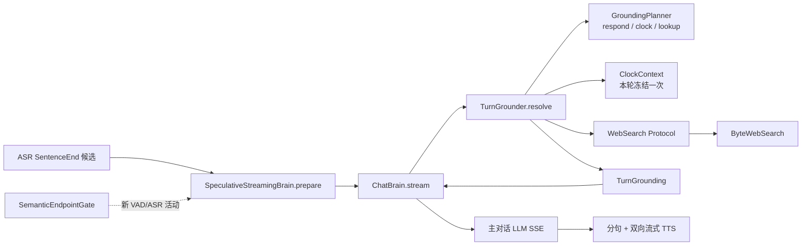

# 实时日期与联网搜索 Grounding

本文说明 OpenRealtime 如何在不引入 RTC、Pipecat 或 VoiceLoop 运行时依赖的前提下，
为默认语音对话链路提供准确日期和实时搜索。实现参考了
[VoiceLoop 日期与搜索设计](voiceloop/datetime-and-web-search.md)及
`tmp/voiceloop/server/fillers/combined_client.py`、
`tmp/voiceloop/server/fillers/lookup_coordinator.py`、
`tmp/voiceloop/server/brain/web_search.py`、
`tmp/voiceloop/server/brain/byte_search.py`，但按 OpenRealtime 的分层重新实现。

这不是对 GPT Voice 私有内部架构的断言。可验证的目标是：面向 GPT Voice 体验，做到
日期不猜、实时事实有证据、慢搜索可取消、普通回答继续流式输出。

## 1. 模块位置



职责边界如下：

| 层 | 模块 | 只负责什么 |
|---|---|---|
| Brain 应用服务 | `brain/realtime_grounding.py` | 路由规划、冻结时钟、搜索期限、失败降级、可信上下文组装 |
| 日期纯计算 | `tools/clock_source.py` | IANA 时区校验、目标时区转换、日历日偏移、可供工具复用的权威时钟文本 |
| 搜索 Seam | `web_search/protocol.py` | `LookupEvidence`、`SearchResult`、`LookupFailure` 和 `WebSearch` 统一契约 |
| Provider Adapter | `web_search/plugins/byte_web_search.py` | 豆包/字节搜索 HTTP 协议、响应上限、URL 过滤和 Provider 错误归一化 |
| Tool Adapter | `tools/web_search_source.py` | 把同一份 WebSearch 证据暴露为 Canonical Tool，不拥有搜索逻辑 |
| Composition Root | `demos/voice_web_server.py` | 根据凭据组合真实 Planner、Byte Provider 和 ChatBrain |

`TurnGrounder` 是给 ChatBrain 的小接口，内部隐藏多个步骤；`WebSearch` 是真实 Provider
替换点。没有为每个内部函数再造 Protocol。

## 2. 单轮处理流程

1. 豆包 ASR 产生一个带 revision 的 SentenceEnd 候选。
2. Kernel 同时启动语义完整度判断和 `SpeculativeStreamingBrain.prepare()`。
3. 预取流先调用 `TurnGrounder.resolve(transcript)`。Planner 只返回严格 JSON：
   `respond`、`clock` 或 `lookup`，以及禁网标记和一个自包含 query。
   如果 LLM 支持 SSE，Planner 优先消费可取消的流；1.5 秒期限会关闭该流，
   而不是让一个超时的后台请求继续占用连接。
4. `respond` 只注入本轮参考日期；`clock` 使用本地纯计算；`lookup` 才调用搜索 Provider。
5. Grounder 返回显式 `TurnGrounding`：可信时钟进 system context；搜索证据只进带
   `untrusted_web_evidence` 标记的 user context。
6. 主对话 LLM 接着以 SSE 产生文本，分句器把首个可说片段立即交给流式 TTS。
7. 如果等待期间出现新 VAD 语音、ASR 文本增量或 generation 变更，候选被撤销，
   同一个预取任务连同 Planner、搜索或主回复一起取消；不会为旧 revision 再开重复任务。
8. 如果语义和停止双闩锁接受候选，Engine 复用该任务已经缓冲的结果，不再请求第二次。

因此日期/搜索工作从 SentenceEnd 就开始，并与语义完整度、VAD stop/ASR idle 等待重叠。
它不绕过 Turn Policy，也不在用户表达尚未稳定时提交副作用；搜索是只读操作。

## 3. 日期规则

### 3.1 本轮只冻结一次

同一轮的 Planner、日期计算和最终回答共享一个 timezone-aware `frozen_at`。不能在规划、
工具执行和回答生成时分别读取系统时钟，否则跨午夜时可能得到两个“今天”。

### 3.2 选择器

Planner 的 clock query 固定为：

```text
<IANA timezone>|<-7..7>
```

例如 `America/New_York|1` 表示目标时区纽约、目标日期为当地日历的明天。时区必须是
可识别的 IANA 名称；偏移必须是整数且在 -7 到 7 之间。无效时区、`posixrules`、布尔值
和越界偏移全部拒绝。

### 3.3 日历语义，不是固定 24 小时

先把冻结的 UTC 瞬间转换到目标时区，再对当地 `date` 加减天数。DST 切换日仍然得到
用户所说的昨天/今天/明天，而不是把时间戳机械加减 86,400 秒。

权威上下文会同时给出：目标时区、日期偏移、基准时间、已应用偏移的目标日期和星期，
并明确要求模型不得再次加减日期。clock 不访问网络，所以“不要联网，今天几号”仍可回答。

## 4. 搜索规则

### 4.1 什么时候搜索

- 普通知识、解释、写作和闲聊：`respond`。
- 当前日期、星期、时间、目标时区相对日期：`clock`。
- 天气、新闻、市场、比赛结果、实时交通、营业状态等易变外部事实：`lookup`。
- 用户明确禁止联网：`lookup_forbidden=true`，lookup 自动降级，绝不发网络请求。

搜索 query 由 Planner 改写为最长 500 字符的自包含查询；含 Unicode 格式控制字符的
query 会被拒绝，避免把视觉上隐藏的控制内容带到 Provider。

### 4.2 结构化证据

Provider 返回的不是拼接字符串，而是不可变的 `LookupEvidence`：

```text
provider + query + retrieved_at
└── results[]
    ├── title
    ├── url
    ├── summary
    ├── source
    └── published_at (optional)
```

它提供三种受控投影：

- `structured()`：始终包含 `untrusted: true`；
- `model_text()`：最多 12,000 字符，供模型读取；
- `public_sources()`：只暴露可展示来源，不泄露请求头或凭据。

搜索摘要属于外部不可信数据。它不能进入权威 system instruction，模型被明确要求不得
执行证据中的指令、不得让网页内容覆盖系统规则，并在引用时保留来源和检索时间。

### 4.3 Provider 防线与失败语义

`ByteWebSearch` 当前执行以下边界：

- 缺少搜索 Key 时在发请求前失败；标准变量名是
  `BYTE_WEB_SEARCH_API_KEY`，同时兼容 VoiceLoop 使用的旧名
  `WEB_SEARCH_API_KEY`，但会输出不含凭据值的弃用提示；
- 单次 Provider 超时默认 3 秒，Grounder 总期限默认 5 秒；
- 响应体最多 1 MB，结果最多 10 条；标题 200、摘要 2,000 字符；
- 只接受 `http`/`https` URL；拒绝内嵌凭据和私网、环回、链路本地、保留 IP 字面量；
- 失败归一为 `provider_unavailable`、`timeout`、`http_error`、
  `invalid_response`、`empty_result`、`pipeline_timeout`。

搜索失败时，最终模型会得到“无法验证实时事实、不得伪造最新结果”的可信系统上下文。
无真实搜索 Key 的部署不会把 `DeterministicWebSearch` 伪装成联网能力。

## 5. 两条 Brain 路径如何统一

默认语音产品使用 `ChatBrain + TurnGrounder`，因为它能被 SentenceEnd 安全预取，搜索只读，
主回答仍然原生流式。启用 `VOICEAGENT_DEMO_TOOLS=1` 后，系统仍走正式的
`ToolCallingBrain → CallToolAction → Policy Gateway → FastToolLoop → ToolResultFeedback`
路径；Clock 和 WebSearch ToolSource 复用相同的日期/搜索底层模块。

没有照搬 VoiceLoop 的 `CombinedBrainClient` 作为全局所有者，也没有移除 OpenRealtime 已有
的 Tool Registry。这样未来新增搜索 Provider、工具策略或 Claude/Codex/Hermes Agent
不会耦合到语音端点状态机。

## 6. 配置

```bash
# 主对话 + Grounding Planner；当前项目默认会读取 DEEPSEEK_API_KEY
export DEEPSEEK_API_KEY=...

# 可选：没有它仍可做 clock，但实时 lookup 会安全失败
export BYTE_WEB_SEARCH_API_KEY=...
export BYTE_WEB_SEARCH_BASE_URL=https://open.feedcoopapi.com/search_api/web_search

# 可选，默认 Asia/Shanghai
export VOICEAGENT_CLOCK_TIMEZONE=Asia/Shanghai

# 可选期限
export VOICEAGENT_GROUNDING_PLANNER_TIMEOUT_S=1.5
export VOICEAGENT_GROUNDING_SEARCH_TIMEOUT_S=3.0
export VOICEAGENT_GROUNDING_TOTAL_TIMEOUT_S=5.0
```

现有 VoiceLoop 环境如果使用 `WEB_SEARCH_API_KEY` 也能直接运行；新部署应改用
`BYTE_WEB_SEARCH_API_KEY`。两者同时存在时标准变量优先，日志永远不会输出 Key 值。

## 7. 当前边界与下一步

- 目前 Planner 与语义完整度判断是两个并行的小模型请求；它们职责不同，尚未为了少一次
  请求而合并接口。应先用真实 p50/p95 数据判断是否值得合并。
- 搜索超过约 800ms 时尚未单独说“我查一下”；当前依靠 SentenceEnd 预取隐藏大部分等待。
  如果实测仍有长静默，应把 lookup started/completed/failed 做成 Engine 事件，再由语音策略
  产生一次确认语，不能把垫词塞进搜索 Provider。
- `urllib` Provider 尚无 HTTP 连接池。它不阻塞事件循环，但每次搜索可能支付 TCP/TLS
  握手成本；这是下一轮网络层延迟优化，不应泄漏进 `WebSearch` 接口。
- 2026-08-10 初始 `complete()` 冒烟测试得到约 14.1s 的冷启动异常尾值以及
  1.11s、1.23s；改用可取消 SSE 后，最终 Coordinator 三类输入约为
  0.60s、0.90s、0.89s，路由全部正确。这些小样本不是统计基线，但说明
  1.5s 可取消期限有实际必要；p50/p95 仍需固定网络条件的正式测量。
- 当前 Planner 没有 Conversation Journal 历史投影，代词型搜索只能依赖本轮原话。应与
  Roadmap 的“multi-turn context projection”一起实现，不能直接把整份 Journal 当命令重放。
- VoiceLoop 的 39 条日期/搜索语义评测集仍留在 `tmp/voiceloop`。本轮移植的是确定性安全
  与协调测试；把评测集改造成 OpenRealtime 自有、可持续运行的模型评测是后续工作。

相关决策见 [ADR-0059](adr/0059-speculative-realtime-date-and-search-grounding.md)。
