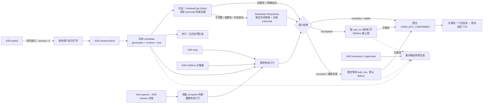

# 语义完整度与停说判定

本文描述 OpenRealtime 当前生效的用户轮次结束（Semantic End of Turn，Semantic EoT）设计。实现参考
[`tmp/voiceloop/server/processors/semantic_eot.py`](../tmp/voiceloop/server/processors/semantic_eot.py)
和项目内整理过的
[`docs/voiceloop/sentence-end-semantic-eot.md`](voiceloop/sentence-end-semantic-eot.md)，
但没有引入 VoiceLoop 的 Pipecat 封装或任何 OpenAI 内部实现假设。FireRedChat turn-detector
已经作为可选的本地 `EotEvidenceProvider` 接入。默认只在“高置信本地结果 + 保守中文闭合模式”
同时成立时走快速 `COMPLETE`；其余结果统一交给带历史上下文的 LLM，避免本地模型误截断用户。

## 1. 结论

`sentence_end` 不是“用户轮次已经结束”，只是一个可以开始并行工作的候选边界。一个候选只有同时满足以下两个独立条件才能提交：

1. **语义闩门**：LLM 已判断当前文本为 `complete`，或者系统执行了有界的活性兜底；
2. **停说闩门**：Silero VAD 已确认停说，或稳定 ASR 文本超过 1000ms 没有增量而触发 `asr_idle`。

在任一闩门等待期间，ASR 文本增量或 Generation 被取代会使候选、语义请求和预生成回复失效。VAD
再次触发时，尚未完成的语义判断仍会取消；但若语义已为 `complete` 且 ASR revision 没有变化，则保留原判断，
重置停说闩门，并在新的短暂 ASR idle 后提交原 revision。



## 2. 为什么要使用双闩门

只用 VAD 会把“我想订一张……”这种思考停顿误判为结束；只用 `sentence_end` 会把 ASR 提供商的断句启发式误当成对话提交；只用 LLM 则无法知道用户是否已经恢复说话。

双闩门把三个信号的职责分开：

| 信号 | 能证明什么 | 不能证明什么 |
|---|---|---|
| ASR `sentence_end` | 当前文本适合开始语义判断和回复预生成 | 用户真的停止说话、语义一定完整 |
| LLM 语义判断 | 当前文本是否像完整意图 | 麦克风里是否有新语音 |
| VAD stop / ASR idle | 音频或文本活动已经稳定 | 当前句子的语义是否完整 |

因此，任何单个信号都不能直接提交轮次。

## 3. 状态与事件

候选的稳定身份是 `(generation, transcript_revision, text)`。其中：

- `generation` 防止旧用户轮次或旧 Agent/LLM 任务产生副作用；
- `transcript_revision` 防止语义判断完成后使用已经被 ASR 修订的文本；
- `text` 是回复预生成缓存的内容键，避免复用到不同文本。

核心状态如下：

| 状态 | 进入条件 | 离开条件 |
|---|---|---|
| `LISTENING` | 用户开始说话 | SentenceEnd 或 VAD stop 生成候选 |
| `CANDIDATE_PENDING` | 候选冻结；语义判断、回复预生成并行启动 | 两个闩门齐备、活动失效或超时策略执行 |
| `HOLD_INCOMPLETE` | 停说已确认，但语义为 `incomplete` | 新活动取消；优先采用正数 `wait_ms`，无提示时最多稳定 5000ms 后强制提交 |
| `HOLD_UNCERTAIN` | 语义为 `uncertain`，或分类器超时/失败 | 新活动取消；稳定 `wait_ms` 后提交 |
| `COMMITTED` | 候选稳定且满足提交策略 | Turn Policy 接收一次 `USER_EOT_CONFIRMED` |

### 活动失效规则

以下事件都比尚未提交的语义结果优先：

| 事件 | 失效原因 | 处理 |
|---|---|---|
| VAD 检测到新语音，语义仍在判断 | `vad_speech` | 取消分类、丢弃预生成，继续同一用户轮次 |
| VAD 检测到新语音，语义已 `complete`，ASR revision 未变 | `vad_speech` | 保留原语义结果和预生成；重置停说闩门，ASR idle 后恢复提交 |
| ASR 文本 revision 增加 | `asr_increment` | 取消旧候选；新的 SentenceEnd 可以创建新候选 |
| 新的文本输入 | `new_user_text` | 清除音频候选和 idle timer |
| Generation 被取代 | `stale_generation` | 所有旧输出通过 Generation Lease 变为不可见 |
| Hook 改写或否决文本 | `hook_transformed_text` / `hook_veto` | 不允许复用基于旧文本的预生成 |

## 4. 带历史上下文的语义接口

[`server/turn_policy/eot_classifier.py`](../server/turn_policy/eot_classifier.py) 定义统一结果：

```text
EotClassification(
    decision = COMPLETE | INCOMPLETE | UNCERTAIN,
    confidence = 0.0 .. 1.0,
    wait_ms = non-negative number,
    source = provider-neutral label,
    evidence = optional provider observations,
)
```

内部可替换 Seam 为 `EotEvidenceProvider.evaluate(EotRequest) -> EotEvidence`。LLM、FireRedChat
以及后续规则模型或远程判停服务都只实现这一方法；`HybridEotClassifier` 隐藏并发执行、失败降级和
仲裁策略，`SemanticEndpointGate` 与 Turn Manager 仍只依赖一个 `EotClassifier`。

主 conformer 是
[`LlmEotClassifier`](../server/turn_policy/plugins/llm_eot_classifier.py)。DeepSeek 默认使用无状态
`POST /responses`、`reasoning.effort=none` 和 `text.format=json_schema`；普通 Brain 回复仍保留
Chat Completions。判停要求严格 JSON：

```json
{"status":"complete","confidence":0.97,"wait_ms":0}
```

`ContextualEotClassifier` 扩展会收到有界的 `EotContext.history`。历史只来自已经提交且对模型可见的
`user.input` / `assistant.output`；Journal 恢复和实时追加都会先投影到 Turn Manager 的会话内缓存，EoT
关键路径不读取数据库。当前候选冻结时同时冻结历史快照，因此同一用户轮次的所有 ASR revision 都使用相同历史。

Responses 请求保持固定顺序：

```text
system prompt → committed history (oldest to newest) → current transcript
```

当前 transcript 始终是最后一条 user message，历史不会被序列化进这条不断变化的 JSON。对于 DeepSeek
这类自动前缀缓存服务，这能让同一轮次的多次判断复用从第 0 个 token 开始的相同前缀；本地缓存的是
历史 DTO，不是假装持有供应商进程内的 KV 张量。默认最多保留 8 条、4000 字；窗口移动时可能造成一次 cache miss，
但不会让历史无限增长。判停输出限制为最多 64 tokens。

线上路径不使用标点捷径。ASR 自动添加的句号不能绕过语义 Provider。旧
`EnsembleEotClassifier` 的标点短路已改为显式 opt-in；新组合统一通过
`HybridEotClassifier` 完成。

## 5. 超时与活性参数

| 参数 | 默认值 | 含义 |
|---|---:|---|
| `VOICEAGENT_VAD_SILENCE_MS` | 256ms | Silero VAD 停说窗口（8 个 32ms 推理窗） |
| `VOICEAGENT_VAD_ONSET_MS` | 96ms | 连续起声门槛（3 个 32ms 推理窗），过滤单窗概率尖峰 |
| `VOICEAGENT_VAD_THRESHOLD` | 0.6 | Silero 起声概率阈值；提高可降低误触发，但会降低轻声召回 |
| `VOICEAGENT_LATE_ASR_RECOVERY_MS` | 2000ms | 空 VAD 片段结束后允许迟到 ASR 恢复同一轮次的最大间隔；超过后显式清空当前 ASR 片段，避免跨轮污染 |
| `DOUBAO_ASR_END_WINDOW_MS` | 256ms | 豆包 ASR WebSocket 内部判停窗口；与外部 Silero 停说窗口对齐，减少自然停顿产生的候选抖动 |
| `DOUBAO_ASR_PACKET_MS` | 100ms | 本地 32ms 音频聚合后发给豆包的包时长（允许 100–200ms） |
| `DOUBAO_ASR_COMMIT_WAIT_MS` | 512ms | 提交轮次时最多等待豆包返回当前修订的 definite 结果（无论本地是否恰好剩余聚合音频）；收到 definite 会立即结束等待，避免标点或尾句被留到下一轮 |
| `VOICEAGENT_EOT_LLM_TIMEOUT_MS` | 5000ms | 单次远程语义判断硬上限；当前优先等待判定结果，降低分类超时率 |
| `VOICEAGENT_EOT_LLM_API_STYLE` | `responses` | DeepSeek 语义判停传输；可设 `chat_completions` 回滚，不影响普通 Brain |
| `VOICEAGENT_EOT_ASR_IDLE_MS` | 1000ms | ASR 无增量时合成停说闩门 |
| `VOICEAGENT_EOT_INCOMPLETE_TIMEOUT_MS` | 5000ms | `incomplete` 保守兜底和模型 `wait_ms` 的硬上限；正数提示还会使用 300ms 稳定下限 |
| `VOICEAGENT_EOT_UNCERTAIN_WAIT_MS` | 300ms | `uncertain` 无有效 `wait_ms` 时的默认稳定窗口 |
| `VOICEAGENT_EOT_HISTORY_MESSAGES` | 8 | 语义判停会话内保留的最近已提交用户/助手消息数 |
| `VOICEAGENT_EOT_HISTORY_CHARS` | 4000 | 语义判停历史文本总字符上限；不含当前 transcript |
| `VOICEAGENT_EOT_FIRERED_MODEL_DIR` | 未设置 | 设置后加载本地 ONNX 模型；未设置时完全不引入 FireRed 运行时 |
| `VOICEAGENT_EOT_FIRERED_STRATEGY` | `fast_complete_fallback` | FireRed 仅处理保守的高精度完成快路，其余交给 LLM；可显式回滚到 `primary_with_shadow` 或 `consensus` |
| `VOICEAGENT_EOT_FIRERED_FAST_COMPLETE_THRESHOLD` | `0.5` | 快速完成的最低本地概率；还必须通过闭合表达门槛，单独调高此值不能替代门槛 |

规则是“每个候选判断一次，然后等待事件”，不是每 300ms 重复询问 LLM：

- `COMPLETE`：等停说闩门；两者齐备后立即提交；
- `INCOMPLETE`：有正数 `wait_ms` 时采用 300–5000ms 内的续说窗口；没有提示时才使用完整 5000ms 兜底，既防止永远不回复，也避免短句误判固定多等 5 秒；
- `UNCERTAIN`：等模型给出的 `wait_ms`（模型提示会被夹在 100–400ms），没有提示时用 300ms；
- 超时、无效 JSON、网络错误：统一降级为 `UNCERTAIN`，再走 300ms 稳定窗口，绝不直接把错误解释成语义完整。

## 6. 回复预生成与防重复

SentenceEnd 冻结候选后，`SpeculativeStreamingBrain.prepare()` 与语义判断同时启动。预生成只允许普通、无副作用的 Chat Brain；即使 Voice Runtime 开启了工具能力，也只预取本地路由判定为普通聊天的分支：

- 相同 `(generation, text)` 只启动一个底层 LLM producer；
- 提交后 `PipelineConversationEngine` 消费同一个缓存/实时流，不再发第二次请求；
- 活动失效时取消 producer 并丢弃缓存；
- 工具意图不预生成 Tool Calling Brain，也不提前执行工具；工具规划、副作用和策略授权仍全部位于提交之后。

这也避免了重复 spawn 主回复任务。语义分类任务、ASR idle timer 和主回复 producer 都通过单候选引用、revision 和 Generation 约束生命周期。

## 7. 模块归属

| 模块 | 负责 | 不负责 |
|---|---|---|
| ASR Adapter | 长连接、增量文本、SentenceEnd 和 revision 归一化 | 语义判断、Turn Policy 提交 |
| VAD Adapter | 一次音频推理产生音量和声学信号 | 文本语义 |
| `LlmEotClassifier` | Prompt、严格 JSON 解析、统一分类结果 | 超时、VAD、候选生命周期 |
| `EotEvidenceProvider` | 输出带来源、置信度、概率和推理耗时的单一判停证据 | 最终仲裁、Turn Policy 提交 |
| `HybridEotClassifier` | 并发 Provider、失败降级、影子或一致性仲裁 | VAD、候选生命周期 |
| `FireRedChatEotProvider` | 本地 ONNX 推理、标点归一化、并发限制 | 历史语义、独立硬提交 |
| Turn Manager 历史缓存 | 接收 Journal 投影、去重、裁剪并冻结候选历史 | 持久化、供应商 KV 存储 |
| `SemanticEndpointGate` | 双闩门、分类超时、活动优先和取消 | ASR/TTS 厂商协议、回复交付 |
| Conversation Kernel | 把 VAD/ASR 事件接入 Gate，维护 revision/Generation | LLM Prompt、厂商 JSON |
| `SpeculativeStreamingBrain` | 单 producer、缓存 delta、提交复用/失效取消 | 工具副作用、轮次提交 |

候选生命周期复杂度集中在 `SemanticEndpointGate`，Provider 组合复杂度集中在
`HybridEotClassifier`。替换 DeepSeek、FireRedChat 或尝试其他方法时，只需实现
`EotEvidenceProvider`，不修改 VAD、ASR Adapter、Gate 或 Turn Policy FSM。

### FireRed turn-detector 当前策略

仅设置 `VOICEAGENT_EOT_FIRERED_MODEL_DIR` 时启用。模型和 tokenizer 在应用启动阶段加载一次，
跨会话共享；推理通过受限 `asyncio.to_thread` 执行，不阻塞实时事件循环。默认
`fast_complete_fallback`：先执行 FireRed；只有概率达到阈值，且文本以明确问句、确认或收束表达
结束时才直接返回 `COMPLETE`。FireRed 判为不完整、低置信度、开放表达或本地推理失败时，才调用
DeepSeek Responses。显式设置 `primary_with_shadow` 可恢复 LLM 主判 + FireRed 影子证据；设置
`consensus` 后二者冲突会降级为 `UNCERTAIN`。

安装与下载不进入普通依赖，也不在请求热路径自动联网：

```bash
uv sync --extra firered
uv run --extra firered hf download FireRedTeam/FireRedChat-turn-detector \
  chinese_best_model_q8.onnx tokenizer/config.json tokenizer/special_tokens_map.json \
  tokenizer/tokenizer.json tokenizer/tokenizer_config.json tokenizer/vocab.txt \
  --local-dir /absolute/path/to/FireRedChat-turn-detector
```

随后设置 `VOICEAGENT_EOT_FIRERED_MODEL_DIR`。模型文件由部署系统固定版本和校验摘要，运行时不下载。

项目自建的首版中文文本评测集位于
[`data/eot_eval/zh_semantic_completeness_v1.jsonl`](../data/eot_eval/zh_semantic_completeness_v1.jsonl)：
100 条、完整/不完整各 50 条，覆盖 10 类口语边界。它通过
[`scripts/evaluate_semantic_eot.py`](../scripts/evaluate_semantic_eot.py) 统一评测任何本地 FireRed 配置，
并分别报告误截断率、漏判率和推理延迟；标注口径和已知限制见
[`data/eot_eval/README.md`](../data/eot_eval/README.md)。

2026-08-14 本机基线：模型加载约 2.85s；100 条推理 p50 44.38ms、p95 45.05ms。官方 0.5
阈值下准确率 67%，误截断率 46%，完整句漏判率 20%；枚举/比较、长口语条件尤其容易被提前截断。
0.50–0.95 的离线阈值扫描没有同时得到可接受的误截断率和漏判率；甚至 0.9995 仍出现高置信误截断。
因此不能仅靠调阈值。保守闭合门槛在 v1 数据上快速接受 8/100，完整精确率 100%，其余 92 条进入
LLM 兜底。这个结果只是能力门槛，不是泛化保证；后续必须用匿名真实会话建立独立 v2 验证集，持续
监控快路误截断率并逐步扩展覆盖。

同日按真实运行时配置顺序执行 100 条 v1：最终准确率 100%、完整判定精确率 100%、误截断率 0%、
完整句漏判率 0%；快速完成 8 条，LLM 兜底 92 条，供应商错误 0 次；端到端分类 p50 927.79ms、
p95 1237.54ms。此前未加开放槽否决时，同一策略首轮为 93% 准确率和 8% 误截断，错误集中在
“还是”“改到周三的”“除了……那个”“坐高铁去”等明显悬空结构；这些结构现在只允许进入
`INCOMPLETE`。这是一次 v1 运行结果，不是“保证所有真实输入 100%”；上线门槛仍应要求独立集
完整判定精确率不低于 99%、误截断率不高于 1%，并单独报告供应商错误率。

建议通过门槛：

- 误截断率不能高于现有 LLM；短回答和中文口语单独统计；
- 本地推理 p95 不超过 100ms，且不阻塞音频线程；
- 影子模式先统计分歧；切到 `consensus` 后，冲突降级为 `UNCERTAIN`，不能让快速模型单独硬提交；
- LLM 网络失败或达到软预算时，FireRed 才作为活性兜底；现有 5s 仍是远程请求硬上限；
- 记录两侧结果、耗时、分歧率和最终是否误截断，再决定是否将插件加入默认 profile。

## 8. 可观测与验收

关键 Ledger/Trace 事件：

- `endpoint_candidate_started`
- `asr_idle_stop_confirmed`
- `eot_classifier_deferred`
- `eot_classifier_failed`
- `endpoint_candidate_invalidated`
- `turn_policy.eot_classify` span

最低验收集合：

1. SentenceEnd 到来而没有 VAD/idle stop 时，不能提交；
2. VAD stop 先到或后到都能与同一语义结果汇合；
3. 等待中出现 ASR increment，旧结果永远不能提交；
4. 语义已 `complete` 后出现 VAD speech，但 ASR 无增量，短暂 ASR idle 后提交原 revision，且不重复分类；
5. `incomplete` 只调用一次模型，活动恢复则取消；正数 `wait_ms` 被 5000ms 硬上限约束，无提示时使用完整兜底；
6. `uncertain` 尊重 `wait_ms`，错误使用默认短等待；
7. 同一候选只启动一个主回复 producer，提交后复用，失效后取消；
8. 所有提交仍经过 Turn Policy 和 Generation Lease。

对应自动化测试：

- `tests/turn_policy/test_semantic_endpoint_gate.py`
- `tests/kernel/test_semantic_endpoint_flow.py`
- `tests/test_eot_classifier.py`
- `tests/turn_policy/test_hybrid_eot_classifier.py`
- `tests/turn_policy/test_fast_complete_fallback_eot_classifier.py`
- `tests/turn_policy/test_fireredchat_eot_provider.py`
- `tests/turn_policy/test_semantic_eot_evaluation.py`
- `tests/live/test_fireredchat_eot_live.py`
- `tests/conversation_engine/test_speculative_streaming_brain.py`

## 9. 有意没有实现的 VoiceLoop 部分

- Pipecat Processor/Frame 运行时；
- ASR overall-finalization 的 VoiceLoop 专用帧协议；
- 对 GPT Voice 私有内部架构的任何断言。

这些内容不是完成本次 LLM-only 语义完整度链路的前置条件。语义打断现已作为独立的
`SemanticInterruptionClassifier` + `SemanticInterruptionGate` 接入，仍不混入本模块的用户轮次结束职责；
详见 [语义打断设计与实现](SEMANTIC-INTERRUPTION.md)。
