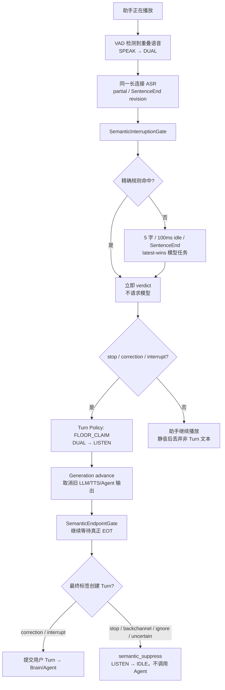

# 语义打断：播放期抢话与 Turn 准入

日期：2026-08-10
状态：已接入当前 OpenRealtime 主链路

本文描述 OpenRealtime 的语义打断实现。它参考
[`docs/voiceloop/semantic-interruption.md`](voiceloop/semantic-interruption.md)
及 `tmp/voiceloop` 中的实现与测试，将其中与 Pipecat 无关的领域逻辑迁移到当前分层架构；没有引入
Pipecat，也不假设或虚构 OpenAI / GPT Voice 的内部实现。

## 1. 职责边界

语义打断只回答：**助手正在播放时，用户这段话是否要求现在停播？**

它不回答“用户是否已经说完”。后者仍由
[`SemanticEndpointGate`](SEMANTIC-EOT.md) 独占：ASR SentenceEnd 只是候选，语义完整度、VAD/ASR
稳定停止和 revision 一起决定何时提交 EOT。

| 模块 | 唯一职责 | 不负责 |
|---|---|---|
| VAD | 是否存在语音、是否出现稳定停说 | 用户意图 |
| ASR | 长连接增量文本、revision、SentenceEnd | 是否停助手、是否提交 Turn |
| Semantic Interruption Gate | 播放期是否立即停播；EOT 后该段话是否创建 Turn | 用户何时说完 |
| Semantic Endpoint Gate | 用户表达何时可提交 | 是否停止正在播放的助手 |
| Turn Policy | 对状态和动作做唯一写入 | 厂商协议、Prompt |
| Generation Lease | 让旧 LLM/TTS/Agent 输出失效 | 语义分类 |

因此一段纠正可以在 partial 阶段立即停播，但必须等 EOT 正式提交后才进入 Brain/Agent；一个单纯的
“别说了”会停播，却不会生成新的 Agent 任务。

## 2. 当前模块位置

| 层 | 当前文件 | 作用 |
|---|---|---|
| Domain / Seam | `server/turn_policy/semantic_interruption.py` | 六标签领域类型、精确规则、revision 调度、latest-wins Gate |
| Model plugin | `server/turn_policy/plugins/llm_semantic_interruption_classifier.py` | 通过统一 `LlmClient` 调用 DeepSeek，解析严格 JSON |
| Orchestration | `server/kernel/conversation_kernel.py` | 把播放期 ASR revision 喂给 Gate，把 verdict 投影到 Turn Policy / Generation |
| State owner | `server/turn_policy/policy.py` | 继续独占状态迁移；控制型 stop 在 EOT 后通过 `semantic_suppress` 回到 IDLE |
| Live composition | `demos/voice_web_server.py` | 默认启用语义打断，并暴露延迟/阈值配置 |

`SemanticInterruptionGate` 是深模块：外部只需要 `begin`、`observe`、`resolve`、`reset/close`；字符防抖、
idle、规则优先、模型超时、置信度和陈旧任务取消都封装在内部。更换 DeepSeek、Claude 或本地模型时只需
实现 `SemanticInterruptionClassifier`，不用改 Kernel 状态逻辑。

## 3. 六标签契约

| 标签 | 立即停播 | EOT 后创建新 Turn | 示例 |
|---|---:|---:|---|
| `stop` | 是 | 否 | “别说了”“停止” |
| `correction` | 是 | 是 | “不是北京，是上海” |
| `interrupt` | 是 | 是 | “先帮我查另一件事” |
| `backchannel` | 否 | 否 | “嗯”“好的，你继续” |
| `ignore` | 否 | 否 | 与当前助手无关或无需动作 |
| `uncertain` | 否 | 否 | 停播类判定低于置信度阈值 |

停止动作集合固定为 `stop/correction/interrupt`；创建 Turn 的集合固定为
`correction/interrupt`。这两个集合分开，避免把“停止播放”和“派发新 Agent 任务”错误绑定。

模型输出必须严格为：

```json
{"label":"correction","confidence":0.93}
```

不接受额外字段、非 JSON、未知标签、布尔或超出 `[0, 1]` 的置信度。

## 4. 端到端流程



### 播放期 ASR 修复

此前 ASR WebSocket 虽然在 `SPEAK/DUAL` 期间继续收音，但 `_monitor_asr_updates` 会跳过这些状态下的
异步结果，导致 partial 只能等静音后由旧 `DualIntentClassifier` 判断。现在播放期 revision 先进入
Semantic Interruption Gate；只有普通 Turn 提交仍受 `LISTEN/WAIT` 限制。

同步 PCM 路径和异步 provider push 路径都接入了同一 `observe` 接口：

- 当前音频包推送后能立刻取得 snapshot：在进入 DUAL 后马上观察；
- provider 结果晚于最后一个音频包：长连接 monitor 收到 revision 后观察；
- 两条路径看见同一 `(generation, revision, text, boundary)`：Gate 去重，不会生成重复模型任务。

## 5. 规则快路径

规则在模型之前执行，命中后不发模型请求，也不经过置信度阈值。

1. 完整停止短语（如“别说了”“不要说了”“闭嘴”“wait/hold on”）在 partial 精确匹配时立即 `stop`。
2. 容易成为长词前缀的“停/停止/别说/stop”只在 SentenceEnd 或 100ms 稳定边界命中。
3. “嗯/好的/继续/你继续”等附和词精确匹配为 `backchannel`。
4. 统一去空白、大小写和末尾标点，但只做**整句精确匹配**，不做子串或前缀匹配。

因此“停电了吗”和“我是在引用‘别说了’”都不会命中停止规则。

## 6. revision、去重与 latest-wins

### 调度

- partial 相对上次模型提交累计新增 5 个字符：立即请求；
- 未达到字符阈值的文本变化：重新武装 100ms idle；
- 完全相同的重复 snapshot：不重置 idle、不重复请求；
- SentenceEnd：升级为稳定候选，并取代同 revision 的 partial 判定；
- 文本重写/回撤：视为新候选，旧任务失效。

### 并发不变量

Gate 内部同时最多只有一个**当前**分类任务：

1. 新 revision 同步替换 `_latest_candidate`；
2. 立即取消旧分类和旧 idle task；
3. 模型返回时再次比对完整 candidate；
4. Kernel 应用 verdict 前再调用 `gate.is_current()`；
5. 真正停播还要求 verdict 的播放 generation 与当前 DUAL generation 一致。

即便模型忽略取消并迟到返回，也无法停止更新一代的播放；同一个 candidate 也不会被并行 spawn 多次。
Live Demo 使用的 `OpenAiCompatibleLlmClient.complete()` 也复用了可取消的 SSE 路径：Gate 取消旧 revision
时会关闭底层 HTTP response，而不只是把结果标成陈旧后让 `urllib` 线程一直跑到 socket timeout。

## 7. 状态管理与 Turn 准入

语义打断不另建对话状态机，而是投影到现有状态：

| 时点 | 条件 | Turn Policy / Kernel 行为 |
|---|---|---|
| 首次重叠 | 助手在 SPEAK，VAD 检测到语音 | 现有 `τ8`：SPEAK → DUAL；Gate `begin` 冻结播放 generation 与助手文本 |
| partial 判定停播 | 最新标签属于停止集合 | 现有 `τ9`：DUAL → LISTEN；advance Generation；发 `AssistantSpeechCancelledFrame` |
| 停播后继续说 | ASR revision 增长 | Gate 保持仲裁，旧判定被新 revision 取代；不重复取消播放 |
| 真正 EOT | Endpoint Gate 提交稳定候选 | Gate 用 SentenceEnd 边界解析最终 Turn 准入 |
| 纯控制/non-turn | `stop/backchannel/ignore/uncertain` | `semantic_suppress`：LISTEN/WAIT → IDLE；清空 ASR 文本，不调用 Brain/Agent |
| 新任务 | `correction/interrupt` | 走原 `USER_EOT_CONFIRMED`，再进入统一 Brain/Tool/Agent 链路 |

`semantic_suppress` 是一个辅助收尾转换，不取代原 τ1–τ11 的全双工主转换。它只解决“已经因提前停播进入
LISTEN，但最终语义是纯控制事件”这一状态闭环。

## 8. 超时、低置信度与降级

- 停播类模型结果低于阈值（默认 `0.8`）：降为 `uncertain`，不停止播放；
- 最新非空候选的模型超时、网络错误或解析错误：fail-open 为 `interrupt`；
- 空文本或尚无 ASR：不请求语义模型，回到现有 `DualIntentClassifier` 的时长策略；
- 正常的 `uncertain` 不是错误，不触发 fail-open；
- 不自动重试。实时判定的时效性高于重试后的旧答案。

这里的 fail-open 含义是“宁可多停一次，也不静默丢掉用户抢话”。最终是否创建 Turn 仍等 EOT 后由最新
标签决定。

## 9. 配置与默认值

| 环境变量 | 默认值 | 含义 |
|---|---:|---|
| `VOICEAGENT_SEMANTIC_INTERRUPTION_ENABLED` | `1` | Demo 是否启用 Gate；设为 `0` 回退原 DualIntent 行为 |
| `VOICEAGENT_SEMANTIC_INTERRUPTION_PARTIAL_CHARS` | `5` | partial 累计新增字符触发阈值 |
| `VOICEAGENT_SEMANTIC_INTERRUPTION_IDLE_MS` | `100` | 文本稳定防抖时间 |
| `VOICEAGENT_SEMANTIC_INTERRUPTION_THRESHOLD` | `0.8` | 停播类模型置信度阈值 |
| `VOICEAGENT_SEMANTIC_INTERRUPTION_TIMEOUT_MS` | `800` | 单次分类硬超时 |

模型复用当前 `VOICEAGENT_LLM_*` / `DEEPSEEK_API_KEY` 配置和统一 `LlmClient`。没有新厂商 SDK、客户端
密钥或独立模型连接。

## 10. 可观测性

Event Ledger 新增：

- `semantic_interruption_decided`：revision、label、confidence、source、creates_turn；
- `semantic_interruption_playback_stopped`：实际通过 generation 取消了哪一代播放；
- `semantic_interruption_turn_suppressed`：最终没有创建 Turn 的原因/标签。

事件只记录元数据，不记录完整 ASR、助手回答、Prompt 或模型原始输出，避免扩大隐私面。

## 11. 已验证场景

- partial “别说了”在静音前立即取消播放；
- provider 异步 ASR update 在 DUAL 中不再被跳过；
- `stop` 只停播，不产生第二个 LLM/Agent Turn；
- `correction` 立即停播，但直到 EOT 才进入 Brain；
- 规则使用精确匹配，“停电了吗”不误打断；
- 同 revision 重复帧不重复创建任务；
- 新 revision 取消旧模型任务，只有最新结果可见；
- 低置信度停止降为 `uncertain`；
- 模型故障对非空抢话 fail-open；
- 未启用语义打断时，原有 DualIntent 行为保持兼容。

核心测试：

- `tests/turn_policy/test_semantic_interruption_gate.py`
- `tests/turn_policy/test_llm_semantic_interruption_classifier.py`
- `tests/kernel/test_semantic_interruption_flow.py`

## 12. 当前事实边界与后续优化

当前 Kernel 会从 `ConversationTurnCoordinator.assistant_text(generation)` 冻结这一代已生成的累计助手
文本；旧的整段 Response Scheduler 路径则使用已完成回复文本。但前端只上报播放完成，没有连续的字符/
音频播放游标，因此 `assistant_playback` 表示“截至抢话时服务器已生成并发送的文本”，不是精确的“浏览器
已播放到第几个字”。这不影响 generation 安全，却会影响少量依赖准确播放位置的纠正分类。

后续可在不改变 Gate/Classifier 接口的前提下加入独立 `PlaybackProjection`：由 TTS segment 入队、开始、
完成和客户端 playback progress 推导已播文本，再把快照传给 `begin`。这属于播放观测增强，不需要改
ASR、EOT、Turn Policy 或 Agent 编排。
