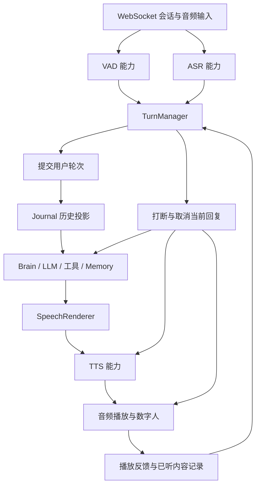

# 语音 Pipeline 与可替换接口

2026-10-01：Web Demo 默认接入模块化会话协调器，当前实现及接口用法见《模块化话轮协调器》（`turn-coordination`）。

连续判停、打断与无响应风险的审查，以及下一版协调器规划，见文档页面《语音交互审查与框架规划》（`voice-interaction-review`）。该页中的新增协调器与标签属于规划，当前可用接口以本页为准。

## 整体结构

语音主链路是事件驱动的级联 Pipeline。它需要并行检测、双向反馈和取消，不能用一串只处理一次的同步函数表达。



`server/realtime/cascaded/pipeline.py` 提供统一装配入口 `CascadedPipeline.assemble()`。实际服务 `demos/voice_web_server.py` 使用这个入口创建 engine 和 resolved profile；音频处理、事件路由和取消仍由现有 Cascaded Engine 执行。

## 接口与替换粒度

| 模块 | 统一接口 | 替换方式 |
| --- | --- | --- |
| VAD | `VadCapabilityProvider` / `VadCapabilitySession` | 替换输入音频到说话/停说事件的能力 |
| ASR | `AsrCapabilityProvider` / `AsrCapabilitySession` | 替换识别能力；已有 `AsrEngine` 可用 Legacy adapter 接入 |
| 对话状态策略 | `DialoguePolicy` | 提供 `state` 和异步 `evaluate(signal, generation)`，通过 factory 注入 TurnManager |
| 语义判停 | `EotClassifier`，可选 `ContextualEotClassifier` | 替换完整性分类器，输出 complete/incomplete/uncertain；支持历史上下文的实现可使用扩展接口 |
| 语义打断 | `SemanticInterruptionClassifier` | 输入助手文本、用户文本、边界与 generation，输出 label/confidence |
| 重叠讲话意图 | `DualIntentClassifier` | 区分抢话、附和、并发讲话等意图 |
| 整体对话管理 | `TurnManagerCapabilityProvider` / `TurnManagerCapabilitySession` | 替换状态策略、判停与打断的整块编排 |
| 推理 | `BrainCapabilityProvider` / `BrainCapabilitySession` | 替换 Brain；LLM 适配器实现 `LlmClient`、流式或工具接口 |
| 语音文本处理 | `SpeechRenderer` | 将显示内容转换为可朗读内容 |
| TTS | `TtsCapabilityProvider` / `TtsCapabilitySession` | 替换语音合成；已有流式/双流式引擎可通过 adapter 接入 |

能力统一遵循 provider 的 `open(context)` 和 session 的 `send(command)`、`events()`、`close()`，SpeechRenderer 为独立的 `render(content)` 接口。每次 `open` 必须创建独立会话状态；连接、任务、缓存与状态机不能跨用户共用。

### 三类状态分别管理

- **会话生命周期**：Voice Session Runtime 管理启动、活动、恢复和关闭。
- **对话轮次状态**：TurnManager 管理 idle/listen/speak/wait/dual，决定提交、等待和让出话权。
- **模型历史**：Conversation Journal 与 Context Projector 管理语义记录及上下文预算。

替换对话策略不需要替换握手、用户鉴权或历史存储。如果新算法需要完全不同的状态模型，应替换整个 TurnManager，并映射到现有公共命令和事件；只替换 `DialoguePolicy` 时，需要遵守现有 `DialogueState`、`Signal`、`Transition` 合约。

## 仅替换判停、打断或状态策略

新模型推荐使用结构化 `classify_request` 输入，历史、当前文本、revision、边界与对话状态的完整规范见[判停与打断插件合约](/docs/semantic-decision-plugins)。旧接口仍兼容。

在服务端装配时注入实现：

```python
turn_manager = LegacyTurnManagerCapabilityAdapter(
    policy_factory=MyDialoguePolicy,
    eot_classifier=MyEotClassifier(),
    semantic_interruption_classifier=MyInterruptionClassifier(),
    dual_intent_classifier=MyDualIntentClassifier(),
)
```

以上为注入示意，需要导入项目 adapter 并实现对应类。`MyDialoguePolicy` 不需要继承 `TurnPolicy`；factory 每次返回新实例。分类器可能被同时调用，如果持有可变状态，需要自行隔离或同步。

判停分类器只判断语义是否完整。`SemanticEndpointGate` 继续结合 VAD/ASR 的停说与稳定性，校验文本修订和 generation，阻止过时判断提交新轮次。打断分类器只判断停止、纠正、插话、附和等意图；`SemanticInterruptionGate` 负责及时规则、超时、最新结果生效与取消。这样替换模型时可以保留经过验证的时序保护。

实际服务入口仍决定默认分类器和参数；当前公共准入路径有其独立配置策略，不能仅靠设置本地判停环境变量就假定所有会话都已启用同一分类器。

## 统一装配 Pipeline

```python
pipeline = CascadedPipeline.assemble(
    CascadedPipelineBindings(
        vad=vad_provider,
        asr=asr_provider,
        turn_manager=turn_manager,
        brain=brain_provider,
        speech_renderer=speech_renderer,
        tts=tts_provider,
    ),
    options=CascadedPipelineOptions(
        response_timeout_s=30,
        response_cancel_timeout_s=0.8,
    ),
)
conversation = await pipeline.engine.open(
    context=interaction_context,
    profile=pipeline.profile,
)
# conversation.send(...) / conversation.events()
# 在 finally 中 await conversation.close()
```

上面的变量均为已构造的能力 provider。`CascadedPipelineOptions` 还可注入历史上下文投影工厂、播放记录存储、延迟观测和音频插件所需的伪名化 key。没有 profile 覆盖时使用六个默认能力。

## 按插件 ID 和版本替换整体能力

1. 在服务端创建 `PluginManifest` 与能力 binding，封装为 `RegisteredPlugin`。
2. 向 `CascadedPipeline.assemble(..., plugins=(registered_plugin,))` 提供已注册插件。
3. 通过 `profile_path` 指定服务端 JSON，例如替换 TurnManager：

```json
{
  "schema_version": 1,
  "engine_kind": "cascaded",
  "plugins": [
    {
      "slot": "turn_manager",
      "plugin_id": "custom.turns",
      "plugin_version": "1.0.0",
      "config": { "idle_ms": 120 }
    }
  ]
}
```

未选中的能力继续使用默认 binding。配置必须符合 manifest 的 schema；需要配置的 provider 实现 `open(context=..., config=...)`。装配会检查插件身份、版本、能力槽位、数据授权、配置与重复选择，并检查六个有效 binding 是否有必要的 `open`/`render` 入口。完整 session 方法、事件语义、取消与资源释放仍需合约测试验证。

实际服务装配函数 `_build_realtime_session` 接受 `pipeline_plugins`，profile 路径由 `VOICEAGENT_REALTIME_PROFILE_PATH` 指定。插件由受信任的服务端代码提供，不从网页上传或自动执行任意 Python 模块。当前没有插件市场、自动扫描或页面任意服务商管理；新增 ASR/TTS/LLM 的页面选择仍需要扩展产品配置和准入。

## 替换后的验证

执行：

```bash
.venv/bin/python -m pytest -q \
  tests/realtime/test_cascaded_pipeline.py \
  tests/realtime/test_builtin_profile.py \
  tests/realtime/test_profile_resolution.py \
  tests/realtime/test_cascaded_engine.py \
  tests/test_turn_policy.py tests/turn_policy
```

新增测试验证整块 TurnManager 的选择、配置传递、独立会话与关闭；不继承内置状态机的策略也能驱动公共状态事件。已有测试覆盖判停稳定性、过期结果、语义打断、取消及引擎生命周期。以上为确定性测试，不证明新增服务商的真实网络、音频质量或低延迟表现；接入真实插件还需实际语音验收。
