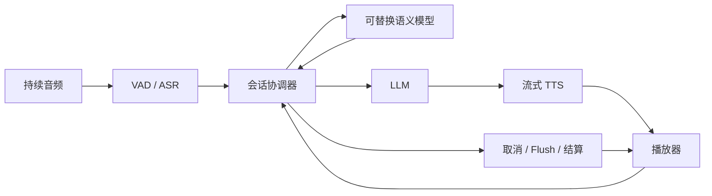

# VoiceLoop 语音交互审查与框架规划

实施更新（2026-10-01）：默认 Pipeline 已接入会话 actor、独立恢复期限及可替换协调策略，详见文档页面《模块化话轮协调器》（`turn-coordination`）。下文保留审查时的结论；多头标签、暂停与 Jev 接入仍待实施。

日期：2026-09-30。参考仓库：`/Users/forever/Desktop/beike/voiceloop`，HEAD `62f93d1`；核查当前工作区文件，可能包含未提交修改。参考项目只读，未改动代码。

## 结论与证据范围

上一版把助手轮次输入收敛成三个动作，遗漏了「取得话轮但尚未表达完整」「先停播、随后继续纠正」「模型不确定但用户已说完」等过程。上层两种话轮可以保留，但不能用当前是谁 speaking 决定输入有效性，也不能把多意图表达压成一个不可修订标签。

VoiceLoop 的经验是维护输入归属、响应代次、文本修订和播放边界。核心风险是多个处理器各自维护 pending、取消和缓冲，分支缺少后续推进事件时，完整输入被悬置或丢弃。减少枚举不会自动解决这些问题。

本次读取代码、问题档案、设计及回归用例，并对照本地 `docs/GPT-Voice`。未启动 VoiceLoop 或访问其数据库；本机缺少 Pipecat 依赖，未重跑其测试。档案的事故时长及修复测试是原项目记录，不是本次复测。下文明确区分历史修复、静态路径风险与新方案。

## 一、VoiceLoop 已记录的问题

### 1. VAD 恢复后，完整性结果成为孤儿

档案：`docs/issues/2026-08-07-jiong-vad-deadlock.md`、`2026-08-20-semantic-eot-vad-oscillation-stale-drop.md`，均标记已修复。

文本已触发异步判断，VAD 再次 start 作废候选；模型随后返回 complete，却没有消费者推进话轮。第一版恢复依赖 ASR idle，但后续发现振荡以真实 stop 结束时，没有入口武装 idle 计时器，仍会无响应。当前 `server/processors/semantic_eot.py` 有对应孤儿恢复逻辑。

借鉴：文本判断与声学停止分别版本化。VAD 恢复可以撤销提交资格，不能永久删除仍匹配文本的语义证据。真实续话的 ASR 有延迟，不能仅凭「此刻文本没变」认定是噪声。

### 2. 启停振荡无限重置兜底等待

档案：`docs/issues/2026-08-31-semantic-eot-vad-oscillation-no-response.md`，标记已修复；记录一次完整请求等待 23.88 秒，VAD 振荡不断取消 5 秒等待。

当前 `semantic_eot.py:397` 起增加独立 `max_open_ms` 计时器，默认 10 秒，锚定 sentence revision。它不是整轮绝对期限，新 sentence revision 仍会重置。

借鉴独立活性期限，但不照搬「到点无条件结束」：当前到期路径仍 await 已有模型任务，也可能在声学显示用户还在说话时收尾。新框架需要整条恢复执行链有界，并为 ASR 延迟、持续真实讲话定义明确策略。

### 3. provisional ID 与公开 Turn ID 分裂

档案：`docs/issues/2026-08-25-interruption-transcript-turn-ownership.md`，代码已修复，部署后待复核。延迟准入输入已获得 ASR 归属，重复 raw VAD start 却替换 provisional epoch，造成 final 与 turn.started 不同 ID。

当前 `server/turn_state.py:411` 起保护已有语义、ASR 或提交结果的 epoch，并在准入时提升原 ID。

借鉴：观察输入时创建候选 ID，准入时提升同一记录；VAD 小段不等于新 Turn。明确丢弃的候选需要 tombstone，避免迟到 final 污染下一轮。

### 4. 判定打断后，旧语音仍播放数秒

档案：`docs/issues/2026-09-02-interruption-stop-flush-latency.md`，已修复、待测试环境复测；记录 admitted 到 tts.stopped 延迟 2.42–5.95 秒。停止通知等待 provider 收尾，客户端按自然结束处理。

借鉴：确认取消后立即发送带目标响应 ID 的 flush，资源清理在后台进行。分别记录模型判定、服务器控制、客户端实际停播，不能用 provider stopped 代替播放确认。

### 5. 精确附和词规则漏组合表达

档案：`docs/issues/2026-08-13-semantic-interruption-backchannel-misjudged.md`。白名单漏掉“好好好”“嗯，好的呀”，落入模型后误停播；已扩展组合规则和 prompt，档案注明生产评测回归待跟进。

可借鉴整句匹配、停止词的稳定边界与前缀保护。还需区分助手提问后的短回答，不能仅扩大附和白名单。

## 二、当前代码路径的风险

以下是静态路径判断，未运行复现，不等同于已确认生产事故。

| 优先级 | 依据 | 风险与改进 |
| --- | --- | --- |
| P0 | `processors/semantic_interruption.py:640`，仅 correction/interrupt 放行缓冲；设计规定终局 uncertain 不创建 Turn | 真实插话被低置信度判 uncertain 时可能消失。终局未知应保留输入并有界恢复或澄清 |
| P0 | 同文件仲裁中 UserStartedSpeakingFrame 分支，没有清除已有 `_user_stopped` | stop 后恢复说话，新 revision 的结果可能沿用旧 stop 提前放行或抑制。需回放 stop→start→新文本→模型结果→第二次 stop |
| P1 | `_finish_if_ready()` 对 fallback 且仍 playing 直接 return；已有失败测试锁定等待自然播放结束 | 429/超时后有效请求可能长期等待旧响应，需独立准入期限和故障策略 |
| P1 | 默认 30000ms 仲裁 timeout 仅在 `process_frame()` 检查；到期 fallback 仍受 playing 条件限制 | 不具备自主唤醒与最终接纳上限。需要独立 timer 事件，缺帧也推进 |
| P1 | `_drop_terminal_frames` 等 TranscriptionFrame 才清除 | 被抑制输入若缺 final，后续输入可能被归入旧尾部；应按候选 ID 丢弃，增加缺 final 回放 |
| P1 | PlaybackProjection 用 TTS/Bot 帧推进预计播放内容 | 生成完成与设备听完可能不同；上下文需标记估计/确认，结合实际播放报告 |
| P2 | 语义设计传全量历史，overflow 后等待旧播放结束 | 长会话增加延迟和故障；使用明确预算内最近交换及当前播放内容，标注截断 |

额外关注连续打断：每次取消只能针对指定响应。旧响应迟到结束事件不能关闭新响应，也不能清掉新输入；已停播动作幂等，但最终用户文本仍可继续更新。

## 三、本地 GPT-Voice 文档的可采纳设计

- `07-状态机、优化与验收指标.md` 明确 listening/speaking 是媒体呈现，不等于业务轮次；会话、媒体、业务和连接不应混成一个枚举。
- `11-最小Voice-Agent参考框架.md` 区分取消输出与取消后台任务。“停一下”不自动取消已委派任务；自然播放完成和打断使用不同事件。
- `12-GPT-Voice完整链路流程图.md` 提供附和、未寻址、抢话及跨层取消流程，但其图例明确部分属于框架策略，不能作为 OpenAI 云端内部事实。
- `13-Realtime-Engine统一接口与插件架构.md` 第 7–9 节定义实际播放进度、单 Speech Lane、会话级能力接口和 TurnManager 唯一权威。这是现有项目基座，应在此扩展而非重建另一套 Pipeline。

这些资料支持「两个话轮视图 + 独立输入/响应记录」。仅看助手有没有声音，会漏掉生成中插话、音频队列尚未播完、停播后用户继续补充等情况。

## 四、OpenRealtime 的现状与缺口

已有基础：Pipeline 六个组件可替换；语义请求有历史、revision、边界与状态；模型负面标签不直接删除完整非回声输入；早期 stop 后最终文本重新仲裁；准入打断后仍走 EOT；SpeechDelivery 有播放报告及历史投影。

需要补齐：

1. `turn_manager.py` 的普通等待与 ASR idle 会被 VAD start 撤销，未见独立于这些路径的输入活性 deadline，需连续振荡回放。
2. 模型异常降级为 confidence=0 的 interrupt 仍可能停播，故障状态应与动作政策分离。
3. 本地附和词需要上下文短回答对照测试。
4. `DialoguePolicy` 仅替换规范五状态下的转移算法，不覆盖候选、期限与播放控制。完整协调应通过 TurnManager provider 或下文合约替换，不能仅改枚举。

本次重跑判停 Gate、打断 Gate、Cascaded capabilities 聚焦测试：64 passed。未证明上述所有竞态已解决，也未做真实模型或浏览器音频验收。

## 五、建议框架：两个话轮视图，独立生命周期

上层保留 USER / ASSISTANT，表示话轮归属；不作为是否收音、保留文本的闸门。两种话轮都持续收音与 ASR。初始无输入、无响应时在 USER 视图下等待。

协调器只拥有三类记录：

| 记录 | 主要内容 | 生命周期 |
| --- | --- | --- |
| 候选用户输入 | utterance_id、累计文本、content revision、音频范围、最近 start/stop、终局原因 | collecting → committed / suppressed / abandoned |
| 助手响应 | response_id/generation、来源输入、生成/播放事实、取消与结算 | active → completed / cancelled / failed |
| 未决判断与期限 | 输入 ID、文本版本、声学版本、目标响应、证据与 timer | pending → resolved / expired / cancelled |

生成和播放可并行，不能做成互斥全局状态。首 token、首音、播放位置、queued、语音活动作为事实记录。明确暂停使用 PauseRecord 保存目标、恢复条件与期限；减少枚举不意味着省略这些必要信息。

ASSISTANT 下允许候选用户输入存在；USER 下允许旧响应后台清理，但旧输出已失效。重叠是事件及观测，不需要新增全局 DUAL。上层变化只由准入、提交、响应终局等确认事件驱动。

数据面仍为 ASR→LLM→TTS，控制面统一接收各层事件。不能只在 ASR 与 LLM 间插入阻塞分类调用就假定实现全双工。

### 协调策略插件合约（建议，未实现）

- 每会话 `open(context)` 独立实例。
- `on_event(event, snapshot)` 串行归并事件，返回新记录及 typed effects。
- effects：classify、commit_input、cancel_response、flush_playback、schedule_timer、settle_input。
- 模型后台运行，以结果事件回流；主队列不等待模型推理或旧 TTS 清理。
- VAD/ASR、模型结果、响应、playback ack、timer、错误、关闭有规范事件；partial 可以合并，取消与提交不能丢。
- 框架执行器固定负责版本/身份检查、幂等、期限、输出拒收和清理；策略可替换时序与阈值，但不能绕过保障。

实施先复用 TurnManager provider，保留 Legacy adapter 与五状态兼容投影，再提取安全执行层，避免维护两套权威。

## 六、训练标签规划

保留两个主要模型任务，控制意图可追加。它们是输入属性，不是会话状态。

| 任务 | 标签 | 说明 |
| --- | --- | --- |
| 完整性 | complete / incomplete / ambiguous | 是否已表达完；SentenceEnd 不等于完整 |
| 插话关系 | backchannel / take_floor / not_addressed / ambiguous | 是否接管话轮；take_floor 可以仍 incomplete |
| 控制意图 | none / stop_response / pause / resume / end_session / ambiguous | 可以与 take_floor 同时出现，不强制单选覆盖其他任务 |

纠正、补充、新请求、回答是 take_floor 的可选细分意图，供 Brain 与分析使用。未寻址是上下文意图判断，不宣称凭文字识别背景说话人。nonsemantic 需要充分文本/声学证据。

ambiguous 是样本歧义；timeout、429、非法结果是运行状态。保留原生概率/置信度，并单独记录实际动作、覆盖原因。早期 stop 允许立即取消旧输出，但用户输入继续收集，最终“别说了，查上海”仍进入新请求。

训练样本包括：最近交换及截断标记；已播放/正在播放/生成未播放的助手内容与精度；累计用户文本、revision、边界、音频范围、相对时序；完整性、插话关系、控制意图；应停播/保留/提交/响应的动作真值。关联 ID 用于回放而非模型理解，敏感身份不进入推理。

按在线多个 revision 标注，不只训练最终文本。按会话、说话人、模板来源拆分数据，防止同一句不同 revision 泄漏。规则命中场景也纳入端到端评测。

## 七、保障自然交流的十条规则

1. 输入从首次观察就有唯一 ID，多次声学停顿不更换归属。
2. 新文本使旧判断过期；只有 VAD start 则撤销 stop 资格并观察 ASR 延迟，不永久删除同文本证据。
3. complete 仍需文本稳定、当前停止及有界 ASR 等待；接管话轮仍需 EOT 才提交请求。
4. 活性期限是独立 timer，不依赖下一帧；噪声不能无限重置恢复期限。
5. 到期必须收敛：安全条件下提交，证据缺失时明确恢复/澄清；不无条件截断持续讲话，也不无限静默等待。
6. 每份已准入有效输入最终得到响应、被明确后续输入替代、执行控制命令、显式失败或随关闭结算。纯 stop 不要求额外口头回答。
7. 取消绑定目标响应；迟到 cleanup、音频与完成事件不影响新响应或输入。
8. 确认打断立即拒收旧音频并发送 flush，实际播放由带目标 ID 的 ack 结算；资源清理独立有界。
9. 最终完整输入的 ambiguous 或模型故障不能直接等同于 ignore；应保留并进入可观测恢复。
10. 每个输入逻辑提交幂等，响应重试有独立 attempt ID。外部工具副作用仍需要业务幂等，不能宣称天然恰好执行一次。

## 八、必须回放的时序

| 场景 | 预期 |
| --- | --- |
| stop→start，文字暂未到 | 同一输入继续，旧 stop 无效，给 ASR 延迟窗口 |
| VAD 振荡，没有新文字 | 独立期限恢复证据或进入故障处理，不无限 rearm |
| 讲解中“嗯，继续” / 提问后“嗯” | 前者通常附和，后者可能是回答，不能词表吞掉 |
| “不是北京……”停顿后“是上海” | 先接管取消旧响应，补全后再提交 |
| “别说了”后继续新请求 | 停播幂等执行，累计文本继续更新 |
| A→B→C 连续打断 | A/B 迟到结束不能覆盖 C 的响应或文本 |
| 首音前用户补充 | 生成中也允许接管，不依赖 is_playing |
| 模型回来前助手自然结束 | 旧打断目标失效，但用户输入仍正常推进 |
| 提交后迟到 final | 按音频范围修订原输入，不自动产生第二次回复 |
| 429、模型超时、缺播放 ended | 输入保留，独立期限推进；不伪造播放进度 |
| 明确暂停十秒 | PauseRecord 控制恢复，区别于 incomplete 自然停顿 |

## 九、OpenAI 与 Jev 参考

[OpenAI VAD 文档](https://developers.openai.com/api/docs/guides/realtime-vad) 用完整性概率调节等待，create_response 与 interrupt_response 独立；[会话文档](https://developers.openai.com/api/docs/guides/realtime-conversations) 区分取消、播放停止和未播内容截断。可采纳检测/动作解耦及已听内容边界，但不能推断 ChatGPT Voice 内部采用某个两状态 FSM。

已通过 TypeSafe 官网核实 [Jev 官方接口](https://docs.typesafe.ai/introduction)：Choice、Score、Noul 可以对同一 state 提供多个独立判断，适合上述多任务适配。纠正之前“Jev 尚未识别”的评估状态。[Confidence 文档](https://docs.typesafe.ai/confidence) 说明 Choice/Score confidence 来自概率分布，Noul 返回 yes 概率且无单独 confidence，需保留各自含义。多问题独立判断仍可能组合矛盾，由策略仲裁。

用户提到平均约 400ms 是待本项目验证的延迟假设，本次没有实测。建议 partial/SentenceEnd 提前判断、请求合并、latest-wins，完整性与插话关系并行而非串行两次调用；经过边界验证的明确 stop 可用快路径。核心队列不被模型阻塞。后续训练的轻量模型复用同一合约，不改变输入归属与期限保障。

## 十、落地顺序与验收

1. 建立事件时序回放，优先连续 VAD 振荡、连续打断、迟到 final/cleanup、unknown/429，断言每份输入有终局。
2. 补独立期限、短回答保护及实际停播观测，不先删除五状态。
3. 实现单协调器策略与安全执行边界，保留 Pipeline、模型和传输能力接口及兼容投影。
4. Jev 先影子评估，再训练与对照轻量模型；影子不能播音、执行工具或写权威数据。
5. **系统附和 TODO**：低优先级、独立输出 ID、可取消、不抢用户输入，不污染主回答历史；当前先完善判停与打断。

验收至少包括有效输入未结算率、无响应/重复响应率、提前判停率、附和误停播率、打断漏停率、末次有效语音到首音 p50/p95、打断确认到实际 flush p50/p95、跨输入错挂及过期结果执行次数。先通过有限回放的不丢输入、无过期动作断言，再真实音频/浏览器验收；线上不能承诺绝对零错误，但每条异常要有可追踪恢复。

本页是审查与方案，新增协调器、标签、期限和 Jev 适配器尚未实现。
