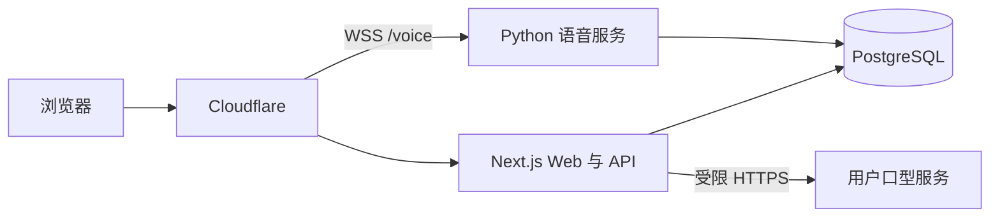

# 公开体验与自行部署

`realtime.happy-token.cn` 使用 Cloudflare 作为 DNS、TLS 和站点入口。Next.js Web 服务、Python WebSocket 语音服务和 PostgreSQL 运行在常规服务器；口型生成服务为用户自行提供的可选能力。此仓库不包含可直接发布的生产域名、账号或密钥。



## 环境配置

`.env` 适合保存**某一次部署的服务参数**：数据库地址、服务 URL、端口、功能开关、会话额度和本地开发用的 API Key。它不是应用内所有配置的统一存储，也不是生产密钥管理器。可公开的默认值写入并提交根目录 `.env.example`；实际 `.env` 只留在本机且不提交。生产环境可沿用相同变量名，由进程管理器、容器平台或 Secret 管理器注入实际值。不要把 API Key 写进 `NEXT_PUBLIC_*`，该前缀的值会进入浏览器构建产物。

| 配置位置 | 放什么 | 当前例子 |
| --- | --- | --- |
| 根目录 `.env.example` | 可提交的变量清单、示例值和说明 | `VOICEAGENT_PUBLIC_ORIGIN`、`VOICEAGENT_POSTGRES_DSN`、`VOICEAGENT_PLATFORM_VOICE_SESSION_SECONDS`、供应商 Key 的空占位 |
| 根目录 `.env` / `.env.local` | 本地开发的实际服务参数与密钥 | 数据库 DSN、`DEEPSEEK_API_KEY`、`VOICEAGENT_USER_SESSION_SECRET` |
| 生产部署环境 / Secret 管理器 | 生产参数与密钥，按 Web、语音服务分别授权 | 同名数据库 DSN、供应商 Key、`VOICEAGENT_CREDENTIAL_ENCRYPTION_KEY` |
| `deploy/inference_services/compose.yaml` 与同目录 `.env.example` | 可选推理容器的端口、模型目录和服务令牌 | `LIPFORCING_PORT`、`LIPFORCING_RUNTIME_ROOT`、`LIPFORCING_SERVICE_TOKEN` |
| PostgreSQL | 登录用户自己的可修改设置 | 个人供应商凭据、口型服务地址及加密令牌 |
| 浏览器本地存储 | 只影响当前浏览器的外观偏好 | 玻璃透明度、模糊度 |

### Docker Compose 如何传递变量

根目录 `compose.yaml` 部署 Web、Python WebSocket 和 PostgreSQL。先将 `deploy/compose/` 中三个 `.env.example` 文件分别复制为 `.env`、`web.env`、`voice.env`，填入实际值。`deploy/compose/.env` 只供 Compose 替换 `${变量}`；`web.env`、`voice.env` 经 `env_file:` 分别传入对应容器。共享的数据库密码、加密密钥和站点地址通过 Compose 的 `environment:` 显式传给需要它们的服务。不要把全部供应商密钥传给每个容器。三个实际配置文件均被 Git 忽略。

```bash
cp deploy/compose/.env.example deploy/compose/.env
cp deploy/compose/web.env.example deploy/compose/web.env
cp deploy/compose/voice.env.example deploy/compose/voice.env
# 编辑以上三个文件，再检查配置；输出可能含密钥，不要公开分享。
docker compose --env-file deploy/compose/.env config --quiet
docker compose --env-file deploy/compose/.env --profile setup run --build --rm migrate
docker compose --env-file deploy/compose/.env up --build -d db voice web
docker compose --env-file deploy/compose/.env ps
```

迁移是独立步骤，不随应用启动自动执行。`migrate` 记录已执行脚本及其摘要，重跑会跳过相同脚本并拒绝被修改的历史脚本；这套记录适用于**新建数据库**。已有数据库若曾手动运行迁移，需先核对并补齐迁移记录，不能直接在旧库上重放。Web 与语音容器共享网络命名空间，让 Web 通过 `127.0.0.1:8766` 调用只接受回环请求的 Python 控制接口；两个公开端口都在 `voice` 服务上发布，且只绑定到宿主机回环地址。通过同机反向代理提供公开 HTTPS。Web 构建时需要 `OPENREALTIME_PUBLIC_VOICE_WS_URL`，修改后应重新构建 Web 镜像。`app-data`、`postgres-data` 是持久化卷，必须纳入备份。PostgreSQL 密码应使用 URL 安全字符，因为该值也组成连接 DSN。

### Cloudflare 如何传递变量

本方案中 Cloudflare 只作为前门；它的 DNS、代理和 TLS 不会给源站的 Next.js 或 Python 进程注入环境变量。应用仍通过 Compose 接收参数。根目录 `wrangler.jsonc` 定义一个很小的 Worker，只将 `realtime.happy-token.cn/voice` WebSocket 升级请求转发到独立的 HTTPS 语音源站；普通 Web/API 请求仍走 Cloudflare 代理到 Web 源站。`VOICE_ORIGIN` 是非密钥部署变量，默认的 `example.com` 占位地址会被 Worker 拒绝。部署前将它改成实际语音源站，例如受控的 `https://voice-origin.example.net`，并设置对应的 HTTPS 反向代理到宿主机 `127.0.0.1:8765`。该源站不能指回公开站域名，否则会循环请求；应限制旁路访问，并依靠语音服务的短期票据验权。先执行 `npx wrangler deploy --dry-run` 检查 Worker 构建；确认 DNS、TLS、WebSocket 转发和限流策略后再执行 `npx wrangler deploy`，此命令会启用公开路由。Wrangler 部署令牌属于运维凭据，不放在仓库中。

如果以后把适配后的 Web 本身部署到 Cloudflare Workers，再用 Wrangler 的 `vars` 配非敏感变量、用 Workers Secrets 配 API Key；本文件当前没有把 Next.js、Python 或 PostgreSQL 部署到 Workers。

1. 本地从 `.env.example` 复制 `.env` 并填写实际值；`.env` 不提交。Web 的公开浏览器变量只有 `NEXT_PUBLIC_*`。生产密钥在服务器环境或 Secret 管理器注入，不能放在 Cloudflare 公开变量、客户端代码或前端管理表单中。
2. 为 Web 与语音服务配置同一 `VOICEAGENT_POSTGRES_DSN` 和 schema，先运行仓库的 PostgreSQL 迁移，包含 `0020` 至 `0027`，再同时更新 Web 与语音服务。`0024` 引入供应商实例及会话绑定，`0027` 会把旧 ASR/TTS 的“连接通过”状态清为未测试，要求重新通过实时契约测试；若只更新 Web 而未更新语音服务，不能启用新实例选择或测试。Web 的 `VOICEAGENT_CONTROL_PLANE_URL` 必须指向语音服务的回环地址（Compose 默认为 `http://127.0.0.1:8766`）；内置契约测试通过共享加密密钥签名，不能把此控制端口对外公开。密钥加密值 `VOICEAGENT_CREDENTIAL_ENCRYPTION_KEY` 必须在 Web 与语音服务一致并稳定备份；轮换前需规划用户凭据重新加密。
3. 配置 Casdoor 回调 `https://realtime.happy-token.cn/api/user/callback` 和 `VOICEAGENT_PUBLIC_ORIGIN`。配置 `NEXT_PUBLIC_VOICE_WS_URL=wss://realtime.happy-token.cn/voice`；只在语音服务使用 `public_ticket` 且反向代理 WebSocket 升级请求后启用 `VOICEAGENT_PUBLIC_VOICE_ENABLED=true`。
4. 默认保留三分钟会话上限及平台 ASR、TTS 各一席并发。服务商账号自身应设置硬额度。生产付费创作开关保持关闭，直到每项操作的用户归属、配额和持久化任务链路经过验证。
5. `VOICEAGENT_PERSONAL_LIPSYNC_ALLOWED_ORIGINS` 填写经运营方审查的 HTTPS 根来源，逗号分隔；为空时用户不能配置 Lip Forcing、MuseTalk 或 Wav2Lip 个人口型服务。用户令牌加密存于 PostgreSQL，页面只展示是否已配置。若用户服务不在允许来源内，先由运营方审查后再添加。

## 服务与路由

- 整站 Compose 使用根目录 `Dockerfile` 构建 Python 服务、`Dockerfile.web` 构建 Next.js 服务；不用 Compose 时，Web 在 Node.js 环境执行 `pnpm install --frozen-lockfile && pnpm build && pnpm start:web`。生产不要使用 `pnpm start` 一次拉起所有本地开发服务。
- Cloudflare 将普通 HTTP 请求送到 Web，`/voice` 的 WebSocket 升级送到 Python 语音服务。源站只接受来自 Cloudflare 或受控网络的访问，Web 与语音服务间控制端口不公开。
- 静态构建文件可缓存；`/api/*`、登录回调、用户媒体和 WebSocket 均不缓存。为 Web、WebSocket、数据库和外部供应商调用分别记录可用性、错误率及会话拒绝原因；日志不记录 API Key、音频内容或完整用户密钥。
- Web 存活检查为 `/api/health`，数据库就绪检查为 `/api/health?ready=1`；代理健康检查应使用就绪接口。
- 离线模式需要已发布的动作与口型对齐视频；实时模式需要已确认的数字人绑定。个人口型服务用于登录用户自己的生成任务，不得使用平台 GPU 作为静默回退。

## 发布前检查

运行 `pnpm exec tsc --noEmit`、`pnpm test`、`pnpm lint`、`pnpm build`、`uv run pytest`。对 Git 跟踪文件和历史执行密钥扫描，并逐项核实人物肖像、音视频、模型权重与第三方素材的授权。用匿名与登录账号分别验证公开语音时长、并发拒绝、个人口型服务隔离和付费创作接口；再用手机与桌面浏览器验证 HTTPS 麦克风、WebSocket 重连、离线与实时切换。只有这些检查通过后才将域名流量切到新部署。
