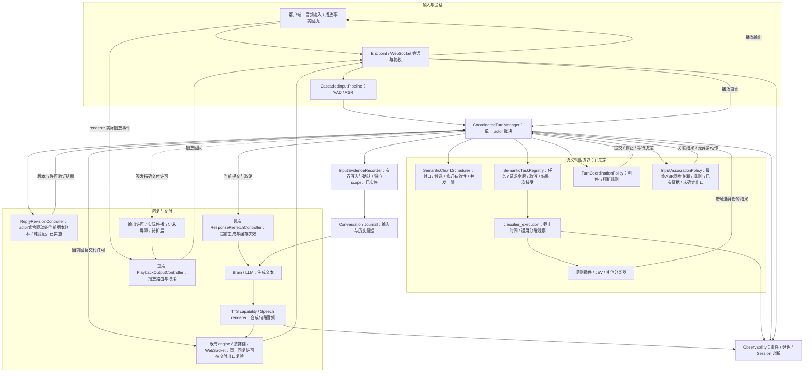

# 调整后的语音交互框架与模块边界

日期：2026-10-05；2026-10-06复核。已实施边界见ADR0139。虚线模块为后续待实施，不能视为当前运行能力。需求见[统一基线](../requirements/2026-10-06-voice-platform-requirements.md)，前置契约与实验见[实施计划](2026-10-05-voice-correction-implementation-plan.md)。

## 整体结构

ReplyRevisionController 不直接向Prefetch/renderer异步发动作；图中其返回actor的是同步验证/账本结果。当前回复交付许可已实施，各既有输出边界复验同一状态；精确当前句许可仍待0137。播放事实投影与版本状态分开保存，不由账本推断音频停止。

说明：任务注册器拥有异步任务；分类执行器封装每次调用，图中的箭头表示职责与调用路径。客户端播放控制器在客户端hook内使用，协议传递其回执到服务端；不把它误画成服务端音频播放引擎。

## 状态归属

|状态/事实|唯一主要维护者|其他模块如何使用|
|---|---|---|
|音频连接、传输绑定|Endpoint/Transport|输入/输出通过协议交互|
|ASR文本修订与VAD事件|InputPipeline及提供商适配器|向actor报告事件|
|候选封口、有效性和并发容量|ChunkScheduler|actor读取并调用调度|
|异步任务、取消、请求令牌|TaskRegistry|actor请求启动/取消/一次接受|
|输入话轮、已执行打断、提交决定|Turn actor|向capability发送动作|
|分类含义与策略|classifier插件/CoordinationPolicy|不直接操控音频或提交|
|最终输入关联|InputAssociationPolicy纯同步策略；actor校验并应用|未播时机不是关联依据，未知保留原文及父引用；不自行控制播放|
|预生成候选生命周期|PrefetchController|回复提交时复用或失效|
|当前输入/回复版本、替代关系、整回复交付许可|actor驱动的ReplyRevisionController，已实施|既有输出边界复验；已归档版本跨Session重建已补，未归档动作幂等与精确当前句许可仍待实现|
|实际播放位置、队列与句末确认|renderer/PlaybackOutputController|通过带ID回执向服务端报告|
|停播/句末交付屏障|输出边界，待扩展|执行actor许可并等待实际回执，不自行裁决语义|
|持久历史与诊断|Journal/Observability|保存事实，不接管实时决策|

## 正常与异常如何共用框架

正常路径：输入→候选→并行分类→actor确认语义及停止条件→预生成复用/LLM→TTS→客户端播放。

补充纠正目标路径：新输入→actor确定关联并更新版本账本→禁止旧版本新交付→未播重生成，或签发只保留当前实际句的许可→输出边界等待真实句末→actor重验heard_frontier后放行新版本。

误打断恢复目标路径：新证据→actor确认恢复意图→更新同一版本账本→依据真实停播与位置事实签发新播放epoch的续播/续答许可。恢复后新的有效打断可以停止新epoch；同一命令重发幂等。不另建恢复任务队列或第二业务actor。

## 当前完成与未完成

已存在：候选有界并行、任务/token执行边界、通用分类诊断、原有规则与预生成、客户端既有播放路由。并发1/2判停文本一致性、执行前旧停止证据冲突、长输入完成记录清理还需补强，不能笼统视为完整安全验收。

已补0136首批：当前输入/回复版本、替代关系、取消前撤销许可、生产装饰链与WebSocket交付复验、原判停结论与截止原因分离，以及未决重叠输入的显式失败出口。账本覆盖运行中ASR正式提交，完整范围见[首批报告](../reports/2026-10-06-reply-version-delivery-isolation.md)。

未完成：完整补充语义关联、跨Session版本重建/幂等、实际句末切换、误打断恢复与G2。这些按0136—0138继续实施，必须确认各renderer回执能力。

2026-10-07进展：跨Session版本重建已覆盖已归档主Journal，未归档回复和全历史动作幂等仍开放。历史投影使用当前命令scope、保留原item/context/digest；既有actor在恢复屏障驱动同一账本，不恢复旧交付许可或另起执行任务。见[恢复报告](../reports/2026-10-07-cross-session-revision-restoration.md)。协调器1663行、账本242行，新增恢复解析和校验位于账本；没有新增actor或队列。

当前yield_ack来自服务端取消完成，不是客户端实际stopped；现有PlaybackOutputController只能整generation取消，尚无当前句保留/未来队列清理/恢复已取消generation接口。协议能力审计前移到阶段0，功能实现仍扩展原输出边界。

2026-10-06关联接线后主协调器1659行，版本账本135行，关联策略86行。版本状态已迁入账本，关联含义进入可替换的纯策略；原有输入actor依然是决策入口，不新增业务actor或任务队列。后续不继续往_Input增加纠正/恢复布尔字段。

## 模块增量约束

前批新增2个执行辅助模块、1个同步版本账本，本批新增1个86行的纯关联策略seam；均不是新服务或网络调用。交付校验扩展既有engine、装饰链和WebSocket，已听历史复用原交付投影，没有新增一套队列。后续句末与恢复继续扩展现有Prefetch/Output，先证明状态归属和契约，不按异常类型建立控制器。

输入证据与逻辑预算的存储边界见[ADR0140](../adr/0140-input-evidence-and-resource-boundaries.md)。存储worker不维护语义状态或输出许可；预算拒绝仍由同一actor裁决。诊断回读与Session保留策略在ApplicationRuntime/控制平面，删除与活动thread注册使用进程内生命周期排他保护。0136已接入当前版本账本，完整关联与后续交付规划仍未完成，不继续新增异常业务actor。
