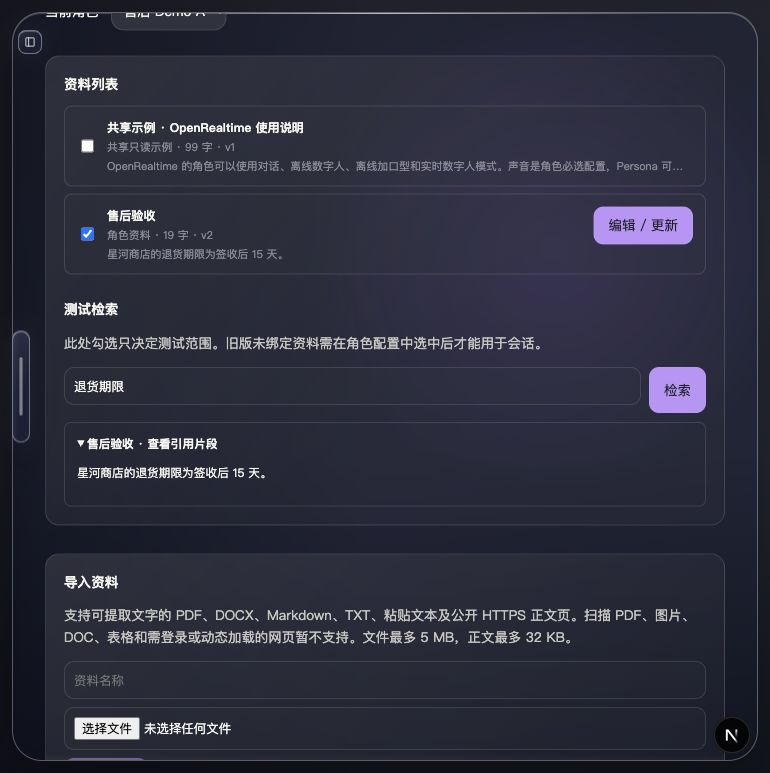

# 知识库验收记录（2026-09-30）

## 已验证

- 实际 PDF、DOCX、TXT、Markdown 文件通过导入 API；中文 UTF-8 与带 BOM 的 UTF-16 可解码。空白 PDF、损坏文件、二进制伪装文本、超限正文被拒绝。
- HTTPS 网页使用真实 example.com 验证；HTML、纯文本、声明的中文编码、跳转、公网 DNS 检查另有自动测试。该机器使用 Fake-IP DNS，实网验证显式配置 `KNOWLEDGE_WEB_DNS=cloudflare-doh`，仍校验并固定目标公网 IP。
- 同名文件及同一 URL 更新保持资料 ID；正文变化增加版本，不变不增加。更新、删除、用户与角色隔离、版本冲突和旧版多角色资料迁移均有测试。
- 页面在临时目录中创建「售后验收」，从 7 天改成 15 天，显示 v2 并命中新正文；另一个角色不可见该资料。未改动实际用户知识库。
- 角色关联实时数字人时复制独立资料；测试验证原角色后续编辑不影响副本，重新复制更新同一副本。

## 验证结果

- 六组前端相关测试：30 通过，1 个实网测试默认跳过；新增副本测试及显式实网运行：13 通过。
- Python 知识库测试：4 通过；知识库、Memory、历史投影 Demo 的全部断言通过。
- TypeScript 类型检查、修改文件 ESLint、`git diff --check` 通过。
- `pnpm build` 通过；有一条既有的 `provider-selection-flow.test.ts` 未使用变量警告。

## 实现边界

当前为本地 JSON 文本目录、关键词片段检索，未使用向量数据库。支持手动逐份更新，不含网页定时同步、目录监听、版本回滚、OCR、旧版 DOC、表格或动态网页。单文件 5,000,000 字节，提取正文 32,000 UTF-8 字节，网页下载 200,000 字节。

Memory 与历史续聊的现状及缺口见 [使用与审计指南](../MEMORY-AND-HISTORY-GUIDE.md)。Demo 不调用模型，页面检索也不证明实际语音模型一定调用工具。

