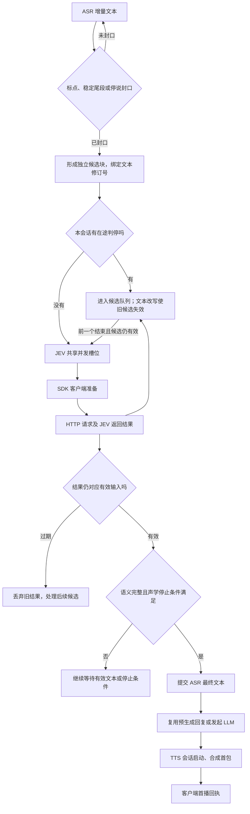

# 2026-10-05 建连与 JEV 分段诊断

> 历史基线：本文三轮数据、单飞流程图与优化建议记录ADR0135实施前的运行方式。现行产品已启用有界并行；不要用下图描述当前调度。采集边界说明仍有效；新的性能结论须按[实验计划](../design/2026-10-06-voice-interaction-experiment-plan.md)获取可比较证据，见[复核报告](2026-10-06-requirements-and-plan-review.md)。

新增 ASR 建立连接延迟、TTS 建立连接延迟卡片，以及 JEV 判停并发槽位等待、客户端准备、SDK 请求等待卡片。缺失历史样本保持空值；现有连接恢复指标保留。

ASR 建连指标测量 capability open 中 start_session，包括 WebSocket 握手与发送初始化配置；不代表首文本返回。TTS 测量后台 warmup，包括连接锁等待与提供商连接协议就绪，已复用连接时也可能产生近零样本。TTS 后续异常重连未被此 warmup 指标单独覆盖，可能仍包含在首包耗时中。

JEV 使用任务局部 ContextVar 绑定分段事件，避免共享客户端将不同 Session 或 chunk 的阶段混在一起。请求等待包含 HTTP 建连、传输、服务端处理和 SDK 解析，无法仅凭本地计时拆出纯模型推理。

## 真实短句三轮验证

|阶段|样本数|平均 ms|最大 ms|
|---|---:|---:|---:|
|ASR 建连|3|85.062|142.016|
|TTS 预连接|3|72.584|101.950|
|JEV 并发槽位等待|9|0.005|0.013|
|JEV 客户端准备|9|5.810|52.259|
|JEV SDK 请求|9|454.990|958.273|
|判停调用全程|9|467.254|1066.683|
|停说到首播（估算）|3|2320.640|2381.482|

候选封口到请求发起，根据同 chunk 调试事件计算：9 个样本，平均 47.7ms，最大 304.8ms。该等待在 provider.classify 计时之外，不能解释单次请求平均的全部差异。

## 当时的单飞流程（历史）

不是等完整句子后连续判断两三遍：ASR 先给出短片段，停顿可能封成第一块；后续文字、标点或修订又形成新候选。为了避免并发旧结果误裁决，本会话判停单飞处理。共享 JEV 槽位队列是另一个独立等待层。

本轮三句话每句产生三次判停，9次调用均成功。请求阶段平均455ms为主要单次耗时；候选串行等待最大305ms。前一轮679ms并不稳定复现，本轮467ms，不能将差值全部归因于网络、模型或排队。

当时的优化建议：减少仅标点/端点修订造成的重复判断、复用语义未变化的有效结果；取消过期候选，保留有独立意义的后续块；按真实时间线校准停止门槛。后续ADR0135采用有界并行和actor结果校验，替代单飞调度；仍不应无限并发或跳过声学停止条件。

验证：真实 Chrome 语音端到端3 passed；Realtime 与 JEV 回归338 passed；前端标签及卡片4 passed；TypeScript检查通过。
