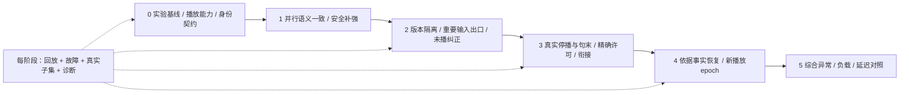

# 2026-10-06 需求与实施/实验计划复核

本报告保存实施前的评审发现与当时行号；后续用户授权“开始”后的代码修复和剩余门槛见[首批实施记录](2026-10-06-parallel-hardening-implementation.md)。下文“当前”指评审时快照，不覆盖后续实施状态。

本轮按当前模型重新整理全部已确认需求，并通过独立的需求/架构、实验、实现三路审查交叉核对。修改范围是需求、ADR和计划文档；没有新增运行时修复、真实模型调用或性能实验。

结论：方向保留，计划需要调整。先补实验与播放契约、并行安全边界，再实现版本纠正、句末衔接与恢复。不能把并行已运行、页面有说明和局部回归通过等同于全部需求完成。

## 1. 关键问题及本轮纠正

|优先级|发现|证据/影响|计划修正|
|---|---|---|---|
|阻断相关性能结论|并发1/2的判停请求语义不同|[候选构造](../../server/realtime/capabilities/coordinated_turn_manager.py:825)仅大于1使用累计前缀；A/B混入模型输入变化|阶段1补强先统一语义，再单独比较容量|
|阻断停播/恢复功能|服务端yield_ack不是客户端实际停播|[取消分支](../../server/realtime/cascaded/engine.py:1714)确认服务端动作；[输出控制器](../../src/voice/audio/playback-output-controller.ts:29)无句末保留/未来队列清理接口|播放能力表前移阶段0，实际协议在阶段3实现|
|优先可靠性修复|旧输出自然结束后重要UNCERTAIN文本仍可能被丢弃|[未决输入分支](../../server/realtime/capabilities/coordinated_turn_manager.py:1094)继续等待；恢复到期丢弃未确认overlap|阶段2首要门槛：输出结束不使输入失效；噪声与重要文本分别有界处理|
|阻断纠正状态契约|旧版本作废与当前句播完存在隐式矛盾|如果全generation失效会误杀当前句；放行整个旧版又会漏播未来句|版本有效性和精确播放许可分开；只保留一个已开始句|
|阻断衔接正确性|预计会播完的句被当成已听见|准备期间许可可撤销或回执丢失；新回复前提可能错误|confirmed_heard与允许当前句分开；放行时重验heard_frontier|
|需补并行裁决|词面前缀仍有效不代表旧停止证据仍有效|旧肯定晚于最新不打断，现有测试只覆盖晚到非停止前缀|用户已确认执行前最新有效文本优先；STOP发出后锁定，补对应回归|
|需补资源/故障验证|inflight有界不等于整个生命周期有界|[registry](../../server/turn_policy/semantic_task_registry.py:29)保留完成jobs到取消；[scheduler](../../server/turn_policy/semantic_chunk_scheduler.py:64)记录issued历史|增加长输入元数据清理及并行非协作取消实验，不增新控制器|
|需补诊断事实|deadline处置可能被记录成COMPLETE，取消/失败聚合不精确|模型结论与兜底提交不是同一事实；部分模块无独立恢复采集|分结论/处置理由，按操作与因果去重，缺数据显示完整度|
|不能作为性能验收|真实E2E只证明基本首播及点击挂断停播|[live用例](../../tests-e2e/voice-runtime-live.spec.ts:83)没有说话触发语义打断/纠正断言；固定短句3轮|新增分层矩阵与真实播放判定；3次仅冒烟|
|文档一致性|历史单飞报告易被当当前架构|10月4计划、10月5建连/JEV报告保留串行描述|标明历史基线，链接现行并行ADR及新实验计划|

上述运行时缺陷没有因为本次文档修订而变成已修复；实施计划保留明确的待实现状态。

## 2. 已确认状态规则

2026-10-06用户确认：尚未发出停播命令时，最新完整有效文本的“不打断”优先于随后返回的旧片段“打断”；停播命令发出后则锁定，不被同批相反结果撤销。它们分别是执行前有效性和执行后不可撤销性，不需要等待所有候选。

停播锁定在STOP_REQUESTED发生。STOP_CONFIRMED需要实际客户端事实，超时为UNKNOWN。恢复签发新播放epoch，允许再次真实打断；同一stop_command_id幂等。

actor仍为唯一业务裁决入口。计划新增一个ReplyRevisionController版本账本，扩展已有输出边界，不为纠正、衔接、恢复分别创建控制器。

## 3. 修订后的顺序

诊断、录音存储及Agent机器身份是横向交付轨道。当前详情页明确录音策略尚未启用；统一GET使用应用管理员认证，不能宣称机器只读凭据已完成。现有页面或导出按钮不是录音/完整证据验收。

## 4. 实验设计的具体变化

- 冻结事件回放验证调度因果，真实WAV验证整链，提供商专项定位连接/请求，各自报告。
- 每次只改变一个因素；配对随机AB/BA，固定语义、模型、提示词及连接条件，处理录音/Session相关性。
- 服务端估算、客户端同钟域计时、硬件校验分开；JEV SDK请求不称纯模型推理。
- 总尝试、失败、超时、正常取消、无响应与缺锚点都保留；成功样本延迟不能替代完成率。
- 先正确性门槛，再平均/P50/P95与资源代价；大样本和绝对SLO仍是工程提案。
- 每阶段建立其失败回归和真实子集，最后一阶段做综合验证，而非第一次测异常。

历史三轮平均1663.8ms仅保留为冒烟描述，一个Session的重叠调用证明并行确实启用。没有足够受控样本证明相较2449ms或2321ms的因果收益，也不能据此解释真实误打断/无响应已消失。

## 5. 文档入口与本轮检查

- [统一产品需求](../requirements/2026-10-06-voice-platform-requirements.md)：入口、诊断、录音、AI接口、延迟、异常、模块化与纠正全覆盖。
- [运行状态细则](../requirements/2026-10-05-voice-interaction-correction.md)：身份、许可、锁定、输入保留、恢复及截止。
- [实施计划](../design/2026-10-05-voice-correction-implementation-plan.md)：阶段0/1补强前置，状态收窄，ADR依赖更新。
- [实验计划](../design/2026-10-06-voice-interaction-experiment-plan.md)：实验因素、18类矩阵、测量、样本与G0—G5门槛。
- [架构边界](../design/2026-10-05-voice-framework-boundaries.md)：单actor与版本账本/输出许可关系。

本轮进行文档交叉评审、相对链接/代码引用和diff格式检查；没有重跑程序回归。旧全量Python1488通过发生在后续改动前，不作为当前未提交代码树全量通过证明。后续实现按对应门槛运行测试，并保存Session证据。
