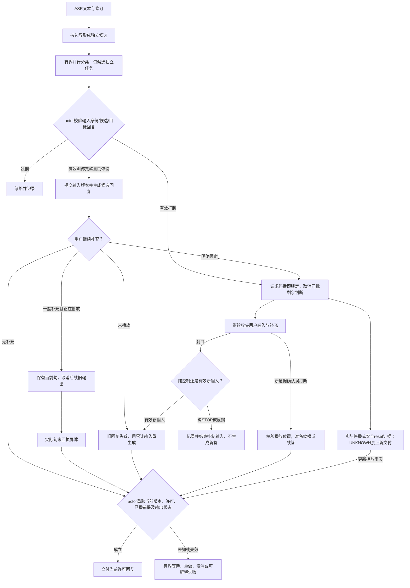

# 语音交互并行判断、补充修正与误判恢复需求

日期：2026-10-05；状态契约复核：2026-10-06。范围：Cascaded 语音链路、语义判停/打断插件、LLM/TTS 交付与客户端播放确认。整体产品要求见[统一需求基线](2026-10-06-voice-platform-requirements.md)。本文规定目标行为，当前差距见实施计划。

## 目标

降低候选串行等待，同时保证用户原始输入和后续补充不丢失。区分“开始生成”“允许交付”“实际播放”和“打断已执行”，避免模型误判引起重复回复、旧输出污染、无响应或错误恢复。

本文是用户已确认需求与技术约束的正式整理。实现阶段见实施计划；尚未落地的流程不得视为当前行为。

## 已确认的产品约定

1. 独立 chunk 触发请求，禁止每个字符或每个 partial 都请求。标点、稳定尾段、停说作为边界；打断无标点达到配置长度可封口。
2. 同一会话候选允许有界并发。候选队列并发与共享 JEV 并发独立配置。
3. 有效完整判停允许提前请求 LLM，但不关闭该轮关联输入；新增有效补充可使旧候选失效。
4. actor 决定请求停播时即锁定该次动作，取消同批剩余分类；继续收集文本。客户端回执确认实际停播，不等回执才锁定，不反复决定是否停止已经停掉的输出。
5. 一般补充在当前实际播放句结束后衔接；明确否定正在播出的错误内容可立即停止。
6. 短纠正也可能重要，不能用长度阈值丢弃“上海”“不是”等输入。
7. 后续纠正应结合累计输入与实际已播放内容，不把未播放的生成文本写成用户已听见的事实。
8. 误打断可恢复，但不能整段重播或依据迟到的同批相反结果自动撤销已执行动作。

## 状态与身份

每次分类关联 Session ID、输入轮身份、ASR 修订号、chunk ID、候选序号、目标 Response ID 和请求 ID。每个回复版本额外关联输入版本、父回复、替代原因；客户端回执关联 output/playback epoch、speech ID、稳定句段身份和实际播放位置。

逻辑输入身份与一次连续说话片段分开：停说后补充可继续关联原问题，但不能复用已经失效的分类批次。input_revision 表示 ASR 快照修订；input_version 表示累计语义版本，标点变化不必制造新的语义版本。reply_version 表示生成/修正/恢复版本。既有 Generation 继续作为执行租约；新身份是其关联字段，不能建立相互竞争的第二套租约。

“同批”是同一输入分类 epoch、任务类型和目标回复/播放 epoch 的候选集合。请求停播即关闭该批判断，后续文本继续进入输入证据。恢复创建新的播放 epoch；再次真实打断可以停止新的 epoch。

分别维护输入状态（接收、候选、停止、提交、补充）、分类任务状态（待发、在途、结束、失效）、回复状态（预生成、可交付、播放、作废、结束）、打断状态（未执行、待停播确认、已确认、恢复中）。用单一“完整/不完整”变量代替这些状态不满足要求。

核心不变量：

- 用户输入、ASR 修订及补充均保留；不因一次不确定结果静默丢弃有意义文本。
- 旧输入/回复版本的结果不能污染当前状态；重复回执不能重复动作。
- 每个输入版本只提交一次。停播按目标回复版本、播放 epoch 与 stop_command_id 幂等；重发同一命令不重复执行，恢复后的新 epoch 允许再次停止。
- 分类任务可并行，状态写入由协调器单一 actor 顺序裁决。
- 未提交或已作废版本不得新增可交付句段。一般补充可保留作废时已经实际开始播放的一句的限时许可，精确绑定回复版本、播放 epoch 与句段；该许可不覆盖后续句。明确否定、结束或安全截止可撤销它。
- 所有等待具备截止时间和明确恢复/失败/澄清出口。

状态归属：actor 是业务决定的唯一入口；ReplyRevisionController 是 actor 同步驱动的版本账本/纯规划器，不自行判关联、确认误打断或发播放命令。renderer 维护实际播放事实，服务端保存回执投影。异步结果只能经 actor 校验和应用。

## 并行结果裁决

判停请求判断候选截至当前的累计语义，附带短历史上下文，不能把互不相干的孤立片段判断结果直接比较。

|到达事件|要求|
|---|---|
|后候选完整先返回，前候选不完整晚返回|有效后候选保留；晚到前缀结果不清空当前判停|
|前候选完整，更新文本尚未判断|前候选不能提交更新后的整轮文本；可保留预生成|
|最新候选不完整/不确定|继续等待或有界复核，不用旧完整结果兜底|
|文本被 ASR 改写|取消受影响任务，作废相关结果与生成；保留仍有效前缀|
|旧任务取消后仍返回|校验身份并丢弃，记录迟到结果|
|任一仍有效候选确认打断|不等待全批；actor 请求停播即锁定，取消同批剩余任务；已执行动作不受迟到相反结果撤销|
|新证据明确推翻打断依据|进入误打断恢复状态，与同批任务结果区分|

并发上限默认2；超限的有效待发候选可合并，必须保留完整语义。不能无限创建任务。输入改写、关闭、提交和确认打断须清理任务、令牌与队列。

并发容量不应改变模型输入语义。并发1/2必须使用相同累计判停文本、上下文与提示词。实时的在途任务、待发候选、完成元数据分别规定上限/生命周期；完整历史进入 Journal，不能借有界 inflight 声称整个会话内存有界。

**执行前冲突规则（2026-10-06 用户确认）**：尚未发出 STOP 时，最新完整输入已被接受为不打断，更旧前缀的停止证据不能仅因词面仍是前缀而再次生效；校验其是否已被当前完整输入裁决或 ASR 改写替代。该规则不要求等待所有结果，也不改变“STOP 发出后锁定”的已确认约定。本轮已实现首批裁决与回归，完整G1资源和真实语义验收仍开放。

这里“完整输入”指模型判断覆盖该候选截至当前的完整累计ASR快照，并不要求sentence_end或用户已经停说。最新BACKCHANNEL达到通用分类阈值即可抑制旧停止前缀，同时保留输入；低于阈值转换UNCERTAIN，不作为已确认不打断证据。`admit_input=True`的继续保留输入与是否停播是两项决策。

尾部规则允许把整轮输入当附和丢弃时，证据要求更严格：每个前序必须是非fallback的BACKCHANNEL，且话轮policy已经决定不停止、不接纳它。模型未达到可靠附和阈值或partial未决不提供这种proof，尾段需要累计模型复核。不能为统一predicate而把“不打断”与“可以丢弃”混在一起。

分类语义意图与播放动作分开。一般补充可以选择句末切换，明确否定正在播放的错误内容选择立即停止；不能仅凭 CORRECTION 标签对两者一律停播。针对旧回复的 overlap 只做打断判断；锁定后按稳定 ASR 与声学停止条件封口后续文本，不重新判断已停止的目标。若旧输出自然结束而输入仍未决，迁移输入阶段，正常判停只在该新阶段按其契约使用。

## 场景一：判停过早后的补充

|旧回复进度|补充策略|
|---|---|
|LLM 请求中，未播|旧生成失效并取消；用原表达+补充生成新版本|
|已合成未播|丢弃旧音频与旧字幕；重新生成，不允许队列中的旧音频漏播|
|正在播一句，一般补充|保留当前句，取消后续旧生成/音频；新回复可并行准备，在句末切换|
|正在播一句，明确否定错误内容|立即停播，待停播确认后播放修正回复|
|旧回复已播完|补充关联原问题与已播内容，形成后续输入；不可丢弃或盲目认定新话题|
|关联不明确|保留上下文并询问澄清；不能仅以字符数或间隔定性|

句末衔接使用实际句段播放完成回执，不使用 TTS 生成完成作为播放结束证据。新生成失败时不得恢复已知错误内容；应报告简短失败或有界重试，并保留输入。

原输出的自然结束、失败或断连不等于用户输入结束。未决文本必须进入关联补充、新请求、继续等待、澄清或可解释失败；只在有可靠反馈/噪声证据时结束反馈输入。不能用恢复截止静默丢弃可能有意义的文本。

准备回复的上下文分开保存 confirmed_heard（已确认播放）与 permitted_current_sentence（允许播完但尚未完成）。预生成绑定 heard_frontier。句末放行时重新核查事实；许可句提前停止、回执缺失或被改写时，调整或重新生成，不能将原先预计会播完的句子当成用户已听见。

例：原问题“推荐北京酒店”，补充“是上海，带孩子”。若当前播放的是通用选址建议，可播完后接“那按上海、带孩子出行来选…”；若正在介绍北京具体酒店，立即停播并修正。

## 场景二：误打断与恢复

同批相反结果不触发恢复。ASR 实质改写、明确附和/噪声证据才允许创建恢复决定。

有精确位置且原输出仍有效：从可确认的安全位置续播；仅有句段完成事实：从最后确认句之后恢复并标记可能重复；位置未知或流无法恢复：基于实际已确认内容重新生成续答。答案被补充改变：进入修正，禁止恢复旧答案。

恢复过程中用户再次说话、新的非本恢复输入/回复版本接管输出或主动结束，必须使恢复版本失效；本恢复版本自己进入播放不触发自身失效。停播确认超时不等于已经停播，不允许新旧声音重叠。

停播状态：NONE → STOP_REQUESTED → STOP_CONFIRMED 或 STOP_UNKNOWN。STOP_REQUESTED 已锁定业务动作，但不证明音频停止。服务端生成取消完成与客户端 stopped 回执是不同事实；缺实际回执时进入 UNKNOWN，并禁止依赖停播成功的新交付。协议支持的安全 reset/重新绑定可建立新输出 epoch；无法建立明确隔离时给出可观测失败，不能永久悬挂。

## 其他异常清单

|异常|必需处置|回归重点|
|---|---|---|
|背景人声、识别乱码、回声|保守分类，非语义不触发打断|IGNORE/UNCERTAIN不抢话|
|判停不完整但用户已结束|有界复核/澄清|不能无限等待|
|JEV 超时/故障|区别记录，进入配置的恢复策略|不能伪装完整或成功|
|连续纠正|累计输入、版本更新，淘汰过期生成|最终仅交付当前版本|
|取消不配合的模型/TTS|deadline+版本隔离|迟到数据不能漏播|
|停播或句末回执丢失、重复、乱序|幂等，超时出口，目标校验|不重复提交、不假停播|
|异常断连/重连|恢复状态与播放事实|不整段重复、不丢输入|
|主动结束|终止与清理|不自动恢复|
|ASR 重启|记录建连/失败，保持输入证据|不跨 generation 混淆|
|回复结束后附和|结束反馈，保留诊断事实|不无限等待不必要新回复|

分类结论与截止处置独立记录。模型超时仍是 TIMEOUT/UNCERTAIN；若配置声学截止提交，使用独立 admission_reason，不能将其伪装成 JEV COMPLETE 或分类成功。每类等待记录 started/deadline、有限重试预算与终态：分类、ASR 最终文本、停播、句末、生成、重连都要覆盖。具体预算在实验中校准，不用等待计时器反复重置延长总截止。

## 诊断要求

所有裁决、版本作废、取消、句末切换、误打断恢复、澄清和失败都有关联事件。记录候选封口→发起等待、JEV 槽位/客户端/请求分段、LLM 首文本、ASR/TTS建连/首尾包、句末等待、实际停播/首播。缺回执/缺时钟边界显示未知；不得补造成功、零延迟或精确客户端时间。

指标目标是逐轮归因与长尾改善，不能仅凭3条短句宣称整体P95达标。使用固定录音回放、真实补充/误打断样本和受控故障注入对照。

服务端估算和客户端同钟域指标分开，正常回复、纠正、恢复分开。完整实验矩阵、样本、失败计数与门槛见[实验计划](../design/2026-10-06-voice-interaction-experiment-plan.md)。

## 验收

AC01 有界并行，第二有效候选不等待前一个完成才能发起。
AC02 乱序结果不回滚当前有效状态；改写后旧结果无效。
AC03 打断确认只执行一次，同批剩余任务取消，后续输入仍保留。
AC04 未播补充可取消旧回复并重生成，迟到文本/音频不能交付。
AC05 一般补充在实际句末切换，既不截断当前句也不播放后续旧句。
AC06 明确否定可立即停播并正确修正。
AC07 恢复使用实际播放事实，位置未知时走可解释续答。
AC08 故障和回执异常不会永久卡住或重复发声。
AC09 每个案例可用Session ID追踪输入→判断→生成→播放→恢复。
AC10 规则附和、短停词、提问上下文、跨chunk否定原回归通过。
AC11 旧回复完成后重要未决输入不失效；噪声与有意义 UNCERTAIN 输入有不同有界出口。
AC12 服务端取消完成不冒充客户端停播；句末放行重新校验 heard_frontier。
AC13 并发参数不改变判停语义；长输入元数据与非协作取消资源具备清理边界。
AC14 超时处置与模型结论分开，诊断可以解释何时、为何提交/澄清/失败。

## 目标处理流程图

并行分类已在ADR0135实施；图中的回复修正、句末屏障与误打断恢复属于后续0136—0138。

