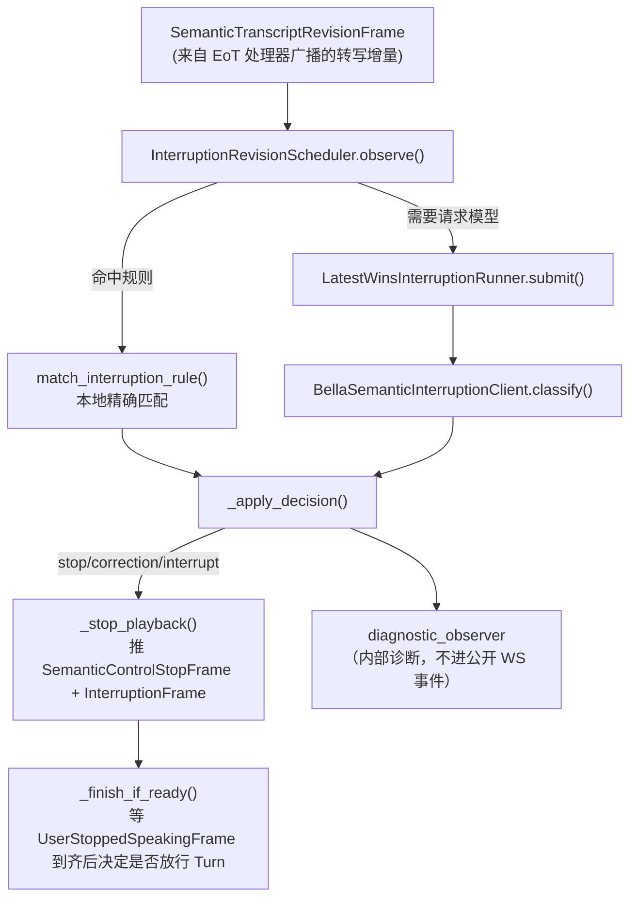

# 语义打断（Semantic Interruption）—— 详细逻辑与迁移参考

日期：2026-08-10
状态：现网实现（`server/processors/semantic_interruption.py`，798 行）。本文档基于**当前代码**编写，
覆盖每种分支的处理流程（配合下方文件清单，也可作为迁移到其他项目的参考），而
`docs/design/semantic-interruption.md`（2026-07-30，状态"已确认，待计划与实现"）是它的前置设计
spec——两者会有出入时，以本文档 + 源码为准。

## 1. 背景与定位

语义打断解决的是"助手正在说话时，用户开口了，助手现在要不要停声"。它和语义完整度判断
（[`sentence-end-semantic-eot.md`](../design/sentence-end-semantic-eot.md)）职责互补、不重叠：

- **语义完整度（EoT）**：唯一权威地回答"用户什么时候说完"，任何时候都在跑（只要 `eot_strategy=semantic`）。
- **语义打断**：只回答"助手现在要不要停声"，**只在助手音频正在播放时**才介入；一旦决定不停声或
  没有介入，用户的话轮仍然完全交给 EoT 判断何时收尾——语义打断从不自己决定话轮何时结束。

六类标签（`server/semantic_interruption.py` 的 `InterruptionLabel`）：

| 标签 | 含义 | 是否停止助手播报 | 是否单独产生新 Turn |
|---|---|---|---|
| `stop` | 只是要求停止，没有后续任务/新信息 | 是 | 否（`SemanticControlStopFrame`，纯控制事件） |
| `correction` | 纠正当前回答依赖的信息（含用户自我修正） | 是 | 是，但推迟到 EoT 正式收尾才释放 |
| `interrupt` | 用新任务/新话题/补充信息抢话轮 | 是 | 是，同上，推迟到 EoT 收尾 |
| `backchannel` | 附和，鼓励助手继续（"嗯""好的"） | 否 | 否 |
| `ignore` | 证据不足以采取任何动作但不是失败 | 否 | 否 |
| `uncertain` | 模型给出但置信度不足以被采信（阈值降级后的结果） | 否 | 否 |

代码里把 `{"stop", "correction", "interrupt"}` 统一记为"停止动作集合"（`_apply_decision`
`if decision.label in {"stop", "correction", "interrupt"}`），三者都会触发停播，区别只在于是否
之后产生新 Turn。

## 2. 核心组件与数据流



四个协作对象（均定义在 `server/processors/semantic_interruption.py`，规则/模型契约在
`server/semantic_interruption.py`）：

| 组件 | 职责 |
|---|---|
| `InterruptionRevisionScheduler` | 纯状态机，把连续的 partial/sentence_end 转写决定"这次要不要发起一次判定"（规则或模型），不做任何 I/O。 |
| `LatestWinsInterruptionRunner` | 管理判定请求的并发/取消：新请求发出即"废黜"更早的同类请求；结果送达时再次核对是否仍是最新，过期结果只回调 `on_discard`。 |
| `SemanticInterruptionProcessor` | pipecat `FrameProcessor`，是整个仲裁的状态机主体：观察转写、缓冲助手播放期间到达的用户帧、应用判定结果、决定何时把缓冲的帧放行给下游。 |
| `PlaybackProjection` | 与语义打断代码解耦的共享组件（`server/playback_projection.py`），估算"助手当前已经播放到哪"，供模型输入和"是否还在播"判断使用。 |

## 3. 规则快路径（`match_interruption_rule`，`server/semantic_interruption.py:1-?`)

在请求模型之前，先做一次本地精确匹配。命中规则的判定**不受置信度阈值影响**（阈值只应用于模型
产出的结果），且优先级总是高于模型——规则匹配成功后当次 revision 不会再触发模型请求
（`_handle_scheduled`/`_observe_revision` 里 `if rule is not None: ... elif ...`）。

```python
_IMMEDIATE_STOP_PHRASES = {"别说了","不要说了","先别说了","闭嘴","够了","不用说了","别讲了","不要讲了"}
_BOUNDARY_STOP_PHRASES = {"停","停止","别说","stop"}
_BACKCHANNEL_PHRASES = {"嗯","嗯嗯","啊","哦","噢","好","好的","行","可以","对","是的","没错","继续","你继续","哈哈","哈哈哈"}

def _normalize_rule_text(text: str) -> str:
    return re.sub(r"\s+", "", text).casefold().rstrip("。！？，；：.!?,;:")
```

三类规则，按顺序判断：

1. **immediate 停止词**：规范化后精确等于白名单中的一条，任何边界（`partial` 也算）立即命中
   `stop`。这批词本身已经是完整短语，不会是更长句子的合法前缀（例如没有人会说"别说了xxx"这种真实
   续接），所以不需要等稳定态。
2. **boundary 停止词**：单字/短词，容易是长句前缀（比如"停电了吗"以"停"开头），因此**只有**
   `stable=True`（由调用方传入，语义上是"idle 超时后"或本身就是 `sentence_end`）或边界本身就是
   `sentence_end` 时才命中，避免"停"刚打出来就被当场打断。
3. **附和词**：精确匹配即命中 `backchannel`，任何边界都生效，且**规则匹配的附和永远不会变成停止
   动作**（不经过阈值降级逻辑，因为规则本身不产出置信度需要降级的场景）。

匹配是**规范化后的整句精确匹配**，不是子串/前缀匹配——"停电了吗""我是在引用'别说了'这个词"都不会
误命中（对应测试 `test_stop_rules_do_not_use_prefix_or_substring_matching`）。规则匹配到的
`stop` 依然允许该用户在同一段发言里后续说出真正的新任务（例如"别说了，帮我查天气"），因为规则只是
让**当次这段文本**产出一个 `stop` 判定，并不会阻止转写继续增长、后续文本重新触发判定。

## 4. 触发调度：`InterruptionRevisionScheduler`

调度器只做一件事：给定连续到达的 `SemanticTranscriptRevisionFrame`，决定"这次要不要发起一次判定
（规则检查 + 可能的模型请求）"，用 `reason` 字段记录原因（`sentence_end` / `chars` / `idle`）。

### 4.1 `observe()`——收到新的转写修订时

| 情况 | 行为 |
|---|---|
| `boundary == "sentence_end"` | **总是**立即发起一次判定（`reason="sentence_end"`, `stable=True`），无论 `trigger` 配置是什么；取消尚未到期的 idle 计时（`_idle_due_ms = None`）。 |
| `trigger == "partial"` 且文本是上一次已提交文本的纯追加（`is_append`），且累计新增字符数 `>= partial_chars`（默认 5） | 立即发起一次判定（`reason="chars"`, `stable=False`）。 |
| 文本发生变化但未达到字符阈值，或 `trigger == "sentence_end"`（此时 partial 增量从不主动触发模型） | 不发起判定，但若文本较上次观察确有变化则（重新）武装 idle 到期时间 `_idle_due_ms = now + idle_ms`。 |
| 文本与上次完全一致（重复帧） | 不改变 `_idle_due_ms`（不重置计时器）。 |

要点：

- **`trigger == "sentence_end"` 模式下，partial 增量从不直接请求模型**——只有规则命中或等到真正的
  `sentence_end`/idle 才有机会判定；这是"减少模型调用次数换取延迟"的配置维度。
- **重写/回撤（`frame.text` 不是旧文本的前缀）** 仍然会重置 idle 计时（只要文本变了），但不计入
  `partial_chars` 的追加字符数判断（`is_append` 为 False 时那一路直接跳过 chars 分支）。
- `_last_submitted_text` 只在真正发起模型请求时更新，规则命中的情况不会更新它——所以规则命中之后，
  下一次 partial 追加字符数仍然是相对"上一次真正提交给模型的文本"计算的。

### 4.2 `on_idle()`——idle 计时到期时

由 `SemanticInterruptionProcessor._idle_after_delay()` 在等待 `idle_ms`（默认 100ms）后调用：

- 若期间已经出现 `sentence_end`、或计时已被新的变化重新武装、或没有武装过，直接返回 `None`（no-op）。
- 否则返回一次 `reason="idle"` 的判定请求，`stable=True`；`request_model` 是否为真取决于当前
  `trigger`——`trigger == "partial"` 时为真（idle 到期本身就是 partial 策略的模型触发时机之一），
  `trigger == "sentence_end"` 时为假（**idle 到期只用于让规则检查在 stable 状态下重新生效**，
  例如单字"停"要等到 idle 才能命中 boundary 规则，但不会因此触发一次模型请求）。

### 4.3 idle 计时的武装/取消（`SemanticInterruptionProcessor._arm_idle`）

```python
if frame.boundary == "partial" and frame.text != self._last_observed_text:
    self._arm_idle()
elif frame.boundary == "sentence_end" and self._idle_task is not None:
    self._idle_task.cancel()
    self._idle_task = None
```

每次新的 partial 且文本变化都会取消旧计时器、重新武装一个新的 100ms 计时；`sentence_end` 到达则
直接取消计时器（不需要 idle 兜底了）。

## 5. 并发与"latest-wins"：`LatestWinsInterruptionRunner`

模型请求是异步的，而转写还在持续变化，必须保证"旧请求的结果不会覆盖新请求"：

- `submit(scheduled)`：先 `supersede(scheduled.revision)`——把 `_latest_revision` 提升到这次的
  版本号，并**取消**所有仍在跑（`_judging_tasks`）的旧判定协程；再为这次请求创建新任务。
  `supersede` 只在传入版本号 > 当前记录版本号时生效，防止用旧版本号意外回退。
- 请求协程 `_run()` 的三种终局：
  1. **`asyncio.CancelledError`**（被更新的请求取消）→ 回调 `on_discard(scheduled, "cancelled")`，
     仅用于诊断日志，不影响状态机。
  2. **异常**（模型调用失败/超时/解析失败）→ 只有当这次请求仍是"当前最新版本"才回调
     `on_failure(scheduled, exc)`；否则静默丢弃（说明已经有更新的转写覆盖了这次失败，没必要触发
     失败兜底逻辑）。
  3. **正常返回但版本号已不是最新**（比如结果到达前又出现了新的转写）→ 回调
     `on_discard(scheduled, "stale")`，同样只记诊断，不采信这个结果。
  4. **正常返回且版本号仍是最新** → 回调 `on_result(scheduled, decision)`，这是唯一真正影响状态机
     的路径。

这套"latest-wins"逻辑保证：无论模型请求耗时多长、返回顺序是否乱序，最终只有最新一次转写对应的
判定结果会被采纳；过期的规则/模型判定只会被记为 `cancelled`/`stale` 诊断，绝不会导致状态机做出
基于旧文本的动作。

## 6. 主状态机：`SemanticInterruptionProcessor`

### 6.1 何时"进入仲裁态"（`_arbitrating`）

`_observe_revision()` 只在满足下列任一条件时才会真正开始仲裁（否则收到的转写只做 no-op）：

```python
if not self._arbitrating and not snapshot.is_playing:
    return
```

即：已经在仲裁中，或者 `PlaybackProjection.snapshot().is_playing` 为真（助手正在播放）。这保证了
"语义打断只在助手确实在说话，或已经开始仲裁这一轮"时才生效——助手静音/思考中的用户话语完全不经过
这条路径，直接走正常的转写/EoT 流程（见第 8 节 `process_frame` 顶层分支）。

首次进入仲裁态时记录 `_arbitration_started_ms`（用于 6.7 的超时兜底），并为这次 revision 快照一份
`(history, PlaybackSnapshot)` 上下文（`_revision_contexts`），供之后真正请求模型时使用——历史和
"助手已播报内容"是在**观察到转写变化的那一刻**冻结的，不是等到真正发起模型请求时才取。

### 6.2 一次转写到达后的完整处理（`_observe_revision`）

1. 同步更新 `_latest_revision`、清空 `_latest_decision`、`_runner.supersede(...)`——三者必须在
   同一批同步代码里完成、中间不能有 `await`，否则处理器的"最新版本"判断和 runner 内部的判断会
   出现竞态（代码注释明确指出这一点）。
2. 判满足仲裁条件后记录上下文快照。
3. 交给 `InterruptionRevisionScheduler.observe()` 判断这次是否需要发起判定。
4. **规则检查优先于调度器返回值被消费**：即使调度器认为"这次不需要发起判定"（比如字符数不够），
   只要 `match_interruption_rule` 命中，仍然会立即 `_apply_decision`（规则检查是对**每一帧**做的，
   不受 `chars`/`idle` 节流限制）。
5. 若规则未命中但调度器认为该发起判定（`scheduled is not None`），转 `_handle_scheduled`。
6. 最后处理 idle 计时器的武装/取消（见 4.3）。

### 6.3 `_handle_scheduled`——规则优先，其次才是模型

```python
rule = match_interruption_rule(scheduled.text, boundary=scheduled.boundary, stable=scheduled.stable)
if rule is not None:
    await self._apply_decision(scheduled.revision, InterruptionDecision(rule.label, 1.0), source="rule")
elif scheduled.request_model:
    self._runner.submit(scheduled)
```

规则匹配的置信度固定为 `1.0`（这也是为什么规则结果不受阈值降级——`apply_interruption_threshold`
只在模型路径的 `_on_model_result` 里调用，规则路径完全不经过它）。若规则未命中且
`scheduled.request_model` 为假（例如 `trigger="sentence_end"` 下的 idle 到期），则这次调度什么都
不做——单纯是"让规则在 stable 状态下重新检查一次"的机会。

### 6.4 应用判定结果：`_apply_decision`

```python
if revision != self._latest_revision or not self._arbitrating:
    return
if decision.label in {"stop", "correction", "interrupt"}:
    await asyncio.sleep(0)                      # 让出一次事件循环
    if revision != self._latest_revision or not self._arbitrating:
        return
```

两次版本校验之间插入了一次 `await asyncio.sleep(0)`：如果这次停止动作是基于稍微过时的文本算出来的
（比如规则检查发生在新 revision 的取消尚未真正执行完之前），让出一次事件循环可以让"取消上一个 idle
计时器"之类的操作先生效，避免用旧文本做出停播决定。

确认仍然有效后：

- 记录 `_latest_decision = (revision, decision, source)`。
- 若是停止动作三选一，调用 `_stop_playback(...)`。
- 若配置了 `diagnostic_observer`，异步（带超时保护）上报一条内部诊断事件（第 7 节）。
- 调用 `_finish_if_ready()`，决定这一轮的缓冲帧是否可以放行。

### 6.5 真正停止播放：`_stop_playback`

```python
current = self._projection.snapshot()
if (self._stop_sent or context is None
    or not current.is_playing
    or current.generation_id != context[1].generation_id):
    return False
self._stop_sent = True
await self.push_frame(SemanticControlStopFrame(revision=revision, source=source, action=action), self._direction)
await self.push_frame(InterruptionFrame(), self._direction)
return True
```

三道防线保证"不会重复停播、不会停错一代播放"：

- `_stop_sent`：这一轮仲裁只允许真正停播一次。
- `context is None` 或 `not current.is_playing`：助手已经自然播完/本来就没在播，不需要（也不能）
  再停一次——此时即使模型判定是 `stop`/`correction`/`interrupt`，也只影响是否放行 Turn，不产生
  `interrupted` 事件。这正是设计文档 §4 里"助手已自然停止则不发 `interrupted` 事件，但标签仍决定
  Turn 是否放行"的落地实现。
- `current.generation_id != context[1].generation_id`：仲裁开始后助手可能已经切到下一代播放内容
  （比如上一轮回答刚结束、下一轮已经开始播），此时旧仲裁的停播动作不能作用到新的一代上。

## 7. 转写/用户帧的缓冲与放行

### 7.1 顶层帧路由（`process_frame`）

在 `enabled and allow_interruptions` 为真的前提下（否则直通，见第 8 节），仲裁态下
（`self._arbitrating`）对不同帧类型的处理：

| 帧类型 | 处理 |
|---|---|
| `InterimTranscriptionFrame` | 直接丢弃（`return`，不下推、不缓冲）——中间态转写只用于驱动仲裁判断，不需要传给下游。 |
| `FillerArmFrame` / `TranscriptionFrame` | 缓冲进 `_eot_frames`，等仲裁结果决定后再统一放行或丢弃。 |
| `UserStoppedSpeakingFrame` | 缓冲进 `_eot_frames`，标记 `_user_stopped = True`，立即尝试 `_finish_if_ready()`。 |
| 其它帧 | 直通下推。 |

`UserStartedSpeakingFrame` 的处理在更上层（仲裁判断之前）：只要允许打断且（已在仲裁中或助手正在
播放），就把它本身也缓冲进 `_eot_frames` 并标记进入仲裁态——即便这一帧之后还没有任何转写文本。

### 7.2 何时放行：`_finish_if_ready`

```python
if not self._user_stopped or self._latest_decision is None:
    return
```

必须**同时满足**"用户已经停止说话（VAD 层面）"和"已经有一个仲裁结论"才会处理这一轮的缓冲帧——
两个条件谁先满足都要等另一个。

- `creates_turn = decision.label in {"correction", "interrupt"}`：
  - 是：把 `_eot_frames` 里缓冲的帧**按到达顺序**依次 `push_frame` 下推（包括之前被缓冲的
    `UserStartedSpeakingFrame`、`FillerArmFrame`、`TranscriptionFrame`、`UserStoppedSpeakingFrame`），
    让下游（EoT/User Aggregation）正常处理成一个新 Turn。
  - 否（`stop`/`backchannel`/`ignore`/`uncertain`）：这些帧**不会**被放行——直接丢弃，等价于这段
    用户话语从未发生过（对下游不可见）。若丢弃的帧里恰好没有 `TranscriptionFrame`（说明 ASR 还没
    来得及给出这段话的最终转写），会额外置位 `_drop_terminal_frames = True`：因为
    `UserStoppedSpeakingFrame` 是高优先级的 SystemFrame，可能会抢先于稍后才到达的
    `FillerArmFrame`/`TranscriptionFrame` 尾部数据帧被处理，需要用这个标志继续吞掉那些迟到的尾部
    帧，直到真正等到（且吞掉）对应的 `TranscriptionFrame` 才复位。
- 若配置了 `admission_observer`，无论哪种结果都上报一条 `revision`/`label`/`creates_turn` 诊断
  （见第 7 节）。
- 最终调用 `_reset_turn()` 清空这一轮的所有仲裁状态，为下一轮做准备。

### 7.3 `_drop_terminal_frames` 的消费

```python
if self._drop_terminal_frames:
    if isinstance(frame, (SemanticTranscriptRevisionFrame, InterimTranscriptionFrame, FillerArmFrame)):
        return
    if isinstance(frame, TranscriptionFrame):
        self._drop_terminal_frames = False
        return
```

这段检查在 `process_frame` 的最前面（甚至在仲裁态判断之前），确保跨越 `_reset_turn()` 之后仍能
继续吞掉属于**上一轮**、迟到的尾部帧，直到吞到对应的 `TranscriptionFrame` 为止才恢复正常路由。

## 8. `enabled` / `allow_interruptions` 的四种组合

| `enabled` | `allow_interruptions` | 行为 |
|---|---|---|
| `False` | 任意 | 完全不处理 `SemanticTranscriptRevisionFrame`（丢弃）；其它帧直通。等价于关闭语义打断，退回上层配置的 `transcript`/`vad` 策略。 |
| `True` | `False` | 转写帧只在助手正在播放时才置位 `_suppressing = True`（不做任何仲裁判断）；`_suppressing` 期间吞掉 `InterimTranscriptionFrame`/`FillerArmFrame`/`TranscriptionFrame`，直到 `UserStoppedSpeakingFrame` 才清除该标志——即"允许打断=False"时，助手播放期间的用户话语被整体屏蔽，不产生任何 Turn（对应会话级 `allow_interruptions: false` 语义）。 |
| `True` | `True`，助手未在播放且未在仲裁中 | 转写帧直接忽略（6.1 的早退条件），其余帧直通——没有必要仲裁。 |
| `True` | `True`，助手在播放或已在仲裁中 | 完整走第 6、7 节描述的仲裁流程。 |

## 9. 失败与超时降级

### 9.1 模型请求失败（`_on_model_failure`）

```python
if not scheduled.text.strip():
    await self._apply_decision(scheduled.revision, InterruptionDecision("ignore", 0.0, **metadata), source="fallback")
    return
await self._apply_decision(scheduled.revision, InterruptionDecision("interrupt", 0.0, **metadata), source="fallback")
```

模型调用失败（超时/`invalid_response`/`context_overflow`/`unavailable`，见第 10 节）时：

- 若这次触发判定的文本本身是空/纯空白 → 按 `ignore` 处理（没有实质内容，不值得触发任何动作）。
- 否则一律**fail-open 为 `interrupt`**——宁可多停一次播放、多开一个新 Turn，也不能让一次模型失败
  导致用户说的话被无声丢弃。这是"一次误打断的成本远低于丢失一整个用户话轮"的显式取舍（比设计文档
  §12 描述的更简单粗暴：不区分失败原因，统一按 `interrupt` 处理，且置信度记为 `0.0` 便于诊断区分
  这是 fallback 而非真实模型判定）。

### 9.2 仲裁整体超时（`_fail_open_on_timeout`，默认 `arbitration_timeout_ms=30_000`）

这不是"模型请求"超时，而是"整轮仲裁"超时——覆盖模型请求超时之外的所有卡死场景（例如
`diagnostic_observer`/`admission_observer` 异常导致状态未推进、或多次 latest-wins 竞争导致
`_latest_decision` 一直没有落定）。在 `process_frame` 入口处每次都检查：

```python
if (self._arbitrating and self._arbitration_started_ms is not None
    and (time.monotonic()*1000 - self._arbitration_started_ms) > self._arbitration_timeout_ms):
    await self._fail_open_on_timeout()
```

处理方式（详见代码内长注释）：**把整轮超时也当作 `interrupt`**——先尝试停播（若助手仍在播），再把
缓冲的 `_eot_frames` 按原顺序全部放行（走正常非仲裁路径，不设置 `_drop_terminal_frames`），保证
"一次分类器彻底没有响应"的代价最多是"多了一次可能不必要的打断"，而不是"整个用户话轮消失、没有
transcript、没有 Turn、没有任何错误提示"。

> 注意：`arbitration_timeout_ms` 目前是构造参数，**没有**像 `partial_chars`/`idle_ms`/`threshold`/
> `trigger`/`timeout_ms` 那样暴露到 `turn_policy`/`SemanticInterruptionConfig` 里，是硬编码的
> 30 秒常量。迁移或调优时如果需要缩短这个上限，需要改代码默认值或给
> `SemanticInterruptionProcessor(...)` 显式传参，而不是指望配置文件。

## 10. 模型契约与 Bella 客户端（`server/semantic_interruption.py`）

### 10.1 严格 JSON 输出契约

```python
{"label": "stop|correction|interrupt|backchannel|ignore|uncertain", "confidence": 0.0}
```

`parse_interruption_decision()` 校验：payload 必须**恰好**是 `{label, confidence}` 两个键
（多一个字段都拒绝）；`label` 必须在六选一枚举内；`confidence` 必须是数值（`bool` 显式排除，因为
`isinstance(True, int)` 为真，容易误判通过）且落在 `[0, 1]` 且为有限数。任何一条不满足都抛
`ValueError`，上层归类为 `invalid_response`。

### 10.2 阈值应用

```python
def apply_interruption_threshold(decision, *, threshold):
    if decision.label in STOP_ACTION_LABELS and decision.confidence < threshold:
        return replace(decision, label="uncertain")
    return decision
```

只作用于模型产出的 `stop`/`correction`/`interrupt`，且只在 `_on_model_result` 路径调用一次——
规则匹配结果和 fail-open 结果都不经过这个函数。默认阈值 `0.8`。

### 10.3 模型输入组装（`build_interruption_messages`）

固定消息顺序：`[system 提示词]` + 过滤后的历史（`role in {user, assistant}` 且 `content` 是字符串）
+ `{"role":"assistant","content":"当前助手预计已播报内容：{...}"}` +
`{"role":"user","content":"当前用户累计文本：{...}\n边界：{partial|sentence_end}"}`。固定顺序是为了
让"历史"部分始终是消息列表的稳定前缀，利于服务端 KV Cache 命中（同 EoT/分类器的设计考量一致）。

系统提示词原文：

```
你是实时语音助手的语义打断分类器。仅根据可见对话、助手预计已播报内容、当前用户累计文本和边界判
断。输出且只输出 JSON：{"label":"stop|correction|interrupt|backchannel|ignore|uncertain",
"confidence":0.0}。stop 仅表示要求停止且没有后续任务；correction 表示纠正当前回答依赖的信息，也
包括用户自我修正先前提供的信息；interrupt 表示以新任务、补充或新话题取得话轮；backchannel 表示支
持助手继续；ignore 表示应忽略；证据不足用 uncertain。
```

### 10.4 上下文长度预检（`estimate_interruption_context_tokens`）

请求前先用一个**保守的字节级上界**估算 token 数（`len(content.encode("utf-8")) + 8` 每条消息
框架开销累加），超过 `max_context_tokens`（默认 120,000）**直接不发请求**，抛
`SemanticInterruptionClientError("context_overflow", estimated_context_tokens=...)`——这个检查在
`BellaSemanticInterruptionClient.classify` 里位于真正调用模型之前（对应测试
`test_bella_client_preflights_context_overflow_without_request`，验证了 `create.assert_not_awaited()`）。

### 10.5 请求参数与失败归类

```python
AsyncOpenAI(api_key=api_key, base_url=base_url.rstrip("/"), max_retries=0)
...
await self._client.chat.completions.create(
    model=model, messages=messages, stream=False, max_tokens=32,
    response_format={"type": "json_object"},
    extra_body={"thinking": {"type": "disabled"}},
    timeout=timeout_ms / 1000,
)
```

`max_retries=0` 是故意的：这个判定有硬性的单次调用截止时间，且已经有规则/fail-open 兜底，一次
SDK 内置重试不可能在预算内给出有用结果，只会让本已不稳定的端点多背一倍负载。

失败归类（`except` 块）：

| 异常 | `kind` |
|---|---|
| `TimeoutError` / `openai.APITimeoutError` | `timeout` |
| `ValueError`（`parse_interruption_decision` 抛出） | `invalid_response` |
| 异常字符串同时包含 `"context"` 和 `"length"` | `context_overflow` |
| 其它一切异常 | `unavailable` |

成功时从 `response.usage` 里提取 `cache_read_tokens`/`cache_creation_tokens`/`prompt_tokens`
（若供应商未返回则为 `None`），连同 `request_ms`/`inference_ms` 一并附着在
`InterruptionDecision` 上，供第 7 节的诊断事件上报。

### 10.6 服务端凭据隔离（安全关键，迁移必须保留）

```python
def resolve_semantic_interruption_api_key() -> str:
    """Return the server-owned Bella credential, never a Session credential."""
    return os.environ.get("API_KEY", "").strip()
```

语义打断**只能**使用服务端自己的 `API_KEY` 环境变量，绝不能复用客户随 Session 传入的 Bella
API key——这是设计文档 §13 的显式安全约束，代码里体现为这个函数**完全不接受任何来自会话/客户端的
参数**。`voice_session.py` 里若 `resolve_semantic_interruption_api_key()` 返回空字符串（说明部署环境
没配 `API_KEY`），直接放弃创建 `BellaSemanticInterruptionClient`（`classifier=None`），处理器仍会
运行，但所有非规则命中的转写都会走"模型不可用"的 `_classify` 早退（`RuntimeError` →
`_on_model_failure` → fail-open 为 `interrupt`/`ignore`，见 9.1）。**迁移到新项目时，新环境的服务端
凭据也必须走同样的、与客户端会话完全隔离的解析函数，不能为了"图方便"改成读会话里传入的 Key。**

## 11. 内部诊断事件（不是公开 WebSocket 事件）

`server/observers/event_hub_observer.py` 里两个方法把仲裁过程写入内部 EventHub（`_emit`），
**不**通过对客户端公开的 WebSocket 协议：

| 事件名 | 触发时机 | 关键字段 |
|---|---|---|
| `semantic.interruption.decided` | 每次 `_apply_decision` 产出结果，或结果被丢弃（`_on_model_discard`） | `label`（丢弃时为 `None`）、`confidence`、`source`（`rule`/`model`/`fallback`）、`revision`、`boundary`、`trigger`、`transcript_len`、`playback_len`、`stopped`、`creates_turn`、`request_ms`、`inference_ms`、`total_decision_ms`、`cache_read_tokens`/`cache_creation_tokens`/`prompt_tokens`/`estimated_context_tokens`、`status`（`decided`/`cancelled`/`stale`/`timeout`） |
| `semantic.interruption.admitted` | 每次 `_finish_if_ready` 处理完一轮（无论是否放行 Turn） | `revision`、`label`、`creates_turn` |

两处上报都通过 `_schedule_diagnostic`（`SemanticInterruptionProcessor` 内部）包一层
`asyncio.wait_for(..., timeout=diagnostic_timeout_ms/1000)`（默认 250ms）+ 异常吞掉只打 warning
日志——诊断上报本身绝不能阻塞或影响仲裁主流程（对应测试
`test_diagnostic_failure_does_not_block_interruption_action` /
`test_blocked_diagnostic_does_not_delay_turn_reset`）。

按照设计文档 §16 的隐私约束，这两个事件只记录长度/标签/耗时/来源等元数据，**不记录**原始转写文本、
历史对话内容或模型原始输出——落地实现与之一致（字段表里没有 `text`/`history`/`raw_output` 这类字段）。

对客户端真正可见的公开事件仍然只是复用已有机制：`SemanticControlStopFrame` → 下游转成
`interrupted` 事件 + `tts.stopped(reason=interrupted)`；`correction`/`interrupt` 放行后走正常的
新 Turn 事件序列。语义打断没有引入新的公开六标签 WebSocket 事件。

## 12. 配置与环境变量

| 配置项 | 位置 | 默认值 | 说明 |
|---|---|---|---|
| `turn_taking.interrupt_strategy` | `[turn_taking]`（TOML，`TurnTakingConfig`） | `"transcript"` | `transcript`/`vad`/`semantic` 三选一；只有 `semantic` 会启用本文档描述的仲裁流程。 |
| `turn_taking.semantic_interruption.trigger` | `[turn_taking.semantic_interruption]` | `"sentence_end"` | 模型触发时机：`sentence_end`（只在整句结束/规则命中时请求模型）或 `partial`（+idle 到期也会请求模型）。 |
| `turn_taking.semantic_interruption.model` | 同上 | `"deepseek-v4-flash-20260719"` | Bella 网关上的模型名。 |
| `turn_taking.semantic_interruption.partial_chars` | 同上 | `5` | `partial` 触发模式下，累计新增多少字符后请求一次模型。 |
| `turn_taking.semantic_interruption.idle_ms` | 同上 | `100` | 转写静默多久后触发 idle 判断（规则重判 + 可能的模型请求）。 |
| `turn_taking.semantic_interruption.threshold` | 同上 | `0.8` | 模型产出的 `stop`/`correction`/`interrupt` 低于该置信度会被降级为 `uncertain`；规则结果不受影响。 |
| `turn_taking.semantic_interruption.timeout_ms` | 同上 | `500` | 单次模型请求超时（注意：与 EoT 侧 `llm_timeout_ms` 默认 1000ms 不同，语义打断的超时预算更紧）。 |
| `turn_policy.interrupt_strategy` | 会话创建请求（客户端传入，覆盖上面的服务端默认值） | — | 同 `turn_taking.interrupt_strategy` 三选一。 |
| `turn_policy.semantic_interruption_trigger` / `_partial_chars` / `_idle_ms` / `_threshold` / `_timeout_ms` | 会话创建请求 | — | 逐字段覆盖服务端默认配置（见 `server/voice_session.py` 的 `policy.get(...)` 读取）。 |
| `turn_policy.allow_interruptions` | 会话创建请求 | `True` | `False` 时助手播放期间的用户话语被整体屏蔽（第 8 节表格第二行）。 |
| `API_KEY` | 环境变量 | 无 | **服务端专用** Bella 凭据，语义打断唯一可用的密钥来源；缺失时该会话的语义打断退化为"模型不可用，全部走规则+fail-open"，不会报错中断会话。 |
| （硬编码，不可配置）`arbitration_timeout_ms` | `SemanticInterruptionProcessor.__init__` 默认参数 | `30_000` | 整轮仲裁的最终兜底超时，见 9.2。 |
| （硬编码）`diagnostic_timeout_ms` | 同上 | `250` | 诊断上报的超时保护，见第 11 节。 |

## 13. 关键文件一览（迁移时按图索骥）

| 文件 | 职责 |
|---|---|
| `server/semantic_interruption.py` | 领域契约：六类标签枚举、规则匹配 `match_interruption_rule`、阈值应用、消息组装、上下文估算、`BellaSemanticInterruptionClient`、`resolve_semantic_interruption_api_key` |
| `server/semantic_interruption_frames.py` | `SemanticTranscriptRevisionFrame`、`SemanticControlStopFrame`、`TranscriptBoundary` 类型 |
| `server/processors/semantic_interruption.py` | `InterruptionRevisionScheduler`（触发调度）、`LatestWinsInterruptionRunner`（并发/latest-wins）、`SemanticInterruptionProcessor`（主状态机） |
| `server/playback_projection.py` | `PlaybackProjection`/`PlaybackSnapshot`：估算助手已播报内容与是否仍在播放，语义打断和其它需要"播放进度"的组件共用 |
| `server/observers/event_hub_observer.py` | `record_semantic_interruption_decision` / `record_semantic_interruption_admission`：内部诊断事件上报 |
| `server/voice_session.py` | 组装 `BellaSemanticInterruptionClient` + `SemanticInterruptionProcessor` + `PlaybackProjection`；把 `turn_policy` 覆盖值与 `SemanticInterruptionConfig` 默认值合并；把仲裁处理器插入 pipeline（`semantic_interruption` 在 `user_agg`/`llm`/`tts` 之前，见 `voice_session.py:1113` 附近的 `pipeline_stages.extend([...])`） |
| `server/app_config.py` | `SemanticInterruptionConfig`（默认值来源）、`TurnTakingConfig.interrupt_strategy` |
| `server/fillers/frames.py` | 语义打断复用的 `FillerArmFrame`（缓冲/放行逻辑里与转写帧一起处理） |

## 14. 测试清单（迁移后验证行为一致性的最快路径）

- `server/tests/unit/test_semantic_interruption.py`：规则匹配（精确/前缀防误判/stable 门槛）、
  阈值降级、`parse_interruption_decision` 契约校验、`resolve_semantic_interruption_api_key` 的
  服务端凭据隔离、`build_interruption_messages` 消息顺序、`BellaSemanticInterruptionClient` 的
  非思考模式短 JSON 请求参数、超时/`invalid_response` 区分、上下文预检不发请求。
- `server/tests/unit/test_semantic_interruption_processor.py`（1186 行，约 28 个用例，覆盖本文档
  列出的几乎所有分支）——按名字摘录部分关键场景：
  - `test_sentence_end_trigger_does_not_submit_partial_and_flushes_sentence_end`
  - `test_partial_trigger_submits_every_five_appended_characters`
  - `test_character_trigger_does_not_resubmit_same_revision_at_idle_boundary`
  - `test_idle_boundary_fires_once_without_duplicate_frame_reset`
  - `test_partial_rewrite_resets_idle_boundary`
  - `test_latest_wins_ignores_old_result_even_when_cancellation_is_suppressed`
  - `test_superseding_revision_does_not_cancel_result_commit`
  - `test_semantic_correction_stops_now_but_releases_turn_only_after_eot`
  - `test_semantic_backchannel_drops_terminal_transcript_and_turn`
  - `test_disallow_interruptions_suppresses_barge_in_during_playback`
  - `test_model_result_uses_submission_snapshot_and_cannot_stop_new_generation`
  - `test_stale_model_result_is_diagnosed_after_turn_state_reset`
  - `test_semantic_stop_drops_buffered_user_start_and_terminal_turn`
  - `test_correction_releases_buffered_user_start_only_at_eot`
  - `test_early_correction_reversed_to_backchannel_drops_buffered_turn`
  - `test_latest_sentence_end_model_failure_fails_open_with_complete_turn`
  - `test_arbitration_timeout_forces_reset_when_user_stop_never_arrives`
  - `test_arbitration_timeout_admits_the_buffered_turn_and_stops_playback`
- `server/tests/unit/test_semantic_interruption_eval.py` / `tests/semantic_interruption_eval.py` /
  `tests/run_semantic_interruption_eval.py`：评测夹具与跑分脚本，对应设计文档 §14 的评测方案
  （macro-F1、混淆矩阵、误打断率等）；迁移到新项目做行为一致性验收时可直接复用夹具格式。

## 15. 迁移到新项目时的注意事项清单

1. **四个可分层迁移的部分**：① 规则快路径（纯字符串处理，零依赖，最先迁移、最容易验证）；
   ② 调度器 `InterruptionRevisionScheduler`（纯状态机，可独立单测）；③ `LatestWinsInterruptionRunner`
   的并发取消模式（可作为通用"latest-wins 异步任务"工具搬到其它需要防抖/防乱序的场景）；
   ④ `SemanticInterruptionProcessor` 本体（与 pipecat 帧模型强耦合，迁移到非 pipecat 框架需要
   重新设计"缓冲用户帧直到仲裁结论落定"这部分，但状态转换逻辑本身可以照搬）。
2. **安全红线，不可放宽**：`resolve_semantic_interruption_api_key()` 只读服务端自己的环境变量，
   新项目里无论用什么密钥管理方式，都不能让这条判定路径接受来自客户端/会话的凭据参数。
3. **规则与模型的优先级、以及规则不受阈值约束**：规则命中永远优先于模型请求；规则产出的判定
   永远不经过置信度阈值降级；这两点是迁移时最容易被无意改掉的行为（比如"顺手"把规则结果也套进
   阈值函数）。
4. **latest-wins 必须在两处都生效**：处理器自己的 `_latest_revision` 和
   `LatestWinsInterruptionRunner._latest_revision` 是两份独立状态，代码里特意强调"必须在同一批
   同步代码里更新、中间不能有 `await`"——迁移时如果拆分成不同模块/服务，需要用单一权威来源
   （比如统一的原子计数器）替代这种"两份状态手动保持同步"的做法，否则容易引入竞态。
5. **停播动作要做"世代"校验**：不能只判断"助手是否在播"，还要判断"当前播放的是不是仲裁开始时
   那一代内容"（`generation_id` 比较）——否则会出现"助手已经开始播下一轮回答，却被上一轮仲裁的
   迟到判定错误打断"的 bug。
6. **fail-open 的方向要根据业务权衡显式选择**：这里选择的是"模型失败/超时/整体仲裁超时 → 统一
   放行为 `interrupt`（多停一次好过丢一次话轮）"，但空文本时降级为 `ignore`。迁移到对"误打断"更
   敏感的业务场景时，这个默认方向可能需要反过来（宁可漏判也不误打断），需要按新业务的容忍度重新
   评估，不要照抄默认值。
7. **诊断上报要有超时和异常隔离**：诊断/可观测性代码绝不能成为主流程的阻塞点或异常源——照抄
   `_schedule_diagnostic` 的"`wait_for` 超时 + 吞异常只打日志"模式。
8. **诊断事件不落原始文本**：即使是内部可观测性，也只记录长度/标签/耗时等元数据，不记录转写全文
   /历史对话/模型原始输出，避免额外的隐私面。
9. **助手是否在播放的判断要独立于处理器状态**：`PlaybackProjection` 是独立组件，"是否在播"、
   "已播报到哪"是从实际播放事件（`begin_generation`/`queue_segment`/`start_queued_segment`/
   `complete_current_segment`/`end_playback`）推导出来的，不是从"是否发过打断信号"反推——迁移时
   如果新项目的 TTS/播放层事件模型不同，这一层需要按新的播放生命周期事件重新实现，但对外契约
   （`snapshot() -> (generation_id, text, is_playing)`）可以保持不变。
10. **配置项要分层，不要合并成一个开关**：是否启用语义仲裁（`interrupt_strategy=semantic`）、
    何时触发模型（`trigger`）、置信度阈值、超时——这四个维度独立配置（对应
    `docs/adr/0001-semantic-interruption-as-opt-in-strategy.md` 的显式取舍），迁移时保持这种
    分层，避免"关闭仲裁"和"调整触发时机"耦合在同一个字段上。

## 16. 相关文档

- [语义打断设计（前置 spec）](../design/semantic-interruption.md) —— 领域词汇、评测方案、验收
  标准的原始设计依据；与本文档的关系见文档头部说明。
- [语义完整度（Semantic EoT）判断逻辑](../design/sentence-end-semantic-eot.md) —— "用户何时说完"
  的权威判断，与本文档"助手是否该停声"互补，见该文档第 9 节。
- [Semantic Interruption 作为 opt-in 策略接入（ADR 0001）](../adr/0001-semantic-interruption-as-opt-in-strategy.md)
- [Interruption Generation 机制](interruption-generation.md) —— 客户端侧取消陈旧 LLM/TTS 响应的
  Generation ID 协议，与本文档描述的服务端仲裁是不同层面的机制，互不重叠。
- [日期时间与实时搜索 —— 迁移参考文档](datetime-and-web-search.md) —— 本文档采用的"详细逐分支 +
  迁移清单"体例范例之一。
